==============================
AbstractGame and AbstractState
==============================

.. |dash| unicode:: U+2014 .. EM DASH SIGN

The ``AbstractGame`` and ``AbstractState`` are two of a number of commands
used to create what are termed :doc:`Compound Objects <index>`.

This section assumes you are very familiar with the concepts, terms and ideas
for :doc:`protograf <../index>`  as presented in the
:doc:`Basic Concepts <../basic_concepts>` , that you understand all of the
:doc:`Additional Concepts <../additional_concepts>` and that you've created some
basic scripts of your own using the :doc:`Core Shapes <../core_shapes>`. You
should also be familiar with the various types of shapes' properties described in
the :doc:`Customised Shapes <../customised_shapes>`.

.. _abstractIndex:

- `Overview`_
- `AbstractGame Command`_
- `AbstractState Command`_
- `Abstract Resources`_

.. _abstractOver:

Overview
========
`↑ <abstractIndex_>`_

Abstract games are the ancestors of many modern games.  They are
played and appreciated by gamers of all ages across many societies.
In addition, many new abstract games continue to be designed and tested.

The aim of the ``AbstractGame`` and ``AbstractState`` commands is to allow
diagrams for many of these types of games to be easily created.

The ``AbstractGame`` command allows for the details of the board and pieces
for such a game to be specified.  However, an ``AbstractGame`` is **not**
designed to be drawn |dash| it can be thought of as the game being
"still in the box".

The ``AbstractState`` command will, when supplied with a previously defined
``AbstractGame``, allow for a position in that game |dash| at any point from
the setup through to its end state |dash| to be shown in diagrammatic form
and, optionally, annotated or marked.

A series of ``AbstractState`` commands, all using the same ``AbstractGame``
command could, if required, depict an entire game but this is not the primary
intended use of the ``AbstractState`` command.

.. NOTE::

  An AbstractState command does **not** have the concept of a game "move".
  Tracking and processing moves is beyond the scope of **protograf**.
  The *markers* property for the AbstractState can be used to show
  how a piece might move with, for example, the aid of a line or arrow.

  For interest, its possible to integrate other Python libraries to
  support tracking and visualisation of game moves; an example for
  **Chess** is shown in ``abstracts_chess_animation.py``` which makes
  use of the `python-chess <https://github.com/niklasf/python-chess>`_
  library to load ``.pgn`` file and then generate an animated game.


.. _abstractgame-command:

AbstractGame Command
====================
`↑ <abstractIndex_>`_

The ``AbstractGame()`` command defines the parts of an abstract game; primarily
the type, and styling, of the board and pieces that it uses.

There are two primary types of board:

- **grid** which is an array-like arrangement of square cells, and
- **hexagonal** which  an arrangement of hexagons.

For both type, the **size** of the board is usually set by a combination of
rows and columns.

.. NOTE::

  The locations are on the board, whether squares or hexagons or intersection
  points, are termed **cells** in this document.

A board can also be specified either by referring to an existing abstract game
by name |dash| for example, Chess, Checkers (aka Draughts), Go or Shogi.

Pieces can be specified by the type of game that they are usually used
with |dash| for example, Chess, Checkers (aka Draughts), Go or Shogi. It is
also possible to create completely unique pieces either by using one or more
of **protograf** shapes and/or images of your choice.

- `AbstractGame Properties`_
- `AbstractGame Board: Grid`_
- `AbstractGame Board: Hexagonal`_
- `AbstractGame Pieces`_

.. _abstractGameProperties:

AbstractGame Properties
-----------------------
`^ <abstractgame-command_>`_

The key properties that can be set for an AbstractGame are:

* *name*: the name of the type of board; which can chosen from  one of:
  ``chess``, ``checkers``, ``go``, ``shogi``, ``hex``, ``hexhex``,
  ``hexagonal``; if omitted, the default type is a ``grid``
* *pieces*: details of pieces that will be placed on the board; these
  pieces can:

  * make use of the full set available from a pre-defined game |dash|
    ``chess``, ``checkers``, ``go``, ``shogi``, ``shogi-int`` |dash| by
    using the *pieces_type* property ; or
  * each be chosen individually and **independently** of the board name from
    any of the pre-existing sets: ``chess``, ``checkers``, ``go``,
    ``shogi``, ``shogi-int`` (see below for
    `Reusing built-in pieces from a game`_); or
  * be defined with a customised list of piece names and shapes; see below
    for `AbstractGame Pieces`_
* *cols*: this is the number of cells in the horizontal direction, for a
  regular layout; a default of ``8`` is used
* *rows*: then this is the number of cells, in the vertical direction,
  for a regular layout; a default of ``8`` is used

Using the name of an existing game will also select the associated number of
rows and columns for that game; for example, a **Shogi** board has 9 rows
and 9 columns.  This can be changed by setting *cols* and/or *rows* values.

.. IMPORTANT::

    Unlike many other shapes or objects in **protograf**, the *height* property
    is used to set the height of a cell on the board, and **not** the height
    of the board itself |dash| this being derived from the combination of
    the number of rows and columns as well the cell *height*.  The reason for
    this is to support both square and hexagonal cells with a single property.

    In the examples used, if *height* is **not** provided to **protograf**,
    then its value is determined by first sizing the board to occupy as much
    of the page as possible and then calculating the cells' *height* based on
    the number of rows and columns.  Boards with intersections occupy slightly
    less space when using this automated process.

Other useful properties that can be set for an AbstractGame are:

* *areas*: a list of one or more shapes that will make-up the cells of the
  board; this provides an alternative to using the normal squares or hexagons
  |dash| see `Example 4. Board with custom areas`_ for how this works
* *cell_shape*: a shape, one which has a centre, which must be drawn in
  addition to the default square or hexagon |dash| this is **not** auto-sized
  so will need to be set to the correct dimension(s) for the grid size, as
  determined by the cells' *height* property (see below); see
  `Example 5. Board with cell shape`_ for how this could be used
* *fills*: a list of one or more :ref:`colors <basic-color>` in which to draw
  one or more alternating board spaces; the default is to draw all cells
  ``white`` |dash| other cell properties can be set with the normal *stroke*
  and *stroke_width*
* *frame*: if ``True``, draw a frame around a gridded board's outline; use the
  normal styling options to customize it |dash| *frame_width*, *frame_stroke*,
  *frame_fill*, *frame_dotted*, and/or *frame_dashed*
* *height*: sets the height of a single cell (the "edge-to-edge" distance
  across a hexagon)
* *hexes*: a value, only used for a ``hexhex`` board, which sets the number
  of hexagons along each edge of the board; see `Example 2. Hex Game Grid`_
* *intersections*: if ``True``, draw pieces on **grid intersections**, not
  grid spaces, and label the lines, not the spaces
* *label*: if ``True``, draw labels around the board's edges; use the
  normal styling options for a label; *label_font*, *label_size*,
  *label_stroke* etc.
* *label_type*: the type of label, drawn on the board edges, which is
  used to identify a row or column; it can be  either *alpha-numeric*,
  or ``AN`` (the default), which is the labelling used for **Chess** boards;
  or *numeric*, or ``NN``, which is the labelling used for **Shogi** boards
* *label_start*: the corner of the board at which the labelling starts; this
  can be: *bottom-left* (``BL``), *bottom-right* (``BR``), *top-left* (``TL``),
  or *top-right* (``TR``). Chess board labels start at the *bottom-left*
  |dash| which is the default |dash| while **Shogi** board labels start at the
  *top-right*.
* *label_offset*: how far away label are drawn from the board edge(s); if not
  set, this is calculated based on the label's font size
* *pattern*: an on/off design showing which cells should be blank i.e. unused
  |dash| see `Example 4. Pattern Grid`_ for how this works
* *pieces_type*: choose a predefined set of pieces from various abstract
  games; possible choices are: ``chess``, ``checkers``, ``go``, ``shogi`` or
  ``shogi-int`` (International, or Westernised, Shogi)


.. NOTE::

    The default settings for an AbstractGame are:

    * *name*: ``grid``
    * *rows*: ``8`` (the same as Chess or Checkers board)
    * *cols*: ``8`` (the same as Chess or Checkers board)
    * *pieces*: ``checkers`` (simple black and white circles)

    A board is sized to occupy as much space as possible, unless the *height*
    of a cell is set, following which the space occupied by the board is
    calculated using the *rows* and *cols* values.

    Note also that the definitions of the board and pieces are **not**,
    generally speaking, the determinants of *where* the pieces get placed;
    how *many* pieces there are, or what the rules are for their movement!


.. _abstractGameGrid:

AbstractGame Board: Grid
------------------------
`^ <abstractgame-command_>`_

A basic AbstractGame board is just a grid of squares and, depending on the
game, will contain either an equal or unequal number of rows and columms.

Such a grid allows pieces to be placed either in the spaces between the lines
or on their intersection points |dash| **protograf** terms these locations
*cells*.

Below are some examples of gridded boards.  There are further examples in
the section on the `AbstractState Command`_.

Example 1. Default Board
~~~~~~~~~~~~~~~~~~~~~~~~
`^ <abstractGameGrid_>`_

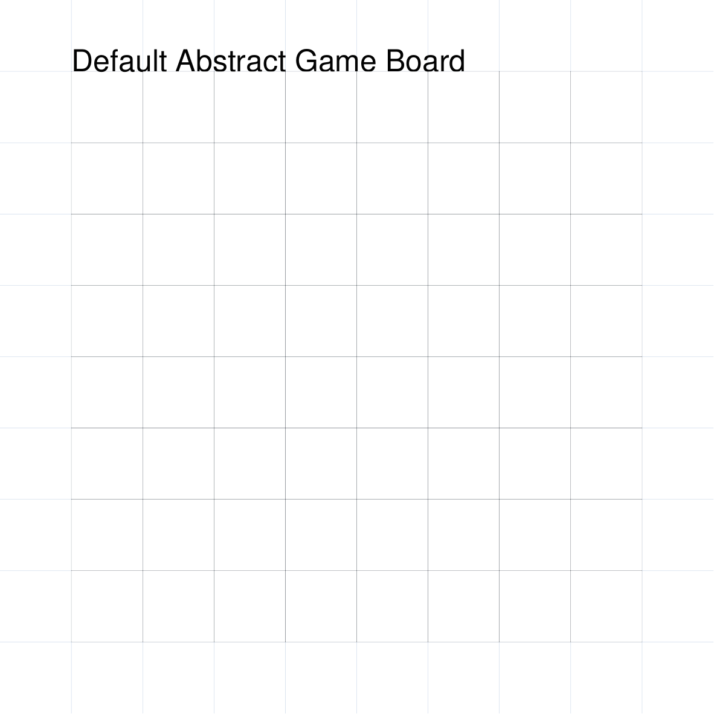

===== ======
|ab1| This example shows an ``AbstractGame`` constructed using these commands:

      .. code:: python

         agd = AbstractGame()
         AbstractState(board=agd)

      The default settings for a board are those of a 8x8 grid of square cells.

      As can be seen, the board is drawn when it is referenced by the *board*
      property of an ``AbstractState`` command.  In short: the ``AbstractGame``
      is assigned to ``adg`` which in turn is referenced by ``board=agd``.

===== ======


Example 2. Board Size and Position
~~~~~~~~~~~~~~~~~~~~~~~~~~~~~~~~~~
`^ <abstractGameGrid_>`_

.. |ab2| image:: ../images/objects/abstracts_size_position.png
   :width: 330

===== ======
|ab2| This example shows ``AbstractGame`` used with these commands:

      .. code:: python

        agsp = AbstractGame(
            x=0, y=0,
            height=1.25,
            rows=3, cols=3,
        )
        AbstractState(board=agsp)

        ahsp = AbstractGame(
            name="hexagons",
            x=4, y=4,
            height=1.25,
            rows=3, cols=3,
        )
        AbstractState(board=ahsp)

      Each of the two boards shown have their own *rows*, *cols* and *height*
      values set in order to determine their size.

      Each of the two boards shown make use of custom *x* and *y* values to
      set their position on the page.

      The board on the lower-right also has the *name* set to ``hexagons``
      in order to change its layout; more example of these types can be
      seen in :ref:`Hexagonal AbstractGame Boards <abstractGameHexagonal>`.

      As can be seen, the boards are drawn when the name assigned to them is
      referenced by the *board* property of the ``AbstractState`` commands
      (``agsp`` and ``ahsp`` respectively).

===== ======


Example 3. Styled Board
~~~~~~~~~~~~~~~~~~~~~~~
`^ <abstractGameGrid_>`_

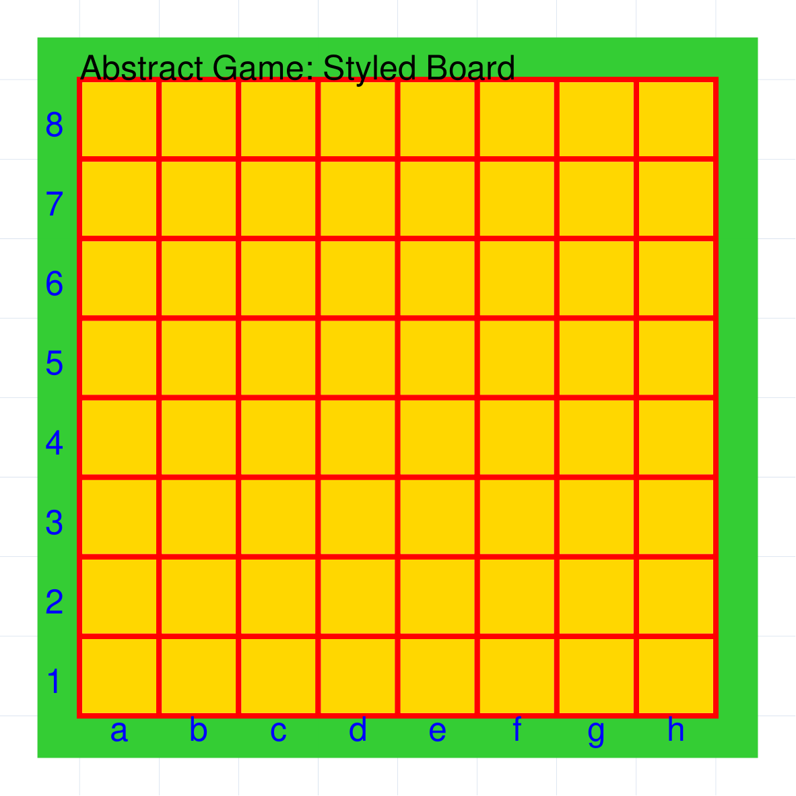

===== ======
|ab3| This example shows an ``AbstractGame`` constructed using these commands:

      .. code:: python

        ags = AbstractGame(
            name="grid",
            fills=["gold"],
            stroke="red",
            stroke_width=2,
            frame=True,
            frame_width=15,
            frame_stroke="limegreen",
            label=True,
            label_stroke="blue"
        )
        AbstractState(board=ags)

      The default board size is a 8x8 ``grid`` of square cells; in this
      example the type of board is explicitly set by its *name* property.

      In this case, the board is further styled by setting:

      - *fills* - a list one or more colors; in this case just a single one
      - *stroke* - the color of the grid lines
      - *stroke_width* - the thickness of the grid lines (in point units)
      - *frame* - if ``True``, the frame will be drawn
      - *frame_width* - the thickness of the frame lines (in point units)
      - *frame_stroke* - the color of the frame
      - *label* - if ``True``, the labels will be drawn
      - *label_stroke* - the color of the labels

      The *label_start* defaults to the *bottom-left* (``BL``),
      and the *label_type* defaults to  *alpha-numeric* (``AN```); so
      letters for the columns go from left to right along the bottom edge
      and numbers for the rows increase from ``1`` up along the left edge.

      As can be seen, the board is drawn when the name assigned to it
      (``ags``) is referenced by the *board* property of an
      ``AbstractState`` command.

===== ======


Example 4. Board with custom areas
~~~~~~~~~~~~~~~~~~~~~~~~~~~~~~~~~~
`^ <abstractGameGrid_>`_

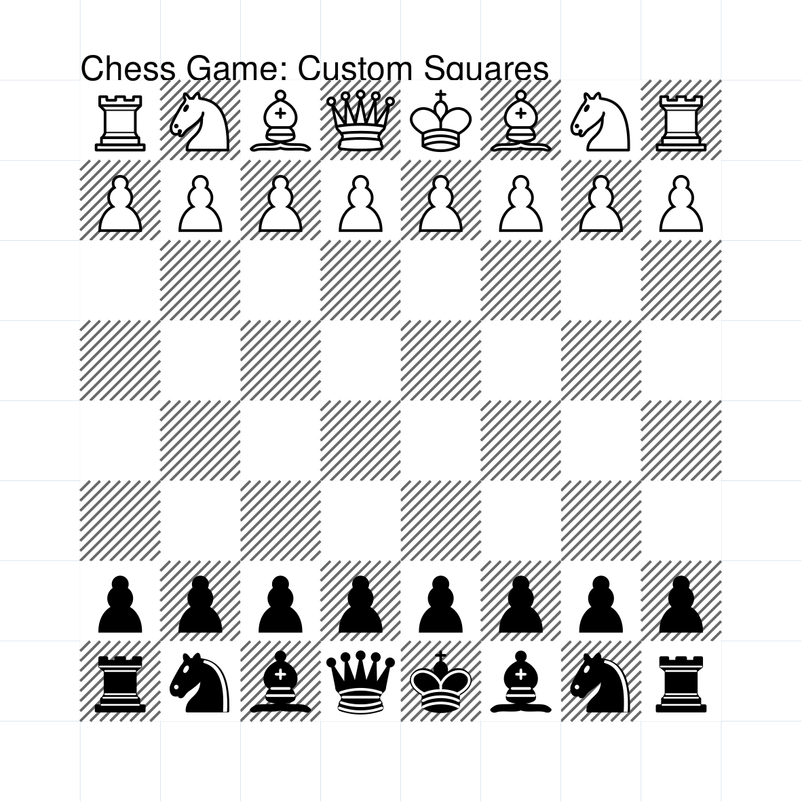

===== ======
|ab4| This example shows an ``AbstractGame`` constructed using these commands:

      .. code:: python

        htch = Default(
            hatches='ne',
            hatches_count=15,
            hatches_stroke_width=1,
            hatches_stroke="dimgray")
        sqr = Default(
            fill="white",
            stroke=None,
            height=1,
            width=1)

        agcb = AbstractGame(
            name="chess",
            areas=[
                rectangle(default=sqr),
                rectangle(default=[sqr, htch])
            ]
        )
        AbstractState(board=agcb)

      In this example the type of ``AbstractGame`` board is set by its
      *name* property to ``chess``.

      This board appears as a square layout of 8 rows by 8 columns
      such is used for a regular game of Chess.

      In addition, the *areas* for the board are supplied as a list of
      two customised rectangles.  These are drawn in turn at alternating
      positions on the underlying row/column grid.

      Each rectangle has the same shape, as set by the
      :ref:`Default() <the-default-command>` command named ``sqr``, but
      the second one also contains a series of :ref:`hatches <rectHatches>`,
      as set by the :ref:`Default() <the-default-command>` command
      named ``htch``.

      Because the Chess tiling pattern is a snake-like one, starting at the
      upper-left and then wrapping around at the end of each row, these
      rectangle shapes appear at different positions on alternating rows.

===== ======


Example 5. Board with cell shape
~~~~~~~~~~~~~~~~~~~~~~~~~~~~~~~~
`^ <abstractGameGrid_>`_

.. |ab5| image:: ../images/objects/abstracts_hexagons_cell_shape.png
   :width: 330

===== ======
|ab5| This example shows an ``AbstractGame`` constructed using these commands:

      .. code:: python

        ags = AbstractGame(
            name="hexhex",
            hexes=4,
            label=True,
            cell_shape=circle(
                radius=0.56,
                stroke="red",
                stroke_width=1),
            stroke="white",
            label_stroke="grey",
        )
        AbstractState(board=ags)

      The *cell_shape* property is assigned to another shape |dash| one which
      has a centre |dash| and this is drawn at the centre of each hexagon.

      By setting the *stroke* to white, the hexagonal grid becomes "invisible",
      effectively leaving the circles as the only visible grid cells.

===== ======


.. _abstractGameHexagonal:

AbstractGame Board: Hexagonal
-----------------------------
`^ <abstractgame-command_>`_

A grid made up hexagons is used in a number of abstract games.  There are
different styles, or type of hexagonal grids, all referenced through the
board's *name* property.


Example 1. Rectangular Hexagonal Grid
~~~~~~~~~~~~~~~~~~~~~~~~~~~~~~~~~~~~~
`^ <abstractGameHexagonal_>`_

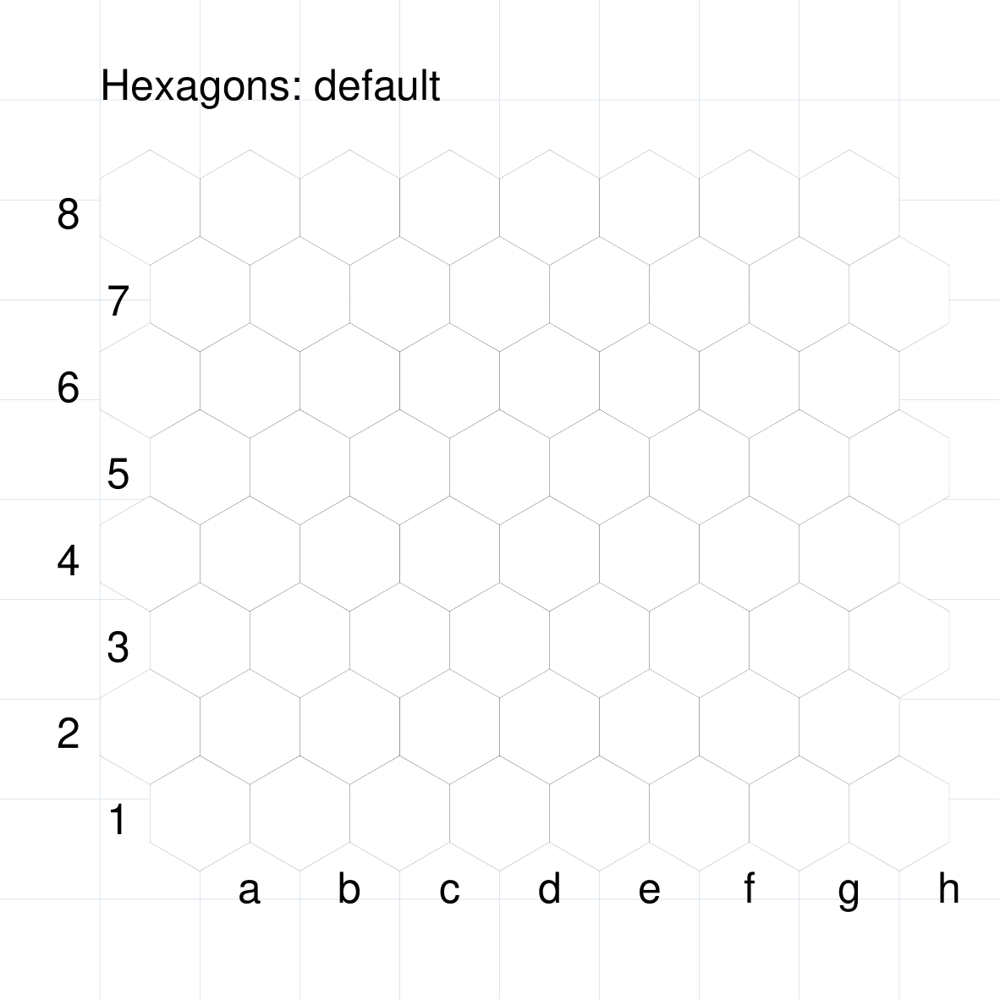

===== ======
|ah1| This example shows an ``AbstractGame`` constructed using these commands:

      .. code:: python

        aghd = AbstractGame(
            name="hexagons",
            label=True)
        AbstractState(board=aghd)

      The default hexagonal board size is a 8x8 arrangement of hexagonal
      cells in a "pointy" orientation.

      As shown, this type of board is  set via its *name* property to
      ``hexagons`` |dash| a *name* property of ``hexagonal`` can also be
      used.

      Setting ``label=True`` activates the default labellng; stating at the
      bottom-left of the grid, letters are assigned to the diagonally-sloping
      columns, and numbers to the rows.

===== ======


Example 2. Hex Game Grid
~~~~~~~~~~~~~~~~~~~~~~~~
`^ <abstractGameHexagonal_>`_

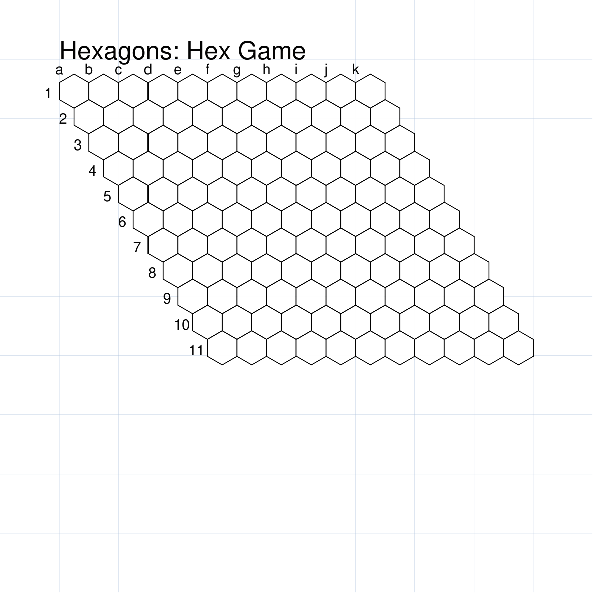

===== ======
|ah2| This example shows an ``AbstractGame`` constructed using these commands:

      .. code:: python

        aghd = AbstractGame(
            name="hex",
            label=True,
            label_size=7)
        AbstractState(board=aghd)

      In this example the type of board is set via its *name* property to
      ``hex``.

      This board appears as a rhombus shaped layout of 11 rows by 11 columns
      and is used for the game called **Hex**.

      The game of  **Hex** was created by Piet Hein in 1942; see
      https://en.wikipedia.org/wiki/Hex_(board_game)

===== ======


Example 3. HexHex Grid
~~~~~~~~~~~~~~~~~~~~~~
`^ <abstractGameHexagonal_>`_

The term "hexhex" refers to a hexagonal grid that itself appears to look like
a hexagon.

This type of board is constructed by:

1. Setting the *name* to ``hexhex``
2. Specifying the number of *hexes* that should appear along the edge or side
   of the hexagonal grid; the minimum |dash| and default |dash| *hexes* value
   being ``2``.

.. NOTE::

    The *rows* and *cols* properties used by other ``AbstractGame``
    layouts are **not** applicable to a ``hexhex`` layout.

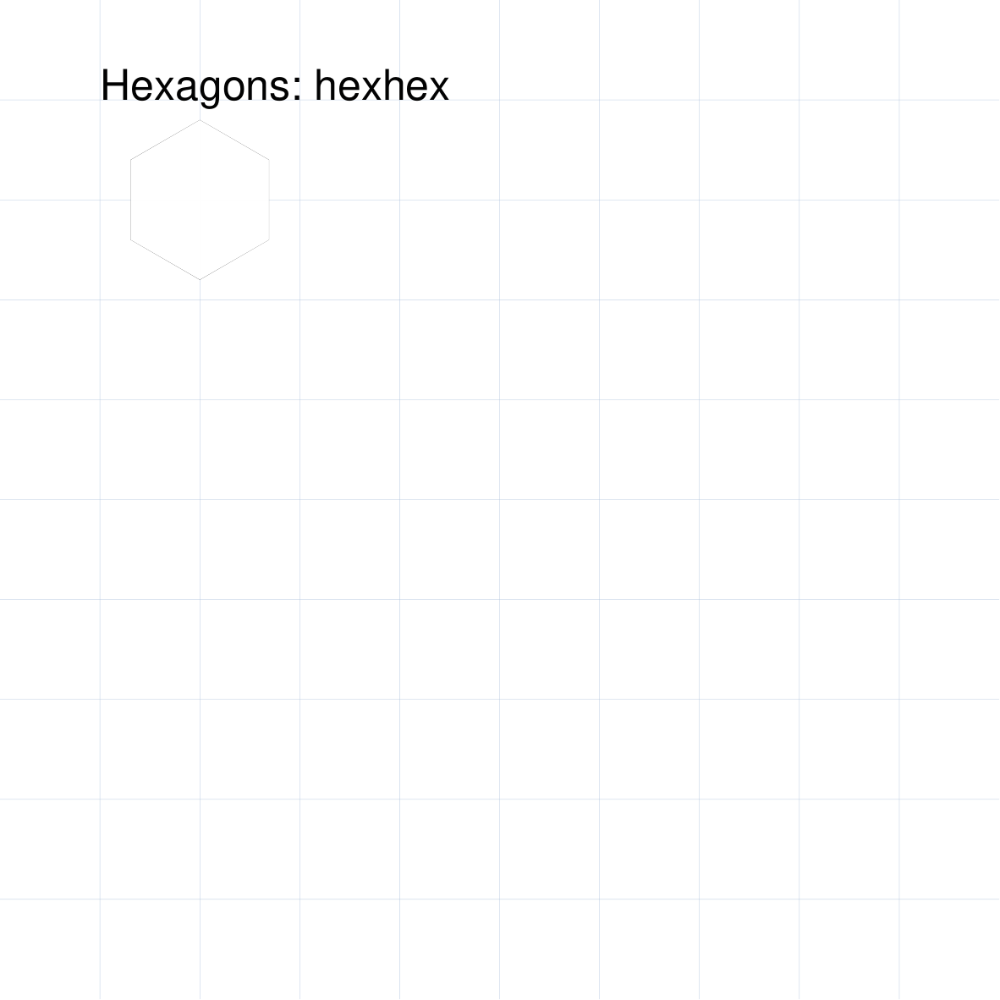

===== ======
|ah3| This example shows an ``AbstractGame`` constructed using these commands:

      .. code:: python

        aghh = AbstractGame(
            name="hexhex",
            hexes=4,
            label=True,
            label_font='Courier',
            label_size=16,
        )
        AbstractState(board=aghh)

      In this example the type of board is set via its *name* property to
      ``hexhex``.

      The *hexes* property is set to ``4`` |dash| this results in a grid with
      7 rows; and 7 columns in the centre row.

      The labels are activated by setting ``label=True`` and then styled by
      setting their font name and size |dash| ``Courier`` and ``16``.

===== ======


Example 4. Pattern Grid
~~~~~~~~~~~~~~~~~~~~~~~
`^ <abstractGameHexagonal_>`_

If a hexagonal grid for a game contains a custom number of hexagons,
that may vary across the rows of the board, then a pattern design,
or layout, can be defined for the ``AbstractGame``.

A pattern grid uses a cell-and-dot notation which is set with the
*pattern* property.

This notation represents each row as separate line, with each regular, or
normal hexagon with a ``O`` (the letter "oh"), and each blank, or missing,
cell with a ``.`` (dot or full stop).

There should be as many lines in the pattern as are set in the *rows* value
for the ``AbstractGame``. Similarly, the total combined number of hexagons
and blanks, in any given line, must match the *cols* value.

The best way to represent multi-line list of characters such as this is by
starting and ending the pattern definition with triple quotes |dash| ``"""``.

Note that empty lines and "whitespace" at the start and end of a pattern will
be ignored; as is any whitespace on a line.

If a row on the board contains only hexagons, this can be shown with a
single ``O`` (capital "oh").


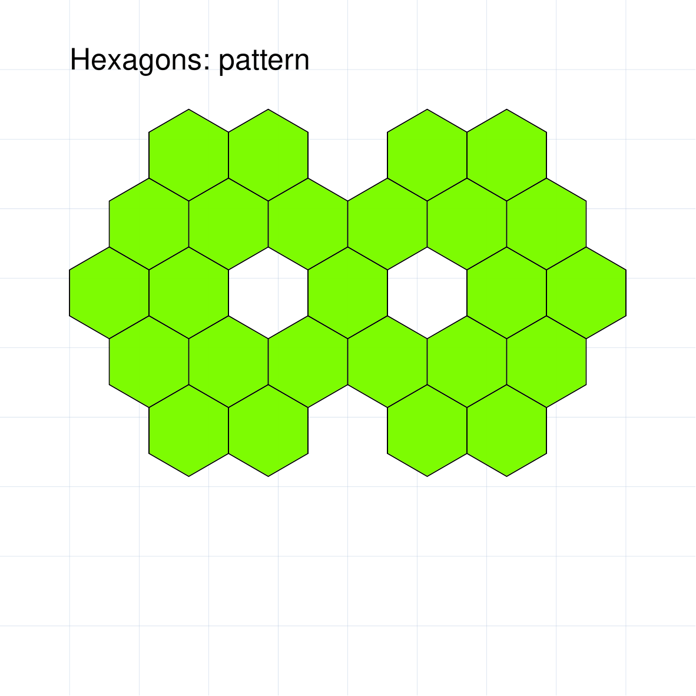

===== ======
|ah4| This example shows an ``AbstractGame`` constructed using these commands:

      .. code:: python

        aghp = AbstractGame(
            name="hexagons",
            rows=5,
            cols=7,
            pattern = """
            . O O . O O .
             O O O O O O .
            O O . O . O O
             O O O O O O .
            . O O . O O .
            """)
        AbstractState(board=aghp)

      In this example the type of board is set via its *name* property to
      ``hexagons``.

      The *pattern* property shows, in string format, an arrangement of
      hexagonal cells (``O``) and empty cells (``.``).

      Note that the spaces in the pattern are ignored when constructing the
      board; they are just used to help visualise the pattern being created.

      .. NOTE::

          It is important that the correct number of *rows* and *cols* are
          set; the pattern has to fit **exactly** into these dimensions.

===== ======


.. _abstractGamePieces:

AbstractGame Pieces
-------------------
`^ <abstractgame-command_>`_

*protograf's* library includes pieces from well-known games available as
SVG images sourced from the internet; see `Abstract Resources`_. These can
be used as a set or as individually referenced pieces.

You can also define your own set of shapes to be used with a game.

Built-in pieces for a known game
~~~~~~~~~~~~~~~~~~~~~~~~~~~~~~~~
`^ <abstractGamePieces_>`_

If you have chosen an existing "named" game, the default set of pieces
corresponding to that game will automatically be selected.

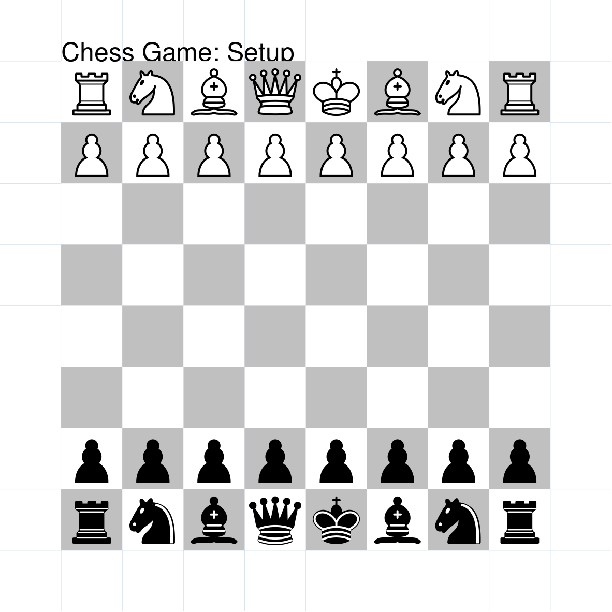

===== ======
|ap1| This example shows an ``AbstractGame`` constructed using these commands:

      .. code:: python

        agcs = AbstractGame(
            name="chess")
        AbstractState(
            board=agcs,
            setup=True)

      In this example the type of board is set via its *name* property to
      ``chess``.  This results in the default grid with alternating colored
      squares.

      Because of the use of ``setup=True`` in the ``AbstractState``, the
      built-in Chess pieces are displayed in their starting positions.

===== ======


Reusing built-in pieces from a game
~~~~~~~~~~~~~~~~~~~~~~~~~~~~~~~~~~~
`^ <abstractGamePieces_>`_

It is possible to select a piece, or pieces, from any of the built-in games.

This can be done by using a ``game_color_piece`` notation; for example, the White
King from **Chess** is referenced by ``chess_white_king``.

.. |ap2| image:: ../images/objects/abstracts_grid_chess_pieces.png
   :width: 330

===== ======
|ap2| This example shows an ``AbstractGame`` constructed using these commands:

      .. code:: python

        agcp = AbstractGame(default=thick,
            rows=4, cols=4,
            pieces=[
                ('K', 'chess_white_knight'),
                ('J', 'chess_black_knight')]
            )
        AbstractState(
            board=agcp,
            positions="""
            .
            KKKK
            JJJJ
            .
            """)

      In this example the type of board is set via its *name* property to
      ``grid`` of size 4 rows by 4 columns.

      The AbstractGame's *pieces* property is assigned to a list of pieces;
      in which each letter |dash| one that *you* choose to represent the piece
      for the purpose of displaying it on the board |dash| is paired with an
      existing piece from a built-in game;  in this case the Black and White
      Knights from **Chess**, using the ``game_color_piece`` notation.

      The use of the *positions* property is described in
      :ref:`AbstractState Positions <abstractStatePositions>`.

===== ======

It is also possible to use *all* the pieces from any of the built-in games.

This can be done by using a ``pieces_type`` property; for example, the
pieces from the game **Go** can be used with ``pieces_type='go'``.

.. |ap3| image:: ../images/objects/abstracts_grid_chess_go_pieces.png
   :width: 330

===== ======
|ap3| This example shows an ``AbstractGame`` constructed using these commands:

      .. code:: python

        amcg = AbstractGame(
            name="chess",
            pieces_type='go'
        )
        AbstractState(
            board=amcg,
            positions='8/8/8/3BW3/3WB3/8/8/8'
        )

      In this example the type of board is set via its *name* property to
      ``chess`` i.e. checkered style with 8 rows by 8 columns.

      However, for this game, the *pieces_type* is set to ``go``, a game which
      uses black and white pieces (aka "stones"), which are referenced by the
      first letter color of their color - ``B`` or ``W``.

      The example shows two stones of each color placed at the centre of the
      board using the *positions* property; this is described in
      :ref:`AbstractState Positions <abstractStatePositions>`.

===== ======


Defining and using custom pieces
~~~~~~~~~~~~~~~~~~~~~~~~~~~~~~~~
`^ <abstractGamePieces_>`_

Custom pieces can either be designed with **protograf**'s built-in shapes,
or by referencing a pre-created image.

.. NOTE::

    If you use an image for a shape, ensure that it is square so as to fit
    properly into a standard grid cell |dash| square or hexagon.

.. |ap4| image:: ../images/objects/abstracts_grid_pieces.png
   :width: 330

===== ======
|ap4| This example shows an ``AbstractGame`` constructed using these commands:

      .. code:: python

        red_pieces = Common(
            radius=0.4, fill="red",
            radii_stroke_width=4,
            radii_stroke="black",
            dot_stroke="black")
        blu_pieces = Common(
            radius=0.4, fill="blue",
            radii_stroke_width=4,
            radii_stroke="silver",
            dot_stroke="silver")
        angles = [60, 120, 180, 240, 300, 360]

        RA = circle(common=red_pieces,
                    radii=angles,
                    radii_dotted=True)
        RL = circle(common=red_pieces,
                    radii=angles)
        RC = circle(common=red_pieces,
                    dot=0.1)

        BA = circle(common=blu_pieces,
                    radii=angles, radii_dotted=True)
        BL = circle(common=blu_pieces,
                    radii=angles)
        BC = circle(common=blu_pieces,
                    dot=0.1)

        all_pieces = [
            ('A', RA), ('L', RL), ('C', RC),
            ('a', BA), ('l', BL), ('c', BC),
        ]

        agpi = AbstractGame(default=thick,
            name="hexhex",
            y=1,
            height=1,
            hexes=4,
            pieces=all_pieces)
        AbstractState(
            board=agpi,
            positions="4/lacal/6/7/6/LACAL/4"
        )

      In this example the type of board is set via its *name* property to
      ``hexhex``, with 4 *hexes* per side.

      The board's *pieces* property is set to the name ``all_pieces``.  This
      in turn is assigned to a list of paired values:  a letter and another
      name, for example, ``('L', RL)``.

      The ``RL`` in turn is defined by a Circle shape, with various properties
      creating the red circle piece with six black lines drawn through it.

      The use of the *positions* property to display these pieces on the
      board is described in
      :ref:`AbstractState Positions <abstractStatePositions>`.

===== ======


.. _abstractstate-command:

AbstractState Command
=====================
`↑ <abstractIndex_>`_

The ``AbstractState()`` command will create a display of a board and its pieces
that have been defined in an :ref:`AbstractGame <abstractgame-command>`. This
display represents a given point during the play of an abstract game |dash| a
situation commonly referred to as "the game state".

- `AbstractState Properties`_
- `AbstractState Positions`_
- `AbstractState Annotations`_
- `AbstractState Markers`_
- `AbstractState Examples`_


.. _AbstractStateProperties:

AbstractState Properties
------------------------
`^ <abstractstate-command_>`_

The properties that can be set for an AbstractState command are:

* *board*: an ``AbstractGame`` object; this is a required setting and the
  AbstractState object cannot be displayed without it
* *positions*: details of where an AbstractGame's pieces go on the board;
  see below for details
* *setup*: if set to ``True``, and the game is one whose initial position is
  stored in **protograf**, then the pieces will be assigned to the board to
  match that predefined setup
* *annotations*: a list of AbstractState annotations; see below for details
* *markers*: a list of AbstractState markers; see below for details


.. _abstractStatePositions:

AbstractState Positions
-----------------------
`^ <abstractstate-command_>`_

The *positions* property of an AbstractState indicates where the pieces |dash|
as defined for the AbstractGame by the shapes, icons or images associated with
a character |dash| are placed.

The notation for doing this is by providing a string of characters in one
of two different notational styles.

.. _abstractStateFEN:

FEN-like Notation
~~~~~~~~~~~~~~~~~
`^ <abstractStatePositions_>`_

This notation is based on the **Chess** notation called "FEN" (see:
https://en.wikipedia.org/wiki/Forsyth%E2%80%93Edwards_Notation)
in which the characters, representing pieces, are separated by a combination
of numbers, to represent consecutive blank cells, and/or ``/`` (forward slash)
characters to mark the end of a row.

For example, a **Chess** game might have:

.. code:: python

   positions = "rnbqkbnr/pppppppp/8"

to represent three rows |dash| the Black pieces as setup at the start of
the game |dash| as well as the unoccupied row in front of the Black pawns.

If there are more than nine adjacent blank cells in a row, as there might be in
a game of **Go**, then use multiple numbers, for example:

.. code:: python

   positions = "9B9/B99"

This represents a situation where the first row has 9 empty points, a Black
stone, and then 9 empty points; whereas the second row has a Black stone,
followed by 9 empty points, and then another 9 empty points |dash| 18
empty points in total.

The FEN-like notation is converted internally by **protograf** into
`Row-and-Dot Notation`_.


.. _abstractStateRowDot:

Row-and-Dot Notation
~~~~~~~~~~~~~~~~~~~~
`^ <abstractStatePositions_>`_

This notation represents each **row** as separate line, and each blank
cell with a ``.`` (**dot** or full stop).

The best way to represent a multi-line list of characters such as this is
by starting and ending all the lines with triple quotes |dash| ``"""``.

For example:

.. code:: python

   positions = """
   r.bqkb.r
   .ppppppp
   """

would show two rows near the start of a **Chess** game where Black has
moved both Knights and one Pawn.

Note that empty lines, as well as "whitespace" at the start and end of any
line, are ignored.

If a row on the board contains **no** pieces, this can be shown with a single
``.`` (dot or full stop).


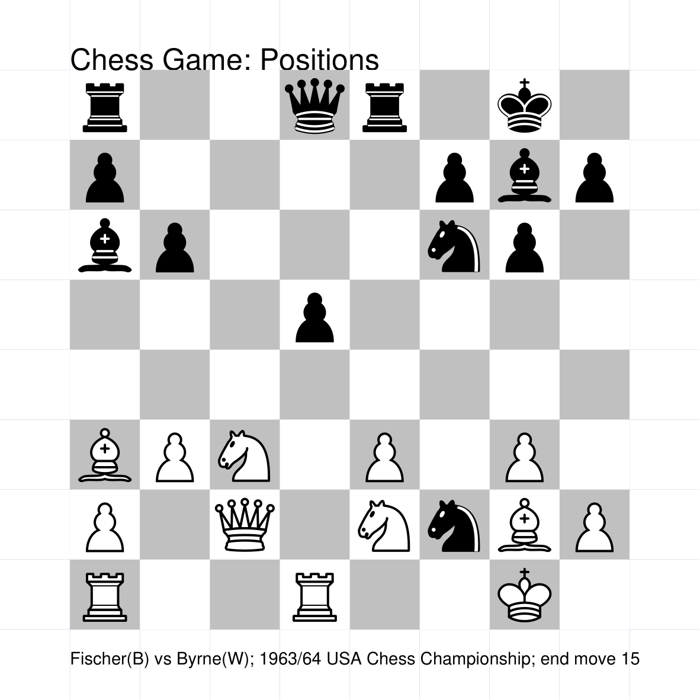

===== ======
|sp1| This example shows an ``AbstractGame`` constructed using these commands:

      .. code:: python

        agcp = AbstractGame(name="chess")
        AbstractState(
            board=agcp,
            positions="""
            r..qr.k.
            p....pbp
            bp...np.
            ...p....
            .
            BPN.P.P.
            P.Q.NnBP
            R..R..K.
            """
        )

      In this example the type of board is set via its *name* property to
      ``chess``.  This results in the default grid with alternating colored
      squares.

      The *positions* property of AbstractState is used to show **Chess**
      pieces on the board; in this case, the "state" at the end of move 15
      in the 1963/64 USA Chess Championship with R.J. Fischer (Black) playing
      R.E. Byrne (White).

===== ======


.. _abstractStateAnnotations:

AbstractState Annotations
-------------------------
`^ <abstractstate-command_>`_

An annotation is typically an :ref:`element <element-concept>` that needs to
be drawn to customise the board in some way |dash| this can be via text,
a shape or an image.  For example, a cross can be drawn in the centre square
of the board.

Annnotations are always drawn **before** any `AbstractState Markers`_ or
any pieces that may appear on the board.

.. _abstractStateLocations:

Annnotations Locations
~~~~~~~~~~~~~~~~~~~~~~

Although it is possible to use the **protograf** absolute
:ref:`positioning <position-concept>` notation to annotate the board, a more
convenient way is to use a **board.reference.position** notation.  In this
notation, the name assigned to the board is used first, followed by a dot,
then the grid reference as set by the labelling method, followed by a dot,
and then the position on the cell at that grid reference.

For example, given a **Chess** board, the lower left square, occupied by
the White Rook at the start of the game, is usually referred to as ``a1``.
So the position |dash| the x- and y- coordinates |dash| of the centre of
that square, for an ``AbstractGame`` named ``chess_game`` would be
``chess_game.a1.c``.

The various positions for a square cell follow those of the abbreviated
:ref:`compass-directions <termsDirection>`;  n (north), s (south), e (east),
w (west), ne (north-east), nw (north-west), sw (south-west), and
se (south-east), as well as c (centre/center).

Similarly for a hexagonal cell, there are  n (north), s (south),
ne (north-east), nw (north-west), sw (south-west), and se (south-east),
as well as c (centre/center).


.. |sp2| image:: ../images/objects/abstracts_grid_annotations.png
   :width: 330

===== ======
|sp2| This example shows an ``AbstractState`` constructed using these commands:

      .. code:: python

        aga = AbstractGame(
            label=True,
            rows=6, cols=6,
            default=thick
        )
        cross = Common(
            side=aga.a6.ht,
            stroke_width=0.5,
            hatches='d',
            hatches_count=2,
            hatches_stroke='red',
            hatches_stroke_width=1.5)
        annotations = [
            square(cxy=aga.a6.c, common=cross),
            square(cxy=aga.f6.c, common=cross),
            square(cxy=aga.a1.c, common=cross),
            square(cxy=aga.f1.c, common=cross),
            circle(cxy=aga.c3.ne,
                   fill_stroke="red",
                   transparency=50),
        ]
        AbstractState(
            board=aga,
            annotations=annotations,
        )

      In this example, *annotations* for the board are defined with a list
      of shapes: a :ref:`circle <circle-command>` and four
      :ref:`squares <square-command>`.  These have some styling added |dash|
      color and transparency for the circle and :ref:`hatches <rectHatches>`
      for the squares.

      The centre locations of the shapes being used for the annotations are
      set with their *cxy* property.  This property's value uses the
      **board.reference.position** notation described earlier to place the
      shape on the board.  For example, the circle's centre is set to the
      north-east corner of cell ``c3``.

===== ======


.. _abstractStateMarkers:

AbstractState Markers
---------------------
`^ <abstractstate-command_>`_

A marker is typically an :ref:`element <element-concept>` that needs to be
shown to draw attention to some aspect of the current state of the board and
its pieces |dash| this can be via text, a shape or an image.   For example,
an arrow can be drawn to show how a piece can, or should, move from one
square to another.

Markers are always drawn **after** any `AbstractState Annotations`_ and
**after** any pieces that may appear on the board.

Markers are supplied as a list of **protograf** shapes, whose position is
set in the same way as :ref:`Annnotations Locations <abstractStateLocations>`.


.. |sp3| image:: ../images/objects/abstracts_grid_chess_markers.png
   :width: 330

===== ======
|sp3| This example shows an ``AbstractGame`` constructed using these commands:

      .. code:: python

        amca = AbstractGame(
            name="chess",
            label=True
        )
        AbstractState(
            board=amca,
            positions='8/8/8/8/3N4/8/8/8',
            markers=[
                dot(cxy=amca.d4.c, fill_stroke="red", dot_width=5),
                line(
                    links=[amca.d4.c, amca.d6.c, amca.e6.w],
                    stroke="red",
                    stroke_width=2),
                square(
                    cxy=amca.e6.c,
                    height=0.9,
                    width=0.9,
                    stroke="red",
                    stroke_width=2),
            ]
        )

      In this example, a **Chess** game shows three markers being used:

      1. The **dot** shape appears at the centre of the Knight's square,
      2. The **line** shape uses the *links* property to join the centre
         of the two squares making up the first part of the Knight's move
         and ending at the west-edge of square ``e6``.
      3. The **square** shape is drawn with its centre in square ``e6``.

      All shapes are given a *stroke* color of ``red``, and the line and
      square are drawn with a *stroke_width* of 2.

===== ======

.. _abstractStateMarkersShortcuts:

AbstractState Markers Shortcuts
~~~~~~~~~~~~~~~~~~~~~~~~~~~~~~~

Although the above method for setting markers is very flexible, its also a
little cumbersome, particularly if only relatively simple markers need to be
used; for example, drawing a line or an arrow between cells or highlighting
the outline of a cell.

The "shortcut" approach provides a limited set of shapes, and restricts their
position to align with the cell centres; all shapes (except for the dot) are
sized to just fit inside the cell.

The shortcuts, prefixed by one or two letters are:

- ``a``: draw an **arrow** between two cells
- ``ac``: draw an **arrow**, with a curve, between two cells
- ``l``: draw a **line** between two cells
- ``lc``: draw a **line**, with a curve, between two cells
- ``c``: draw a **circle** inside a cell
- ``d``: draw a **dot** inside a cell
- ``s``: draw a **square** inside a cell
- ``h``: draw a **hexagon** inside a cell
- ``x``: draw an **X** inside a cell (between diagonally opposite vertices)

These shapes are always drawn in "outline" mode; that is to say, there is
no fill color for the area shapes.

The other shortcut that can be used is that of a color, referenced by its
:ref:`RGB hexadecimal <termsColor>` value. This is a single color used to fill
the cell |dash| a hexagon on a hexagonal board and a square on a grid board.
(Note that, unlike in most other places in **protograf**, the hexadecimal form
is the only way to specify color here.)

Along with this prefix, there also needs to be a reference for at least one
cell or, in the case of line or arrow, a reference for at least two cells
|dash| the start and end locations.  For all shortcuts, it is possible to
supply a list of multiple locations in which that shape appears.

All these details appear together in a single string for a single shape, and
one or these strings is then assigned to the *markers* property list, and
is drawn in that order.

Some basic customisation is possible:

- *markers_stroke*: sets the color of all the shortcut markers; this defaults
  to ``yellow``
- *markers_fraction*: sets the width of all the shortcut markers lines as a
  fraction of the cell size; this defaults to ``0.1`` (one tenth)
- *markers_transparency*: sets the transparency of all the shortcut markers;
  this defaults to no transparency

The two different styles of creating markers can be mixed together in the
same list.


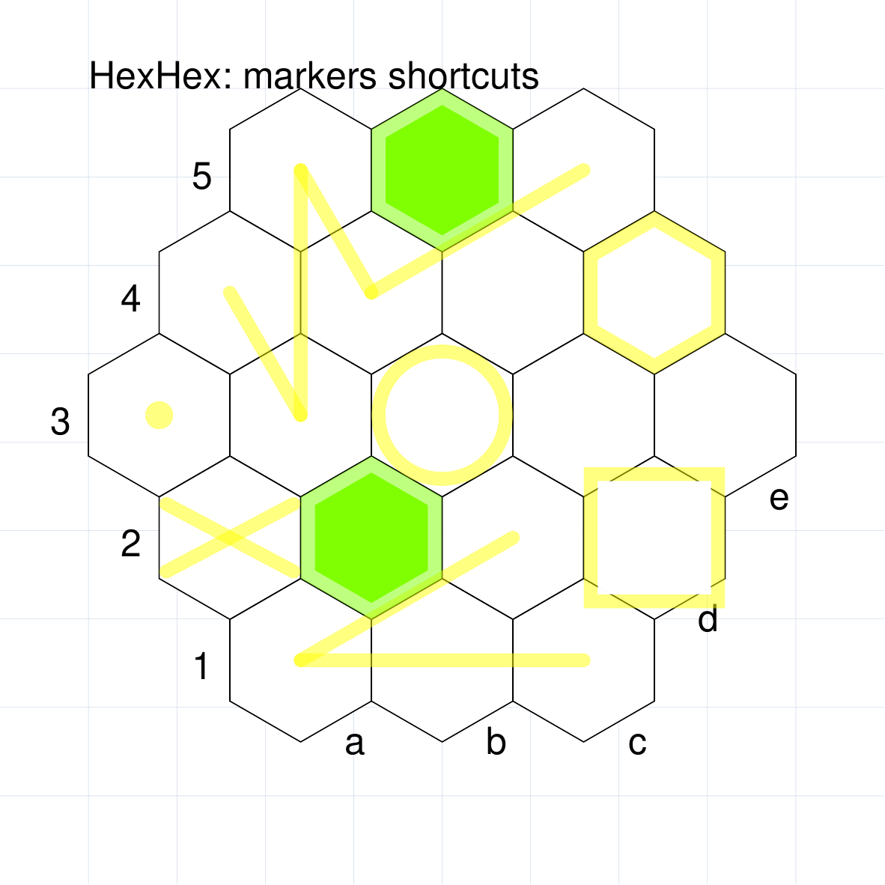

===== ======
|sp4| This example shows an ``AbstractGame`` constructed using these commands:

      .. code:: python

        aml = AbstractGame(
            name="hexhex",
            hexes=3,
            label=True,
        )
        AbstractState(
            board=aml,
            markers_transparency=50,
            markers=[
                'a a1 c1',
                'ac a1 c2',
                'd a3',
                'l b4 b3 c5 c4',
                'lc c4 e5',
                'c c3',
                'h e4',
                's d2',
                'x a2',
                '#7FFF00 d5 b2',
            ]
        )

      In this example, markers are drawn with default color and stroke
      thickness, but the *markers_transparency* is set to ``50`` percent.

      Markers are drawn on a ``hexhex`` board; as can be seen, the square
      marker does not really suit this style of cell.

      In this example, the *l* (line) marker has a number of different
      grid references included |dash| this means that a continuous line
      is drawn between the centre of each cell in the sequence.  This
      drawing method is making use of a Line's
      :ref:`Links <lineLinksShapes>` property.

      In this example, two cells |dash| ``b2`` and ``d5`` |dash| are
      completely "colored in" with a green color defined by ``#7FFF00``.

===== ======

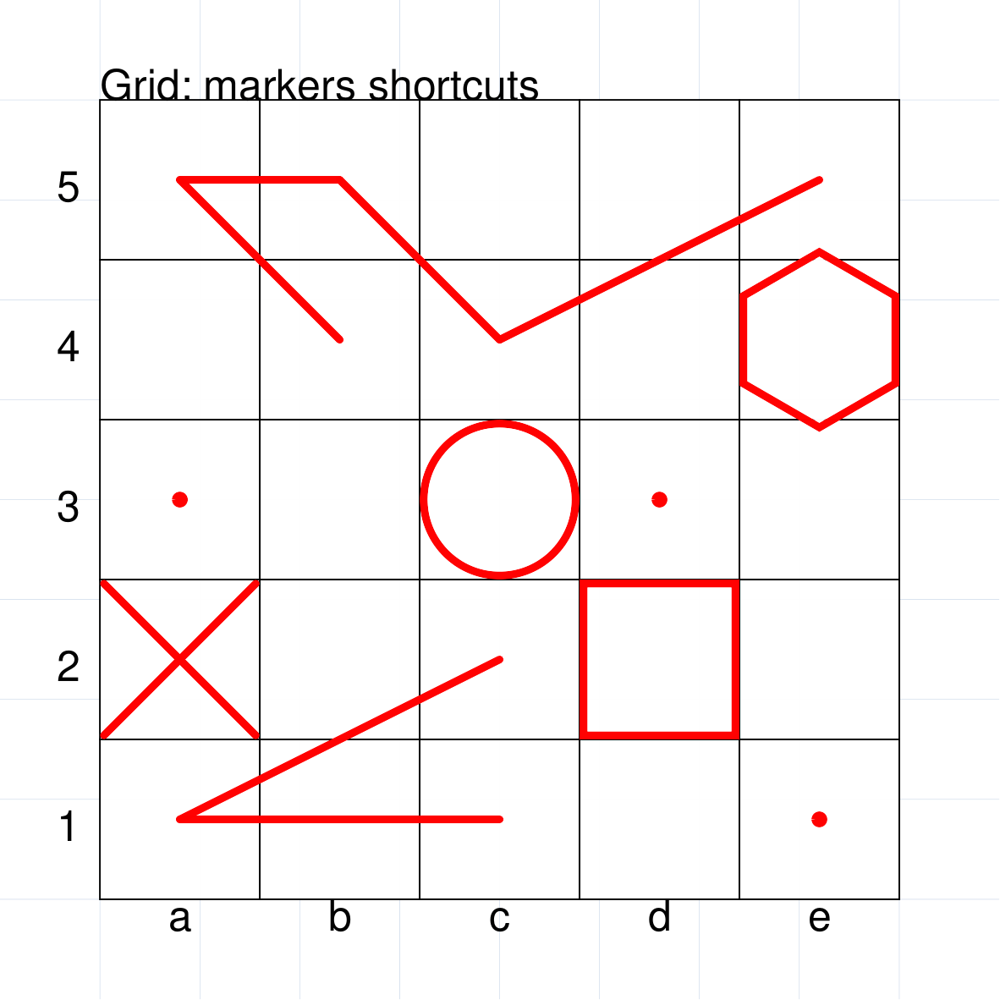

===== ======
|sp5| This example shows an ``AbstractGame`` constructed using these commands:

      .. code:: python

        amg = AbstractGame(
            name="grid",
            cols=5, rows=5,
            label=True,
        )
        AbstractState(
            board=amg,
            markers_stroke="red",
            markers_fraction=0.05,
            markers=[
                'a a1 c1',
                'ac a1 c2',
                'd a3 d3 e1',
                'l b4 a5 b5 c4',
                'lc c4 e5',
                'c c3',
                'h e4',
                's d2',
                'x a2',
            ]
        )

      In this example, the markers styles are changed: *markers_stroke*
      (their color) is set to ``red``; while the *markers_fraction* is set to
      ``0.05`` |dash| the line thickness relative to the cell size.

      Markers are drawn on a ``grid`` board; as can be seen, the hexagon
      marker does not really suit this style of cell.

      In this example, the *d* (dot) marker has a number of different
      grid references listed with it |dash| this means that the dot is
      drawn at the centres of all of those cells.

===== ======


.. _abstractStateExamples:

AbstractState Examples
----------------------
`^ <abstractstate-command_>`_


Example 1. Chess Board: Colored
~~~~~~~~~~~~~~~~~~~~~~~~~~~~~~~

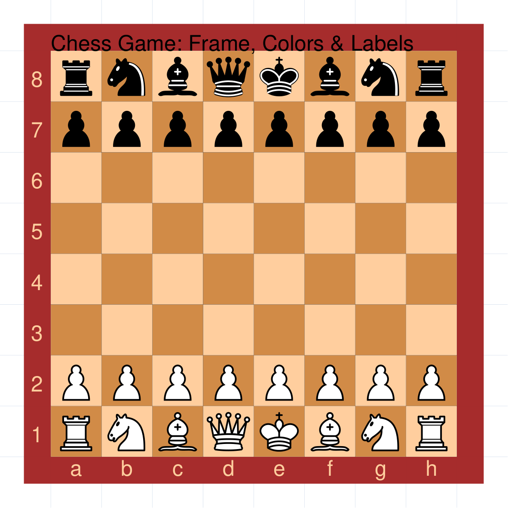

===== ======
|ax1| This example shows the use of ``AbstractGame`` and ``AbstractState``:

      .. code:: python

        agcs = AbstractGame(
            name="chess",
            fills=["#FFCE9E", "#D18B47"],
            frame=True,
            frame_width=15,
            frame_stroke="brown",
            label=True,
            label_stroke="#FFCE9E",
            label_offset_row=0.275,
            label_offset_col=0.25,
        )
        AbstractState(board=agcs, setup=True)

      This example shows a **Chess** board using custom *fills* colors
      of shades of brown for the alternating squares.

      A frame is drawn; the styled labels, with a custom offset distance
      for both row and column labels, are drawn last and therefore appear
      drawn over the frame.

===== ======


Example 2. Checkers Board: Setup
~~~~~~~~~~~~~~~~~~~~~~~~~~~~~~~~

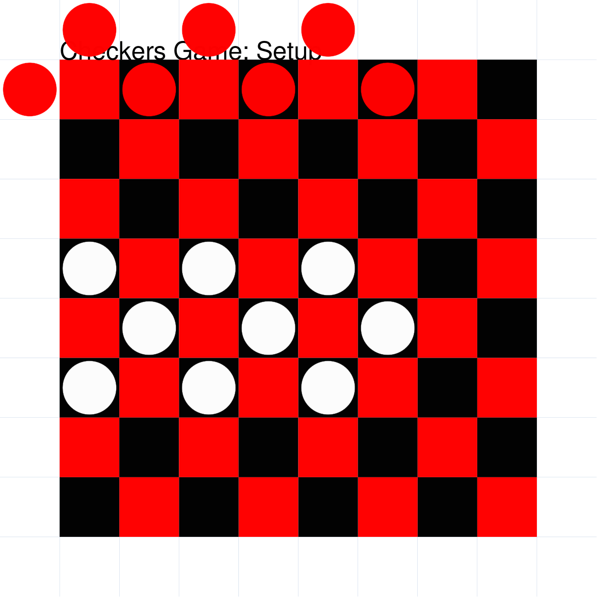

===== ======
|ax2| This example shows the use of ``AbstractGame`` and ``AbstractState``:

      .. code:: python

        agks = AbstractGame(name="checkers")
        AbstractState(board=agks, setup=True)

      This example shows a Checkers game setup, using the pieces which are
      predefined with **protograf** |dash| in this case, simple red and and
      white :ref:`circles <circle-command>`.

===== ======


Example 3. Shogi Board: Setup
~~~~~~~~~~~~~~~~~~~~~~~~~~~~~

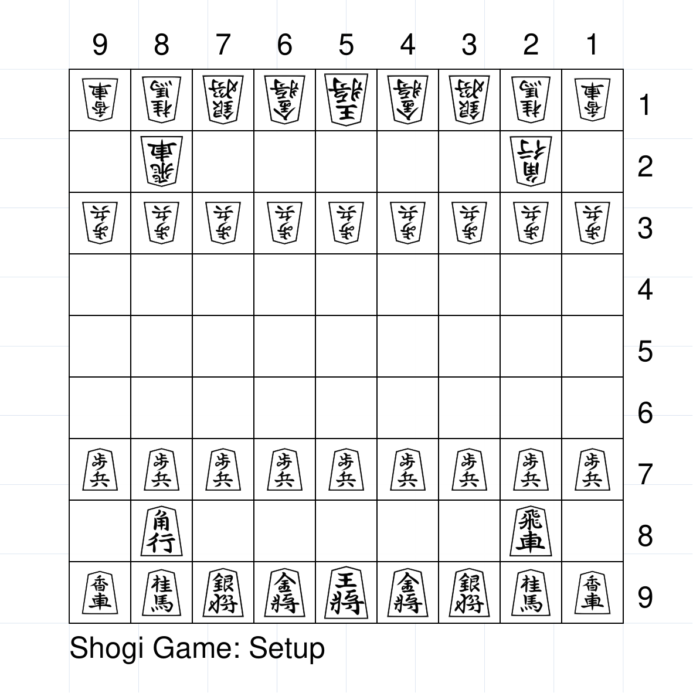

===== ======
|ax3| This example shows the use of ``AbstractGame`` and ``AbstractState``:

      .. code:: python

        agss = AbstractGame(
          name="shogi",
          label=True)
        AbstractState(board=agss, setup=True)

      This example shows a **Shogi** game setup, using the pieces whose images
      are available with **protograf**.

===== ======


Example 4. Shogi Board: Positions
~~~~~~~~~~~~~~~~~~~~~~~~~~~~~~~~~

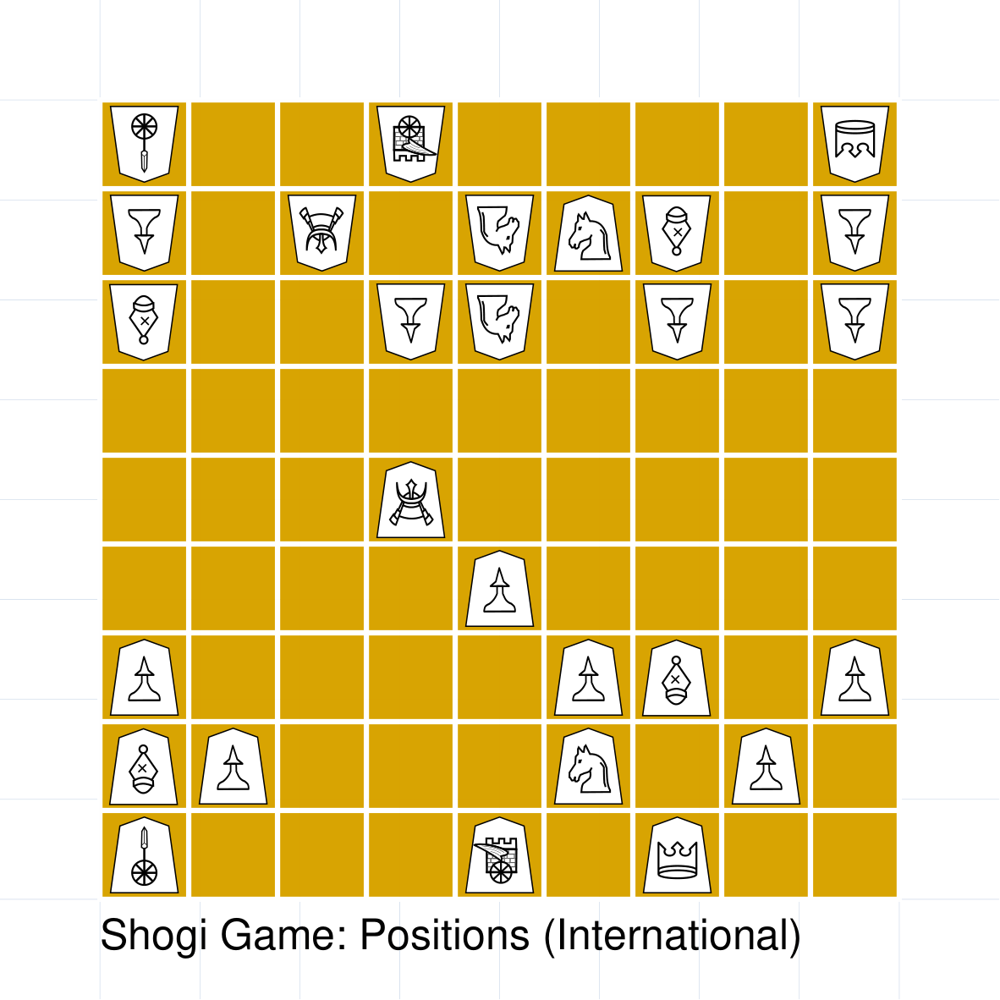

===== ======
|ax4| This example shows the use of ``AbstractGame`` and ``AbstractState``:

      .. code:: python

        agcp = AbstractGame(
            name="shogi",
            fills=['#D8A300'],
            stroke_width=1.5,
            stroke="white",
            pieces_type="shogi-int")
        AbstractState(
            board=agcp,
            positions="""
            L..R..K..
            P.S.NnB.P
            B..PN.P.P
            .........
            ...s.....
            ....p....
            p....pb.p
            bp...n.p.
            l...r.k..
            """
        )

      This example shows a **Shogi** game in progress, using the
      "international style" of pieces types, as set with
      ``pieces_type="shogi-int"``, whose images are available as
      part of **protograf**.

      In addition, the board itself is styled with a different color of cells
      and thicker, white lines.

===== ======


Example 5. Go Board: Positions
~~~~~~~~~~~~~~~~~~~~~~~~~~~~~~~~~

.. |ax5| image:: ../images/objects/abstracts_go_positions.png
   :width: 330

===== ======
|ax5| This example shows the use of ``AbstractGame`` and ``AbstractState``:

      .. code:: python

        aggp = AbstractGame(
            name="go",
            label=True,
            fill='#D8A300')
        AbstractState(
            board=aggp,
            positions="99/"*7 + ".B.B.W..W.BBB..B.W/" + "99/"*10
        )

      This example shows a **Go** game with a few stones placed on it, using
      the :ref:`"FEN-like" notation <abstractStateFEN>`.

      In addition, the board itself is styled with a different color of cells,
      and the labels have been activated.

===== ======


.. _abstract-resources:

Abstract Resources
==================
`↑ <abstractIndex_>`_

Chess
-----

The following are the SVG images, sourced from Wikipedia Commons, available
for use in constructing  **Chess** games |dash| or games using those pieces.

The pieces are referenced, using the notation described above, via the letter
in the last column of the table.

Uppercase letters are used for White pieces; lowercase letters for Black.

 .. |icon-king| image:: ../../../protograf/resources/abstracts/chess/Chess_klt45.svg
      :width: 35px
      :height: 35px
      :alt: King
 .. |icon-queen| image:: ../../../protograf/resources/abstracts/chess/Chess_qlt45.svg
      :width: 35px
      :height: 35px
      :alt: Queen
 .. |icon-bishop| image:: ../../../protograf/resources/abstracts/chess/Chess_blt45.svg
      :width: 35px
      :height: 35px
      :alt: Bishop
 .. |icon-knight| image:: ../../../protograf/resources/abstracts/chess/Chess_nlt45.svg
      :width: 35px
      :height: 35px
      :alt: Knight
 .. |icon-rook| image:: ../../../protograf/resources/abstracts/chess/Chess_rlt45.svg
      :width: 35px
      :height: 35px
      :alt: Rook
 .. |icon-pawn| image:: ../../../protograf/resources/abstracts/chess/Chess_plt45.svg
      :width: 35px
      :height: 35px
      :alt: Pawn


.. list-table:: Chess Pieces for White
   :widths: 60 20 30
   :header-rows: 1

   * - English Name
     - Image
     - protograf
   * - King
     - |icon-king|
     - ``K``
   * - Queen
     - |icon-queen|
     - ``Q``
   * - Bishop
     - |icon-bishop|
     - ``B``
   * - Knight
     - |icon-knight|
     - ``N``
   * - Rook
     - |icon-rook|
     - ``R``
   * - Pawn
     - |icon-pawn|
     - ``P``

Shogi
-----

The following are the SVG images, sourced from Wikipedia Commons, available
for use in constructing **Shogi** games |dash| or games using those pieces.

The pieces are referenced, using the notation described above, via the letter
in the last column of the table.

In Japanese the two opposing sides are called *Sente* ("earlier move") and
*Gote* ("later move"), but in English they are referred to as Black and White,
with Black being the first to play, with pieces shown as upright, on the
nearer/closer side of the board.

As with **Chess**, uppercase letters are used for White pieces; lowercase
letters for Black.

.. NOTE::

    Because **protograf** only allows a single character per piece, the usual
    abbreviation cannot always be used and so alternate letters have been
    assigned to them.

 .. |icon-osho| image:: ../../../protograf/resources/abstracts/shogi/Shogi_osho(svg).svg
       :width: 35px
       :height: 35px
       :alt:  ōshō (king - champion; general)
 .. |icon-gyokusho| image:: ../../../protograf/resources/abstracts/shogi/Shogi_gyokusho(svg).svg
       :width: 35px
       :height: 35px
       :alt:  gyokushō (king - challenger; jeweled general)
 .. |icon-hisha| image:: ../../../protograf/resources/abstracts/shogi/Shogi_hisha(svg).svg
       :width: 35px
       :height: 35px
       :alt:  hisha (rook; flying chariot)
 .. |icon-ryuo| image:: ../../../protograf/resources/abstracts/shogi/Shogi_ryuo(svg).svg
       :width: 35px
       :height: 35px
       :alt:  ryūō (promoted rook; dragon king)
 .. |icon-kakugyo| image:: ../../../protograf/resources/abstracts/shogi/Shogi_kakugyo(svg).svg
       :width: 35px
       :height: 35px
       :alt:  kakugyō (bishop; angle mover)
 .. |icon-ryuma| image:: ../../../protograf/resources/abstracts/shogi/Shogi_ryuma(svg).svg
       :width: 35px
       :height: 35px
       :alt:  ryūma / ryūme (promoted bishop; dragon horse)
 .. |icon-kinsho| image:: ../../../protograf/resources/abstracts/shogi/Shogi_kinsho(svg).svg
       :width: 35px
       :height: 35px
       :alt:  kinshō (gold general)
 .. |icon-ginsho| image:: ../../../protograf/resources/abstracts/shogi/Shogi_ginsho(svg).svg
       :width: 35px
       :height: 35px
       :alt:  ginshō (silver general)
 .. |icon-narigin| image:: ../../../protograf/resources/abstracts/shogi/Shogi_narigin(svg).svg
       :width: 35px
       :height: 35px
       :alt:  narigin (promoted silver general)
 .. |icon-keima| image:: ../../../protograf/resources/abstracts/shogi/Shogi_keima(svg).svg
       :width: 35px
       :height: 35px
       :alt:  keima (knight; horse)
 .. |icon-narikei| image:: ../../../protograf/resources/abstracts/shogi/Shogi_narikei(svg).svg
       :width: 35px
       :height: 35px
       :alt:  narikei (promoted knight; cassia)
 .. |icon-kyosha| image:: ../../../protograf/resources/abstracts/shogi/Shogi_kyosha(svg).svg
       :width: 35px
       :height: 35px
       :alt:  kyōsha (lance; chariot)
 .. |icon-narikyo| image:: ../../../protograf/resources/abstracts/shogi/Shogi_narikyo(svg).svg
       :width: 35px
       :height: 35px
       :alt:  narikyō (promoted lance; incense)
 .. |icon-fuhyo| image:: ../../../protograf/resources/abstracts/shogi/Shogi_fuhyo(svg).svg
       :width: 35px
       :height: 35px
       :alt:  fuhyō (pawn; foot soldier)
 .. |icon-tokin| image:: ../../../protograf/resources/abstracts/shogi/Shogi_tokin(svg).svg
       :width: 35px
       :height: 35px
       :alt:  tokin (promoted pawn; reaches gold)

.. list-table:: Shogi Pieces for Black (*Sente*)
   :widths: 30 10 20 20 10 10
   :header-rows: 1

   * - English Name
     - Image
     - Kanji
     - Meaning
     - Abbreviation
     - protograf
   * - King (champion)
     - |icon-osho|
     - ōshō
     - king general
     - K
     - ``K``
   * - King (challenger)
     - |icon-gyokusho|
     - gyokushō
     - jeweled general
     - K
     - ``J``
   * - Rook
     - |icon-hisha|
     - hisha
     - flying chariot
     - R
     - ``R``
   * - Promoted rook ("Dragon")
     - |icon-ryuo|
     - ryūō
     - dragon king
     - +R
     - ``D``
   * - Bishop
     - |icon-kakugyo|
     - kakugyō
     - angle mover
     - B
     - ``B``
   * - Promoted bishop ("Horse")
     - |icon-ryuma|
     - ryūma / ryūme
     - dragon horse
     - +B
     - ``H``
   * - Gold general ("Gold")
     - |icon-kinsho|
     - kinshō
     - gold general
     - G
     - ``G``
   * - Silver general ("Silver")
     - |icon-ginsho|
     - ginshō
     - silver general
     - S
     - ``S``
   * - Promoted silver
     - |icon-narigin|
     - narigin
     - promoted silver
     - +S
     - ``V``
   * - Knight
     - |icon-keima|
     - keima
     - horse
     - N
     - ``N``
   * - Promoted knight
     - |icon-narikei|
     - narikei
     - promoted cassia
     - +N
     - ``T``
   * - Lance
     - |icon-kyosha|
     - kyōsha
     - chariot
     - L
     - ``L``
   * - Promoted lance
     - |icon-narikyo|
     - narikyō
     - promoted incense
     - +L
     - ``A``
   * - Pawn
     - |icon-fuhyo|
     - fuhyō
     - foot soldier
     - P
     - ``P``
   * - Promoted pawn
     - |icon-tokin|
     - tokin
     - reaches gold
     - +P
     - ``W``
