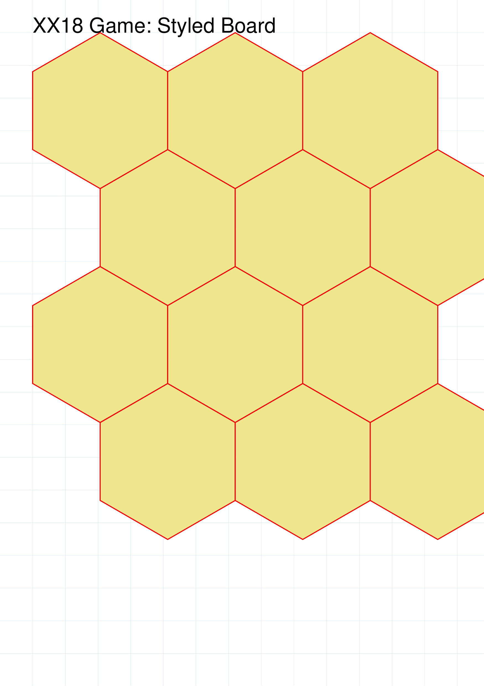
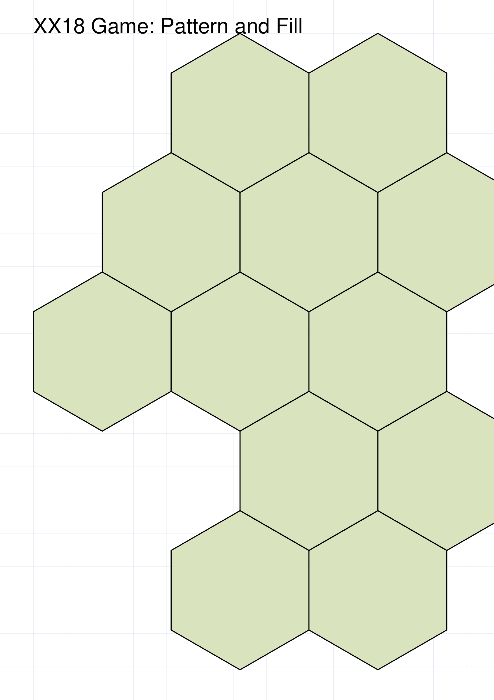

======================
XX18Game and XX18State
======================

.. |dash| unicode:: U+2014 .. EM DASH SIGN

The ``XX18tGame`` and ``XX18State`` are two of a number of commands
used to create what are termed :doc:`Compound Objects <index>`.

This section assumes you are very familiar with the concepts, terms and ideas
for :doc:`protograf <../index>`  as presented in the
:doc:`Basic Concepts <../basic_concepts>` , that you understand all of the
:doc:`Additional Concepts <../additional_concepts>` and that you've created some
basic scripts of your own using the :doc:`Core Shapes <../core_shapes>`. You
should also be familiar with the various types of shapes' properties described in
the :doc:`Customised Shapes <../customised_shapes>`.

.. _xx18Index:

- `Overview`_
- `Background`_
- `Features`_
- `XX18Game Command`_

    - `XX18Game Properties`_
    - `XX18Game Board: Grid`_

        - *Grid Orientation and Offset*
        - *Grid Coordinates and Labels*

    - XX18Game Board: Features
    - XX18Game Board: Functions
    - XX18Game Board: AdHoc Drawing

    - `XX18Game Board: Hexagonal`_
- `XX18Game Command`_
- `18xx Resources`_

.. _xx18Backround:

Background
==========

**protograf** is a general purpose tool and is not designed to produce prototypes
for specific games.  However, there are hundreds of games in the 18XX series, and
so it seemd worthwile was worth developing custom functionality to allow this
type of game to be more easily prototyped.

The very first game in the series was *1829*, designed by Francis Tresham, and
published in 1974.  It was the forerunner to the series, but the game that has
really provided the foundation for all the ones that came after was *1830*,
developed by Avalon Hill in collaboration with Francis Tresham.

*1830* also set the tone of the graphic design that has been used in many of the
games in the series and the prototyping capability provided here is modeled
after that design.

.. _xx18Over:

Overview
========
`↑ <abstractIndex_>`_

The aim of the ``XX18Game`` and ``XX18Game`` commands is to allow
diagrams for many of the 18Xx series of games to be easily created.

The ``XX18Game`` command allows for the details of the board and features
for such a game to be specified.  However, an ``XX18Game`` is **not**
designed to be drawn |dash| it can be thought of as the game being
"still in the box".

The ``XX18Game`` command will, when supplied with a previously defined
``XX18Game``, to show the board, along with any other components, such
as tiles, and, optionally, annotated or marked.

.. _xx18game-features:

Features
========

Below is a short summary of the features available.

The ``XX18Game()`` command can depict:

* towns as filled-in, black circles, or rectangles
* cities (different sizes) as white circles; may include
  the railroad logo or a custom shape or text inset into it
* revenue as an open (default) circle with an amount
* track, curved or straight
* track extending from a point to an edge
* terminal spikes running off-board (short, medium and long)
* blocked hex-sides as thick lines
* a highlighted hex as a yellow band inside of all hex edges
* private railways; either in-hex or across hexes
* icons for common in-hex features; including mountains
  (two sizes), hills, and rivers
* symbols for special features such as: coal, desert, factory, fish,
  flag, forest, hills, lock, mine, noentry, oil, pennant, port,
  swamp, train, tree, tunnel
* a river; as "wavy line"; running through a hex
* a custom shape in a hex
* a single piece of text
* hex coordinates along the edges of the map (above, below,
  left-of, and right-of)
* a whole, colored-in hex
* a small, multi-line, colored table to appear in an off-board
  hexagon or area (showing revenue per phase of the game)

The command also provides:

* standard, named 18xx colors
* the ability to load different map font names & sizes, or colors to use,
  from a settings file
* simple labelling for use with icons, symbols, towns or cities

In-hex features, for example, cities, towns, icons, symbols or lettering will,
by default, appear at the centre of a hex. These can be repositioned using a
combination of direction (in degrees clockwise from east) and distance (as a
fraction of the hex radius).

Positioning of features, such as lines, spikes, bumps or numbered circles, on
hex edges will be done using standard compass directions; "ne" for northeast,
"s" for south, etc., and will be centred on that edge.

Drawing of features is done following the order in which they are provided.

Setting of an off-board, colored, rectangular, or polyshape area |dash|
typically reddish and extending from the edge of the board hexagons |dash| is
not handled directly by the ``XX18Game()`` command.  There is simply too much
variation in how such areas are drawn to use a common formula.  What **is**
possible is to use the grid references and hexagon geometry to set the
vertices of such shapes relative to the board.


.. _xx18game-command:

XX18Game Command
================
`↑ <abstractIndex_>`_

The ``XX18Game()`` command defines the parts of an 18XX game; primarily
the construction and styling, of the board and features.

The overall **size** of the board is set by a combination of rows and
columns.

.. NOTE::

  The hexagonal locations on the board are termed **cells** in this guide.

- `XX18Game Properties`_
- `XX18Game Board: Grid`_
- `XX18Game Board: Hexagonal`_


.. _xx18GameProperties:

XX18Game Properties
-------------------
`^ <xx18game-command_>`_

The key properties that can be set for an ``XX18Game()`` command are:

* *cols*: this is the number of cells in the horizontal direction, for a
  regular layout; a default of ``8`` is used
* *rows*: then this is the number of cells, in the vertical direction,
  for a regular layout; a default of ``8`` is used
* *pattern*: an on/off design showing which cells should be used and which
  should be blank i.e. unused
* *orientation*: whether the edges of the hexes are parallel to the top of
  the mapbard ("flat") or pointing at it ("pointy"); the default of "pointy"
  matches that of *1830*
* *fill*: the default color with which most of the hexagons will be filled;
  by default this is white, but many maps use a light brown or light green.

.. IMPORTANT::

    Unlike many other shapes or objects in **protograf**, the *height* property
    is used to set the height of a cell on the board, and **not** the height
    of the board itself |dash| this being derived from the combination of
    the number of rows and columns as well the cell *height*.

Other useful properties that can be set for an XX18Game are:

* *side*: sets the length of the side of a single hexagon; by default this is
  slighly less than 1 inch (2.3864 cm)
* *label*: if ``True``, draw labels around the board's edges; use the
  normal styling options for a label; *label_font*, *label_size*,
  *label_stroke* etc.
* *label_position*: the sides of the board along which the labelling runs; this
  can be: *top-left* (``TL``) |dash| the default |dash| *bottom-left* (``BL``),
  *bottom-right* (``BR``) or *top-right* (``TR``).
* *label_offset*: how far away label are drawn from the board edge(s); if not
  set, this is calculated based on the label's font size
* *settings*: this is the name of JSON file, including its path, that can be
  used to override some of the default sizes and style of features

.. NOTE::

    The default settings for an XX18Game are:

    * *rows*: ``8``
    * *cols*: ``8``
    * *side*: about 1 inch (2.3864 cm)


.. _xx18GameGrid:

XX18Game Board: Base Grid
-------------------------
`^ <xx18game-command_>`_

Below are some examples of  18XX boards.  There are further examples in
the section on the `XX18Game Command`_.


Example 1. Default Board
~~~~~~~~~~~~~~~~~~~~~~~~
`^ <abstractGameGrid_>`_

.. |ab1| image:: ../images/objects/xx18_default.png
   :width: 330

===== ======
|ab1| This example shows an ``XX18Game`` constructed using these commands:

      .. code:: python

         xx1 = XX18Game()
         XX18Game(board=xx1)

      The default settings for a board are those of a 8x8 grid of hexagons.

      As can be seen, the board is drawn when it is referenced by the *board*
      property of an ``XX18Game`` command.  In short: the ``XX18Game``
      is assigned to ``xx1`` which in turn is referenced by ``board=xx1``.

===== ======


Example 2. Board Size, Color and Position
~~~~~~~~~~~~~~~~~~~~~~~~~~~~~~~~~~~~~~~~~
`^ <abstractGameGrid_>`_

.. |ab2| image:: ../images/objects/xx18_size_position.png
   :width: 330

===== ======
|ab2| This example shows ``XX18Game`` used with these commands:

      .. code:: python

        agsp = XX18Game(
            x=0, y=0,
            side=0.25,
            rows=3, cols=3,
            fill="khaki"
        )
        XX18Game(board=agsp)

        ahsp = XX18Game(
            name="hexagons",
            x=4, y=4,
            height=1.25,
            rows=3, cols=3,
            fill="berylgreen"
        )
        XX18Game(board=ahsp)

      Each of the two boards shown have their own *rows*, *cols* and *height*
      values set in order to determine their size.

      Each of the two boards shown make use of custom *x* and *y* values to
      set their position on the page.

      Each of the boards sets the default color of the cells to a light
      brown and light green, respectively, via the *fill* property. It
      is also possible to choose from the built-in 18XX colors.

      The board on the lower-right also has the *name* set to ``hexagons``
      in order to change its layout; more example of these types can be
      seen in :ref:`Hexagonal XX18Game Boards <abstractGameHexagonal>`.

      As can be seen, the boards are drawn when the name assigned to them is
      referenced by the *board* property of the ``XX18Game`` commands
      (``agsp`` and ``ahsp`` respectively).

===== ======


Example 3. Styled Board
~~~~~~~~~~~~~~~~~~~~~~~
`^ <abstractGameGrid_>`_



===== ======
|ab3| This example shows an ``XX18Game`` constructed using these commands:

      .. code:: python

        ags = XX18Game(
            label=True,
            label_stroke="blue"
        )
        XX18Game(board=ags)

      The default board size is a 8x8 ``grid`` of square cells; in this
      example the type of board is explicitly set by its *name* property.

      In this case, the board is further styled by setting:

      - *label* - if ``True``, the labels will be drawn
      - *label_stroke* - the color of the labels

      The *label_start* defaults to the *bottom-left* (``BL``),
      and the *label_type* defaults to  *alpha-numeric* (``AN```); so
      letters for the columns go from left to right along the bottom edge
      and numbers for the rows increase from ``1`` up along the left edge.

      As can be seen, the board is drawn when the name assigned to it
      (``ags``) is referenced by the *board* property of an
      ``XX18Game`` command.

===== ======


Example 4. Board with custom areas
~~~~~~~~~~~~~~~~~~~~~~~~~~~~~~~~~~
`^ <abstractGameGrid_>`_

.. |ab4| image:: ../images/objects/xx18_chess_custom_board.png
   :width: 330

===== ======
|ab4| This example shows an ``XX18Game`` constructed using these commands:

      .. code:: python

        htch = Default(
            hatches='ne',
            hatches_count=15,
            hatches_stroke_width=1,
            hatches_stroke="dimgray")
        sqr = Default(
            fill="white",
            stroke=None,
            height=1,
            width=1)

        agcb = XX18Game(
            name="chess",
            areas=[
                rectangle(default=sqr),
                rectangle(default=[sqr, htch])
            ]
        )
        XX18Game(board=agcb)

      In this example the type of ``XX18Game`` board is set by its
      *name* property to ``chess``.

      This board appears as a square layout of 8 rows by 8 columns
      such is used for a regular game of Chess.

      In addition, the *areas* for the board are supplied as a list of
      two customised rectangles.  These are drawn in turn at alternating
      positions on the underlying row/column grid.

      Each rectangle has the same shape, as set by the
      :ref:`Default() <the-default-command>` command named ``sqr``, but
      the second one also contains a series of :ref:`hatches <rectHatches>`,
      as set by the :ref:`Default() <the-default-command>` command
      named ``htch``.

      Because the Chess tiling pattern is a snake-like one, starting at the
      upper-left and then wrapping around at the end of each row, these
      rectangle shapes appear at different positions on alternating rows.

===== ======


Example 5. Board with cell shape
~~~~~~~~~~~~~~~~~~~~~~~~~~~~~~~~
`^ <abstractGameGrid_>`_

.. |ab5| image:: ../images/objects/xx18_hexagons_cell_shape.png
   :width: 330

===== ======
|ab5| This example shows an ``XX18Game`` constructed using these commands:

      .. code:: python

        ags = XX18Game(
            name="hexhex",
            hexes=4,
            label=True,
            cell_shape=circle(
                radius=0.56,
                stroke="red",
                stroke_width=1),
            stroke="white",
            label_stroke="grey",
        )
        XX18Game(board=ags)

      The *cell_shape* property is assigned to another shape |dash| one which
      has a centre |dash| and this is drawn at the centre of each hexagon.

      By setting the *stroke* to white, the hexagonal grid becomes "invisible",
      effectively leaving the circles as the only visible grid cells.

===== ======


.. _xx18GameHexagonal:

XX18Game Board: Hexagonal
-------------------------
`^ <xx18game-command_>`_

A grid made up hexagons is used in a number of abstract games.  There are
different styles, or type of hexagonal grids, all referenced through the
board's *name* property.


Example 1. Rectangular Hexagonal Grid
~~~~~~~~~~~~~~~~~~~~~~~~~~~~~~~~~~~~~
`^ <abstractGameHexagonal_>`_

.. |ah1| image:: ../images/objects/xx18_hexagons_default.png
   :width: 330

===== ======
|ah1| This example shows an ``XX18Game`` constructed using these commands:

      .. code:: python

        aghd = XX18Game(
            name="hexagons",
            label=True)
        XX18Game(board=aghd)

      The default hexagonal board size is a 8x8 arrangement of hexagonal
      cells in a "pointy" orientation.

      As shown, this type of board is  set via its *name* property to
      ``hexagons`` |dash| a *name* property of ``hexagonal`` can also be
      used.

      Setting ``label=True`` activates the default labellng; stating at the
      bottom-left of the grid, letters are assigned to the diagonally-sloping
      columns, and numbers to the rows.

===== ======


Example 4. Pattern Grid
~~~~~~~~~~~~~~~~~~~~~~~
`^ <abstractGameHexagonal_>`_

If a hexagonal grid for a game contains a custom number of hexagons,
that may vary across the rows of the board, then a pattern design,
or layout, can be defined for the ``XX18Game``.

A pattern grid uses a cell-and-dot notation which is set with the
*pattern* property.

This notation represents each row as separate line, with each regular, or
normal hexagon with a ``O`` (the letter "oh"), and each blank, or missing,
cell with a ``.`` (dot or full stop).

There should be as many lines in the pattern as are set in the *rows* value
for the ``XX18Game``. Similarly, the total combined number of hexagons
and blanks, in any given line, must match the *cols* value.

The best way to represent multi-line list of characters such as this is by
starting and ending the pattern definition with triple quotes |dash| ``"""``.

Note that empty lines and "whitespace" at the start and end of a pattern will
be ignored; as is any whitespace on a line.

If a row on the board contains only hexagons, this can be shown with a
single ``O`` (capital "oh").




===== ======
|ah4| This example shows an ``XX18Game`` constructed using these commands:

      .. code:: python

        aghp = XX18Game(
            name="hexagons",
            rows=5,
            cols=7,
            pattern = """
            . O O . O O .
             O O O O O O .
            O O . O . O O
             O O O O O O .
            . O O . O O .
            """)
        XX18Game(board=aghp)

      In this example the type of board is set via its *name* property to
      ``hexagons``.

      The *pattern* property shows, in string format, an arrangement of
      hexagonal cells (``O``) and empty cells (``.``).

      Note that the spaces in the pattern are ignored when constructing the
      board; they are just used to help visualise the pattern being created.

      .. NOTE::

          It is important that the correct number of *rows* and *cols* are
          set; the pattern has to fit **exactly** into these dimensions.

===== ======


.. _xx18state-command:

XX18Game Command
================
`↑ <abstractIndex_>`_

The ``XX18Game()`` command will create a display of a board and its pieces
that have been defined in an :ref:`XX18Game <xx18game-command>`. This
display represents a given point during the play of an abstract game |dash| a
situation commonly referred to as "the game state".

- `XX18Game Properties`_
- `XX18Game Positions`_
- `XX18Game Annotations`_
- `XX18Game Markers`_
- `XX18Game Examples`_


.. _xx18StateProperties:

XX18Game Properties
-------------------
`^ <xx18state-command_>`_

The properties that can be set for an XX18Game command are:

* *board*: an ``XX18Game`` object; this is a required setting and the
  XX18Game object cannot be displayed without it
* *positions*: details of where an XX18Game's pieces go on the board;
  see below for details
* *setup*: if set to ``True``, and the game is one whose initial position is
  stored in **protograf**, then the pieces will be assigned to the board to
  match that predefined setup
* *annotations*: a list of XX18Game annotations; see below for details
* *markers*: a list of XX18Game markers; see below for details


.. _xx18StatePositions:

XX18Game Positions
------------------
`^ <xx18state-command_>`_

The *positions* property of an XX18Game indicates where the pieces |dash|
as defined for the XX18Game by the shapes, icons or images associated with
a character |dash| are placed.

The notation for doing this is by providing a string of characters in one
of two different notational styles.

.. _xx18StateFEN:

FEN-like Notation
~~~~~~~~~~~~~~~~~
`^ <abstractStatePositions_>`_

This notation is based on the **Chess** notation called "FEN" (see:
https://en.wikipedia.org/wiki/Forsyth%E2%80%93Edwards_Notation)
in which the characters, representing pieces, are separated by a combination
of numbers, to represent consecutive blank cells, and/or ``/`` (forward slash)
characters to mark the end of a row.

For example, a **Chess** game might have:

.. code:: python

   positions = "rnbqkbnr/pppppppp/8"

to represent three rows |dash| the Black pieces as setup at the start of
the game |dash| as well as the unoccupied row in front of the Black pawns.

If there are more than nine adjacent blank cells in a row, as there might be in
a game of **Go**, then use multiple numbers, for example:

.. code:: python

   positions = "9B9/B99"

This represents a situation where the first row has 9 empty points, a Black
stone, and then 9 empty points; whereas the second row has a Black stone,
followed by 9 empty points, and then another 9 empty points |dash| 18
empty points in total.

The FEN-like notation is converted internally by **protograf** into
`Row-and-Dot Notation`_.


.. _xx18StateRowDot:

Row-and-Dot Notation
~~~~~~~~~~~~~~~~~~~~
`^ <abstractStatePositions_>`_

This notation represents each **row** as separate line, and each blank
cell with a ``.`` (**dot** or full stop).

The best way to represent a multi-line list of characters such as this is
by starting and ending all the lines with triple quotes |dash| ``"""``.

For example:

.. code:: python

   positions = """
   r.bqkb.r
   .ppppppp
   """

would show two rows near the start of a **Chess** game where Black has
moved both Knights and one Pawn.

Note that empty lines, as well as "whitespace" at the start and end of any
line, are ignored.

If a row on the board contains **no** pieces, this can be shown with a single
``.`` (dot or full stop).


.. |sp1| image:: ../images/objects/xx18_chess_positions.png
   :width: 330

===== ======
|sp1| This example shows an ``XX18Game`` constructed using these commands:

      .. code:: python

        agcp = XX18Game(name="chess")
        XX18Game(
            board=agcp,
            positions="""
            r..qr.k.
            p....pbp
            bp...np.
            ...p....
            .
            BPN.P.P.
            P.Q.NnBP
            R..R..K.
            """
        )

      In this example the type of board is set via its *name* property to
      ``chess``.  This results in the default grid with alternating colored
      squares.

      The *positions* property of XX18Game is used to show **Chess**
      pieces on the board; in this case, the "state" at the end of move 15
      in the 1963/64 USA Chess Championship with R.J. Fischer (Black) playing
      R.E. Byrne (White).

===== ======


.. _xx18StateAnnotations:

XX18Game Annotations
--------------------
`^ <xx18state-command_>`_

An annotation is typically an :ref:`element <element-concept>` that needs to
be drawn to customise the board in some way |dash| this can be via text,
a shape or an image.  For example, a cross can be drawn in the centre square
of the board.

Annnotations are always drawn **before** any `XX18Game Markers`_ or
any pieces that may appear on the board.

.. _xx18StateLocations:

Annnotations Locations
~~~~~~~~~~~~~~~~~~~~~~

Although it is possible to use the **protograf** absolute
:ref:`positioning <position-concept>` notation to annotate the board, a more
convenient way is to use a **board.reference.position** notation.  In this
notation, the name assigned to the board is used first, followed by a dot,
then the grid reference as set by the labelling method, followed by a dot,
and then the position on the cell at that grid reference.

For example, given a normal board, the upper left hexagon, assuming it is
not a blank, will be referred to as ``A1``.

So the position |dash| the x- and y- coordinates |dash| of the centre of
that hex, for an ``XX18Game`` named ``xx02`` would be ``xx02.A1.c``.

The various positions for a hexagonal cell, there are  n (north), s (south),
ne (north-east), nw (north-west), sw (south-west), and se (south-east),
as well as c (centre/center).

.. |sp2| image:: ../images/objects/xx18_grid_annotations.png
   :width: 330

===== ======
|sp2| This example shows an ``XX18Game`` constructed using these commands:

      .. code:: python

        aga = XX18Game(
            label=True,
            rows=6, cols=6,
            default=thick
        )
        cross = Common(
            side=aga.a6.ht,
            stroke_width=0.5,
            hatches='d',
            hatches_count=2,
            hatches_stroke='red',
            hatches_stroke_width=1.5)
        annotations = [
            square(cxy=aga.a6.c, common=cross),
            square(cxy=aga.f6.c, common=cross),
            square(cxy=aga.a1.c, common=cross),
            square(cxy=aga.f1.c, common=cross),
            circle(cxy=aga.c3.ne,
                   fill_stroke="red",
                   transparency=50),
        ]
        XX18Game(
            board=aga,
            annotations=annotations,
        )

      In this example, *annotations* for the board are defined with a list
      of shapes: a :ref:`circle <circle-command>` and four
      :ref:`squares <square-command>`.  These have some styling added |dash|
      color and transparency for the circle and :ref:`hatches <rectHatches>`
      for the squares.

      The centre locations of the shapes being used for the annotations are
      set with their *cxy* property.  This property's value uses the
      **board.reference.position** notation described earlier to place the
      shape on the board.  For example, the circle's centre is set to the
      north-east corner of cell ``c3``.

===== ======


.. _xx18StateMarkers:

XX18Game Markers
----------------
`^ <xx18state-command_>`_

A marker is typically an :ref:`element <element-concept>` that needs to be
shown to draw attention to some aspect of the current state of the board and
its pieces |dash| this can be via text, a shape or an image.   For example,
an arrow can be drawn to show how a piece can, or should, move from one
square to another.

Markers are always drawn **after** any `XX18Game Annotations`_ and
**after** any pieces that may appear on the board.

Markers are supplied as a list of **protograf** shapes, whose position is
set in the same way as :ref:`Annnotations Locations <xx18StateLocations>`.


.. |sp3| image:: ../images/objects/xx18_grid_chess_markers.png
   :width: 330

===== ======
|sp3| This example shows an ``XX18Game`` constructed using these commands:

      .. code:: python

        amca = XX18Game(
            name="chess",
            label=True
        )
        XX18Game(
            board=amca,
            positions='8/8/8/8/3N4/8/8/8',
            markers=[
                dot(cxy=amca.d4.c, fill_stroke="red", dot_width=5),
                line(
                    links=[amca.d4.c, amca.d6.c, amca.e6.w],
                    stroke="red",
                    stroke_width=2),
                square(
                    cxy=amca.e6.c,
                    height=0.9,
                    width=0.9,
                    stroke="red",
                    stroke_width=2),
            ]
        )

      In this example, a **Chess** game shows three markers being used:

      1. The **dot** shape appears at the centre of the Knight's square,
      2. The **line** shape uses the *links* property to join the centre
         of the two squares making up the first part of the Knight's move
         and ending at the west-edge of square ``e6``.
      3. The **square** shape is drawn with its centre in square ``e6``.

      All shapes are given a *stroke* color of ``red``, and the line and
      square are drawn with a *stroke_width* of 2.

===== ======

.. _xx18StateMarkersShortcuts:

XX18Game Markers Shortcuts
~~~~~~~~~~~~~~~~~~~~~~~~~~

Although the above method for setting markers is very flexible, its also a
little cumbersome, particularly if only relatively simple markers need to be
used; for example, drawing a line or an arrow between cells or highlighting
the outline of a cell.

The "shortcut" approach provides a limited set of shapes, and restricts their
position to align with the cell centres; all shapes (except for the dot) are
sized to just fit inside the cell.

The shortcuts, prefixed by one or two letters are:

- ``a``: draw an **arrow** between two cells
- ``ac``: draw an **arrow**, with a curve, between two cells
- ``l``: draw a **line** between two cells
- ``lc``: draw a **line**, with a curve, between two cells
- ``c``: draw a **circle** inside a cell
- ``d``: draw a **dot** inside a cell
- ``s``: draw a **square** inside a cell
- ``h``: draw a **hexagon** inside a cell
- ``x``: draw an **X** inside a cell (between diagonally opposite vertices)

These shapes are always drawn in "outline" mode; that is to say, there is
no fill color for the area shapes.

The other shortcut that can be used is that of a color, referenced by its
:ref:`RGB hexadecimal <termsColor>` value. This is a single color used to fill
the cell |dash| a hexagon on a hexagonal board and a square on a grid board.
(Note that, unlike in most other places in **protograf**, the hexadecimal form
is the only way to specify color here.)

Along with this prefix, there also needs to be a reference for at least one
cell or, in the case of line or arrow, a reference for at least two cells
|dash| the start and end locations.  For all shortcuts, it is possible to
supply a list of multiple locations in which that shape appears.

All these details appear together in a single string for a single shape, and
one or these strings is then assigned to the *markers* property list, and
is drawn in that order.

Some basic customisation is possible:

- *markers_stroke*: sets the color of all the shortcut markers; this defaults
  to ``yellow``
- *markers_fraction*: sets the width of all the shortcut markers lines as a
  fraction of the cell size; this defaults to ``0.1`` (one tenth)
- *markers_transparency*: sets the transparency of all the shortcut markers;
  this defaults to no transparency

The two different styles of creating markers can be mixed together in the
same list.


.. |sp4| image:: ../images/objects/xx18_hexagons_markers_shortcuts.png
   :width: 330

===== ======
|sp4| This example shows an ``XX18Game`` constructed using these commands:

      .. code:: python

        aml = XX18Game(
            rows=4,
            col=4,
            side=0.25,
            label=True,
        )
        XX18Game(
            board=aml,
            markers_transparency=50,
            markers=[
                'a a1 c1',
                'ac a1 c2',
                'd a3',
                'l b4 b3 c5 c4',
                'lc c4 e5',
                'c c3',
                'h e4',
                's d2',
                'x a2',
                '#7FFF00 d5 b2',
            ]
        )

      In this example, markers are drawn with default color and stroke
      thickness, but the *markers_transparency* is set to ``50`` percent.

      Markers are drawn on a ``hexhex`` board; as can be seen, the square
      marker does not really suit this style of cell.

      In this example, the *l* (line) marker has a number of different
      grid references included |dash| this means that a continuous line
      is drawn between the centre of each cell in the sequence.  This
      drawing method is making use of a Line's
      :ref:`Links <lineLinksShapes>` property.

      In this example, two cells |dash| ``b2`` and ``d5`` |dash| are
      completely "colored in" with a green color defined by ``#7FFF00``.

===== ======

.. |sp5| image:: ../images/objects/xx18_grid_markers_shortcuts.png
   :width: 330

===== ======
|sp5| This example shows an ``XX18Game`` constructed using these commands:

      .. code:: python

        amg = XX18Game(
            cols=2,
            rows=2,
            label=True,
        )
        XX18Game(
            board=amg,
            markers_stroke="red",
            markers_fraction=0.05,
            markers=[
                'a a1 c1',
                'ac a1 c2',
                'd a3 d3 e1',
                'l b4 a5 b5 c4',
                'lc c4 e5',
                'c c3',
                'h e4',
                's d2',
                'x a2',
            ]
        )

      In this example, the markers styles are changed: *markers_stroke*
      (their color) is set to ``red``; while the *markers_fraction* is set to
      ``0.05`` |dash| the line thickness relative to the cell size.

      Markers are drawn on a ``grid`` board; as can be seen, the hexagon
      marker does not really suit this style of cell.

      In this example, the *d* (dot) marker has a number of different
      grid references listed with it |dash| this means that the dot is
      drawn at the centres of all of those cells.

===== ======


.. _xx18-resources:

18xx Resources
==============
`↑ <abstractIndex_>`_
