======================
XX18Game and XX18State
======================

.. |dash| unicode:: U+2014 .. EM DASH SIGN

The ``XX18Game`` and ``XX18State`` are two of a number of commands
used to create what are termed :doc:`Compound Objects <index>`.

This section assumes you are very familiar with the concepts, terms and ideas
for :doc:`protograf <../index>`  as presented in the
:doc:`Basic Concepts <../basic_concepts>` , that you understand all of the
:doc:`Additional Concepts <../additional_concepts>` and that you've created some
basic scripts of your own using the :doc:`Core Shapes <../core_shapes>`. You
should also be familiar with the various types of shapes' properties described in
the :doc:`Customised Shapes <../customised_shapes>`.  Being familiar with
:doc:`Hexagonal Grids <../hexagonal_grids>` will also help with understanding
how an 18xx game board is created and used.

.. _xx18Index:

- `Background`_
- `Overview`_
- `Features`_
- `XX18Game Command`_

    - `XX18Game Properties`_
    - `XX18Game Board Grid`_
    - `XX18Game Features`_
    - `XX18Game JSON Styles`_
    - `XX18Game Functions`_
    - `XX18Game AdHoc Drawing`_

- `XX18State Command`_
- `18xx Advanced Tips and Options`_
- `18xx Resources`_


.. _xx18Backround:

Background
==========
`↑ <xx18Index_>`_

**protograf** is a general purpose tool and is not designed to produce prototypes
for specific games.  However, there are hundreds of games in the 18xx series of
railroad board games, and so it seemed worthwhile developing custom functionality
to allow this type of game to be more easily prototyped.

The very first game in the series was *1829*, designed by Francis Tresham, and
published in 1974.  It was the forerunner to the series, but the game that has
really provided the foundation for all the ones that came after was *1830*,
developed by The Avalon Hill Game Company in collaboration with Francis Tresham.

*1830* also set the style for the graphic design that has been used in many of
the games in the series and the prototyping capability provided here is modeled
after that design.

.. _xx18Over:

Overview
========
`↑ <xx18Index_>`_

The aim of the ``XX18Game`` and ``XX18Game`` commands is to allow
diagrams for many of the 18Xx series of games to be easily created.

The ``XX18Game`` command allows for the details of the board and features
for such a game to be specified.  However, an ``XX18Game`` is **not**
designed to be drawn |dash| it can be thought of as the game being
"still in the box".

The ``XX18Game`` command will, when supplied with a previously defined
``XX18Game``, to show the board, along with any other components, such
as tiles, and, optionally, annotated or marked.

.. _xx18game-features:

Features
========
`↑ <xx18Index_>`_

Below is a short summary of the features available.

The ``XX18Game()`` command can depict:

* towns as filled-in, black circles, or rectangles
* cities (different sizes) as white circles; may include
  the railroad logo or a custom shape or text inset into it
* revenue as an open (default) circle with an amount
* track, curved or straight
* track extending from a point to an edge
* terminal spikes running off-board (short, medium and long)
* blocked hexagon-sides as thick lines
* a highlighted hexagon as a yellow band inside all the hexagon edges
* private railways; either in-hexagon or across hexagons
* icons for common in-hexagon features; including mountains
  (two sizes), hills, and rivers
* symbols for special features such as: coal, desert, factory, fish,
  flag, forest, hills, lock, mine, noentry, oil, pennant, port,
  swamp, train, tree, tunnel
* a river; as "wavy line"; running through a hexagon
* a custom shape in a hexagon
* a single piece of text
* hexagon coordinates along the edges of the map (above, below,
  left-of, and right-of)
* a whole, colored-in hexagon
* a small, multi-line, colored table to appear in an off-board
  hexagon or area (showing revenue per phase of the game)

The command also provides:

* standard, named 18xx colors
* the ability to load different map font names & sizes, or colors to use,
  from a settings file
* simple labelling for use with icons, symbols, towns or cities

In-hexagon features, for example, cities, towns, icons, symbols or lettering will,
by default, appear at the centre of a hexagon. These can be repositioned using a
combination of direction (in degrees clockwise from east) and distance (as a
fraction of the hexagon radius).

Positioning of features, such as lines, spikes, bumps or numbered circles, on
hexagon edges will be done using standard compass directions; "ne" for northeast,
"s" for south, etc., and will be centred on that edge.

Drawing of features is done following the order in which they are provided.

Setting of an off-board, colored, rectangular, or polyshape area |dash|
typically reddish and extending from the edge of the board hexagons |dash| is
not handled directly by the ``XX18Game()`` command.  There is simply too much
variation in how such areas are drawn to use a common formula.  What **is**
possible is to use the grid references and hexagon geometry to set the
vertices of such shapes relative to the board.


.. _xx18game-command:

XX18Game Command
================
`↑ <xx18Index_>`_

The ``XX18Game()`` command defines the parts of an 18xx game; primarily
the construction and styling, of the board and features.

The overall **size** of the board is set by a combination of rows and
columns.

.. NOTE::

  The hexagonal locations on the board are termed **cells** in this guide.


.. _xx18GameProperties:

XX18Game Properties
-------------------
`^ <xx18game-command_>`_

The key properties that can be set for an ``XX18Game()`` command are:

* *cols*: this is the number of cells in the horizontal direction, for a
  regular layout; a default of ``8`` is used
* *rows*: then this is the number of cells, in the vertical direction,
  for a regular layout; a default of ``8`` is used
* *fill*: the default color with which most of the hexagons will be filled;
  by default this is white, but many maps use a light brown or light green.
* *features*: the "things" that need to be drawn on the board; there are
  :ref:`many possible features <xx18GameFeatures>`
* *orientation*: whether the edges of the hexagons are parallel to the top of
  the mapbard ("flat") or pointing at it ("pointy"); the default of "pointy"
  matches that of *1830*
* *pattern*: an on/off design showing which cells should be used and which
  should be blank i.e. unused

.. IMPORTANT::

    Unlike many other shapes or objects in **protograf**, the *height* property
    is used to set the height of a hexagon on the board, and **not** the height
    of the board itself |dash| this being derived from the combination of
    the number of rows and columns as well the hexagon *height*.

Other useful properties that can be set for an XX18Game are:

* *side*: sets the length of the side of a single hexagon; by default this is
  slighly less than 1 inch (2.3864 cm)
* *label*: if ``True``, draw labels around the board's edges; use the
  normal styling options for a label; *label_font*, *label_size*,
  *label_stroke* etc.
* *label_position*: the sides of the board along which the labelling runs; this
  can be: *top-left* (``TL``) |dash| the default |dash| *bottom-left* (``BL``),
  *bottom-right* (``BR``) or *top-right* (``TR``).
* *label_offset*: how far away label are drawn from the board edge(s); if not
  set, this is calculated based on the label's font size
* *settings*: this is the name of JSON file, including its path, that can be
  used to override some of the default sizes and style of features

.. NOTE::

    The default settings for an XX18Game are:

    * *rows*: ``8``
    * *cols*: ``8``
    * *side*: about 1 inch (2.3864 cm)


.. _xx18GameGrid:

XX18Game Board Grid
-------------------
`^ <xx18game-command_>`_

Below are some examples of how to set the basic parameters for the hexagonal
grid that is used for all 18xx game boards.


Example 1. Default Board
~~~~~~~~~~~~~~~~~~~~~~~~
`^ <xx18GameGrid_>`_

.. |ab1| image:: ../images/objects/xx18_default.png
   :width: 330

===== ======
|ab1| This example shows an ``XX18Game`` constructed using these commands:

      .. code:: python

         xx1 = XX18Game()
         XX18Game(board=xx1)

      The default settings for a board are those of a 8x8 grid of hexagons.

      As can be seen, the board is drawn when it is referenced by the *board*
      property of an ``XX18Game`` command.  In short: the ``XX18Game``
      is assigned to ``xx1`` which in turn is referenced by ``board=xx1``.

===== ======


Example 2. Board Size, Color and Position
~~~~~~~~~~~~~~~~~~~~~~~~~~~~~~~~~~~~~~~~~
`^ <xx18GameGrid_>`_

.. |ab2| image:: ../images/objects/xx18_size_position.png
   :width: 330

===== ======
|ab2| This example shows ``XX18Game`` used with these commands:

      .. code:: python

        agsp = XX18Game(
            x=0, y=0,
            side=0.25,
            rows=3, cols=3,
            fill="khaki"
        )
        XX18Game(board=agsp)

        ahsp = XX18Game(
            name="hexagons",
            x=4, y=4,
            height=1.25,
            rows=3, cols=3,
            fill="berylgreen"
        )
        XX18Game(board=ahsp)

      Each of the two boards shown have their own *rows*, *cols* and *height*
      values set in order to determine their size.

      Each of the two boards shown make use of custom *x* and *y* values to
      set their position on the page.

      Each of the boards sets the default color of the cells to a light
      brown and light green, respectively, via the *fill* property. It
      is also possible to choose from the built-in 18xx colors.

      The board on the lower-right also has the *name* set to ``hexagons``
      in order to change its layout; more example of these types can be
      seen in :ref:`Hexagonal XX18Game Boards <abstractGameHexagonal>`.

      As can be seen, the boards are drawn when the name assigned to them is
      referenced by the *board* property of the ``XX18Game`` commands
      (``agsp`` and ``ahsp`` respectively).

===== ======


Example 3. Styled Board
~~~~~~~~~~~~~~~~~~~~~~~
`^ <xx18GameGrid_>`_

.. |ab3| image:: ../images/objects/xx18_styled.png
   :width: 330

===== ======
|ab3| This example shows an ``XX18Game`` constructed using these commands:

      .. code:: python

        ags = XX18Game(
            rows=4, cols=3,
            x=1.5, y=2,
            label=True,
            label_size=24,
            fill="khaki",
            stroke="red",
            stroke_width=3
        )
        XX18Game(board=ags)

      In this case, the 18xx board is further styled by setting:

      - *rows* - the number of rows in the grid
      - *cols* - the number of columns in the grid
      - *x* and *y* - set the offset of the top-left of the grid from
        the page margins
      - *label* - if ``True``, the labels will be drawn
      - *label_stroke* - the color of the labels
      - *label_size* - the point height of the labels
      - *fill* - the default color of the hexagons
      - *stroke* - the default color for lines and labels
      - *stroke_width* - the default width of lines

      The *label_start* defaults to the *above-left* (``AL``), so
      letters for the rows go from top to bottom along the left edge, and
      numbers for the columns increase from ``1`` starting at the top-left.

      As can be seen, the board is drawn when the name assigned to it
      (``ags``) is referenced by the *board* property of an
      ``XX18Game`` command.

===== ======


Example 4. Pattern Grid
~~~~~~~~~~~~~~~~~~~~~~~
`^ <xx18GameGrid_>`_

While the extent of an 18xx game board may stretch across a number of
hexagons for both rows and columns, typically there are also unused
hexagons in that grid, because the outline is meant to conform to some
underlying terrain e.g. the borders of a state, country or even a
continent.

To achieve this effect, a *pattern* design must be created that uses a
circle-and-dot notation. This notation represents each row as separate line,
showing each regular, or normal, hexagon with a ``O`` (the letter "oh"),
and each blank, or missing, hexagon with a ``.`` (dot or full stop).

There should be as many lines in the pattern as are set in the *rows* value
for the ``XX18Game``. Similarly, the total combined number of hexagons
and blanks, in any given line, must match the *cols* value.

The best way to represent multi-line list of characters such as this is by
starting and ending the pattern definition with triple quotes |dash| ``"""``.

Note that empty lines and "whitespace" at the start and end of a pattern will
be ignored; as is any whitespace on a line.

If a row on the board contains only hexagons, this can be shown with a
single ``O`` (capital "oh").


.. |ah4| image:: ../images/objects/xx18_hexagons_pattern.png
   :width: 330

===== ======
|ah4| This example shows an ``XX18Game`` constructed using these commands:

      .. code:: python

        aghp = XX18Game(
            rows=5, cols=4,
            fill='berylgreen',
            pattern = """
            . O O .
             O O O .
            O O O .
             . O O .
             . O O .
            """)
        XX18Game(board=aghp)

      The *pattern* property shows, in string format, an arrangement of
      available hexagons (``O``) and empty positions (``.``).

      Note that any spaces in the pattern are ignored when constructing the
      board; they are just used to help visualise the pattern being created.

      .. NOTE::

          It is important that the correct number of *rows* and *cols* are
          set; the pattern has to fit **exactly** into these dimensions.

===== ======


.. _xx18GameFeatures:

XX18Game Features
-----------------
`^ <xx18game-command_>`_

Summary
~~~~~~~
`^ <xx18GameFeatures_>`_

An 18xx game board can display numerous features that each have different
effects on game play, inclduing cities, towns, tracks, railroads and the
labels and income associated with these, as well as host of other symbols
that help characterise hexagons.

Features are set in a list i.e. enclosed in square brackets ``[ ... ]``
and set via the *features* property.

General Feature Specification
~~~~~~~~~~~~~~~~~~~~~~~~~~~~~
`^ <xx18GameFeatures_>`_

Each feature contains two or more pieces of information as a *set* of values
enclosed in round brackets ``( ... )``. The **order of these items is vital**
and must follow the sequence below.

1. Feature **location**: this is a grid reference of one or more hexagons,
   with each reference separated by a space; for example ``A1 B4```.  In
   pointy hexagons grid, the letter is the row identifier, and in a grid
   with flat hexagons, the letter is the column identifier.
2. Feature **name**: the lowercase name of the feature, such as town, city,
   track etc.
3. Feature **offset**: by default, a feature is drawn in the centre of the
   hexagon.  By specifying an offset, the feature can be moved elsewhere in
   the hexagon. The offset is defined by a pair of values enclosed in round
   brackets ``( ... )``: direction |dash| in degrees clockwise from the east
   |dash| and distance |dash| a fraction of the hexagon's radius from the
   location's centre. For example, ``(90, 0.5)`` is point in the "south"
   direction, half-way along the radius.
4. Feature **label**:  the name or text associated with a feature; for example,
   the name of a city, or the cost associated with a mountain.
5. Feature **label location**: the place where the label is drawn relative
   to the feature, by default it is drawn below it.  Possible label locations
   are: above, below, left, or right.


This general pattern of feature specification is changed somewhat for the
following features: fill, private railroads, ???.  See the specifif feature
example and description below for details of the changes.


General Example Construction
~~~~~~~~~~~~~~~~~~~~~~~~~~~~
`^ <xx18GameFeatures_>`_

All of the feature examples follow the same overall construction, and
for sake of brevity, that construction is not repeated every time.

Essentially, each follows the approach shown in the code fragment below:
the *rows* and *cols* define the extent of the board |dash| the number of
hexagons in each direction; the *fill* sets the default color for all the
hexagons on the board; the ``label=True`` turns on the grid labels |dash|
by default, along the top and left-side of the grid; and the *label_size*
sets the font point size of those labels.

Finally, the *features* list contains the "specifications" for all the
features for that board; this is the part that differs for each example.

.. code:: python

    xgfc = XX18Game(
        rows=4, cols=3,
        fill='berylgreen',
        label=True,
        label_size=18,
        features=[
          ...
        ]
    )
    XX18State(board=xgfc)


Feature #1. Town and Mountain
~~~~~~~~~~~~~~~~~~~~~~~~~~~~~
`^ <xx18GameFeatures_>`_

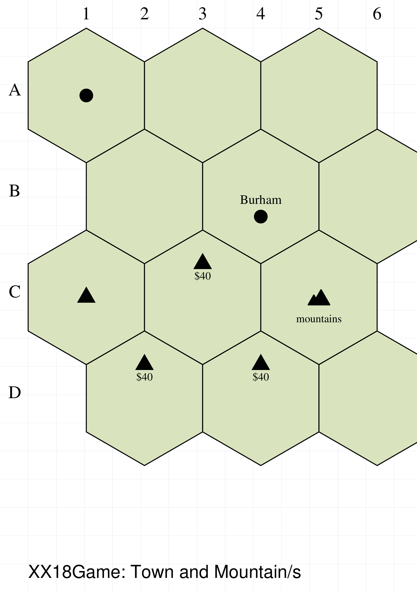

===== ======
|gft| This example shows setting of *features* of an ``XX18Game``:

      .. code:: python

        ('A1', 'town'),
        ('B4', 'town', (90, .3), 'Burham', 'above'),
        ('C1', 'mountain'),
        ('C3 D2 D4', 'mountain', (270, .5), '$40'),
        ('C5', 'mountains', None, "mountains"),

      This example shows how to add a town or a mountain to the board.

      A town is typically depicted by a small, solid black circle.

      A town is by default drawn at the centre of the hexagon, or hexagons,
      in which it is located (``A1`` in this example).

      A mountain is typically depicted by a small, solid black triangle.

      A mountain is by default drawn at the centre of the hexagon, or hexagons,
      in which it is located (``C1`` in this example).

===== ======


Feature #2. City
~~~~~~~~~~~~~~~~
`^ <xx18GameFeatures_>`_

.. |gfc| image:: ../images/objects/xx18_features_city.png
   :width: 330

===== ======
|gfc| This example shows setting of *features* of an ``XX18Game``:

      .. code:: python

        ('A1', 'city'),
        ('A3', 'city', None, 'Arkwright', 'above'),
        ('A5', 'city', (180, .4), 'Aylish', 'right'),

        ('B2', 'cityx2', None, 'Baroque'),
        ('B4', 'cityx3', None, 'Blau'),
        ('B6', 'cityx4', None, 'Branth'),

        ('C1', 'city', None, 'Cantile', 'b',
            [image("images/Panama_Canal_Railway.svg")]),
        ('C3', 'city', None, 'Colwa', 'below',
            [circle(fill="aqua", label="6", radius=0.7)]),
        ('C5', 'city', None, 'Cuwate', 'above',
            [text("8", font_name="Times-Bold", font_size=24)]),

        ('D2', 'cityx2v', None, 'Darpa'),

        ('D4', 'cityx3', None, 'Delroux', "b",
            [
              image("images/Jinchu_Railway.svg"),
              image("images/Panama_Canal_Railway.svg"),
              circle(fill="orange", label="6")
            ]
        ),

        ('D6', 'city', None, 'Domrus'),
        ('D6', 'revenue',  (240, .6), '20'),

      This example shows how to add cities of different sizes to the board.

      A city is depicted by large circle, usually white, with a black border.

===== ======


Feature #3. Train Track
~~~~~~~~~~~~~~~~~~~~~~~
`^ <xx18GameFeatures_>`_

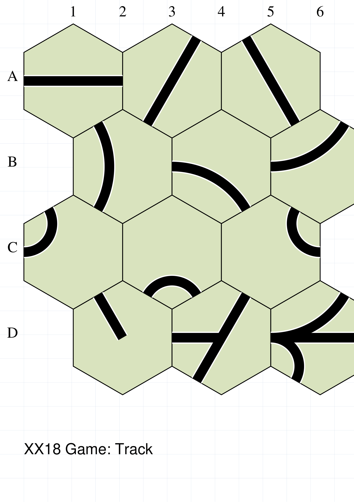

===== ======
|gfk| This example shows setting of *features* of an ``XX18Game``:

      .. code:: python

        ('A1', 'track', 'e,w'),
        ('A3', 'track', 'ne,sw'),
        ('A5', 'track', 'se,nw'),
        ('B2', 'track', 'nw,sw'),
        ('B4', 'track', 'se,w'),
        ('B6', 'track', 'w,ne'),
        ('C1', 'track', 'nw,w'),
        ('C3', 'track', 'se,sw'),
        ('C5', 'track', 'ne,e'),
        ('D2', 'track', 'nw'),
        ('D4', 'track', 'w ne,sw'),
        ('D6', 'track', 'w,e w,ne w,sw'),

      This example shows how to add railroad track to the board.

      Railroad track is depicted as a thick line, straight or curved, usually
      with a white border, that typically connects two edges of a hexagon.

      The name of this feature is ``track``, and it should be followed by
      the track settings.  These are the compass location of one or more
      pairs of edges, separated by a comma.  Each pair should be separated
      by a space.

===== ======


Feature #4. Train Track & Town
~~~~~~~~~~~~~~~~~~~~~~~~~~~~~~
`^ <xx18GameFeatures_>`_

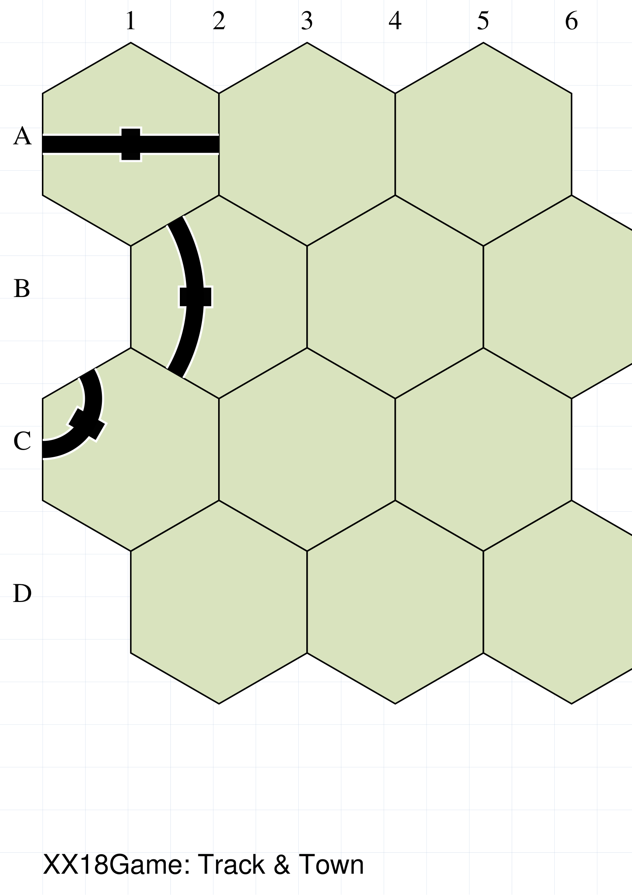

===== ======
|gfn| This example shows setting of *features* of an ``XX18Game``:

      .. code:: python

        ('A1', 'track_town', 'e,w'),
        ('B2', 'track_town', 'nw,sw'),
        ('C1', 'track_town', 'nw,w'),

      This example shows how to add track, with a town on it, to the board.

      The name of this feature is ``track_town``, and it should be followed by
      the track settings for a single piece of track that connects two hexagon
      edges (see `Feature #3. Train Track`_).

===== ======


Feature #5. Train Track-to-edge
~~~~~~~~~~~~~~~~~~~~~~~~~~~~~~~
`^ <xx18GameFeatures_>`_

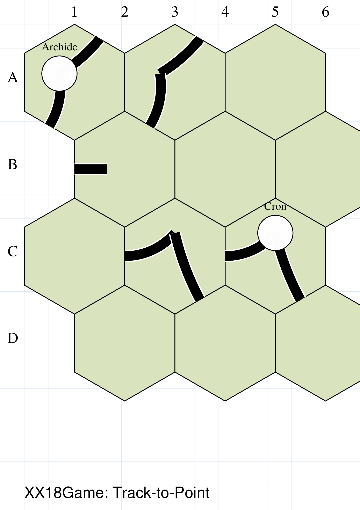

===== ======
|gfe| This example shows setting of *features* of an ``XX18Game``:

      .. code:: python

        C3 = (270, .4)

        ('A1', 'track_edge', (210, .3), 'ne', -0.1),
        ('A1', 'track_edge', (210, .3), 'sw', 0.2),
        ('A1', 'city', (210, .3), 'Archide', "above"),

        ('A3', 'track_edge', (210, .3), 'ne', -0.1),
        ('A3', 'track_edge', (210, .3), 'sw', 0.2),

        ('B2', 'track_edge', (180, .3), 'w', 0),

        ('C3', 'track_edge', C3, 'w', 0.25),
        ('C3', 'track_edge', C3, 'se', -0.1),

        ('C5', 'track_edge', C3, 'w', 0.25),
        ('C5', 'track_edge', C3, 'se', -0.1),
        ('C5', 'city', C3, 'Cron', "above"),

      This example shows how to add track to the board that extends from
      a point to an edge.

===== ======


Feature #6. Symbols
~~~~~~~~~~~~~~~~~~~
`^ <xx18GameFeatures_>`_

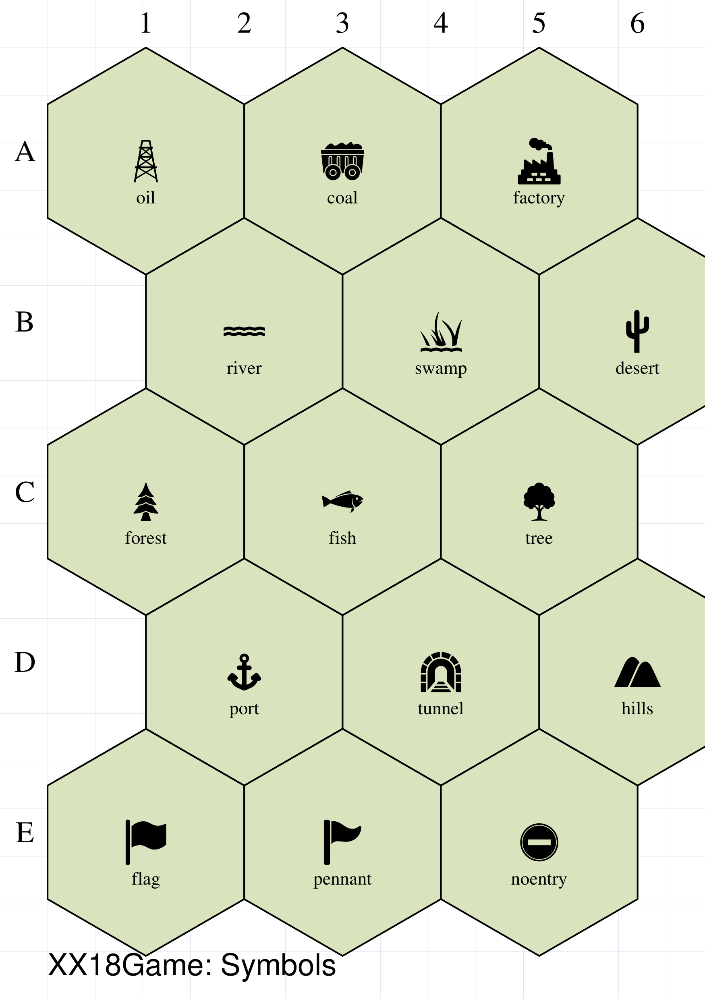

===== ======
|gfs| This example shows setting of *features* of an ``XX18Game``:

      .. code:: python

        ('A1', 'oil', None, 'oil'),
        ('A3', 'coal', None, 'coal'),
        ('A5', 'factory', None, 'factory'),
        ('B2', 'river', None, 'river'),
        ('B4', 'swamp', None, 'swamp',),
        ('B6', 'desert', None, 'desert'),
        ('C1', 'forest', None, 'forest'),
        ('C3', 'fish', None, 'fish'),
        ('C5', 'tree', None, 'tree'),
        ('D2', 'port', None, 'port'),
        ('D4', 'tunnel', None, 'tunnel'),
        ('D6', 'hills', None, 'hills'),
        ('E1', 'flag', None, 'flag'),
        ('E3', 'pennant', None, 'pennant'),
        ('E5', 'noentry', None, 'noentry'),

      This example shows how to add different symbols to the board.


===== ======


Feature #7. Colored Hexagon
~~~~~~~~~~~~~~~~~~~~~~~~~~~
`^ <xx18GameFeatures_>`_

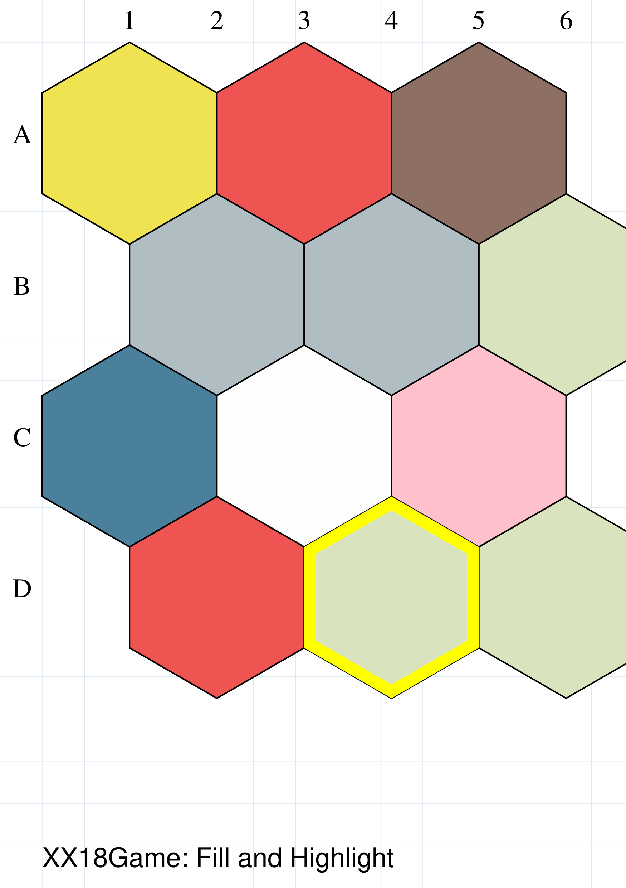

===== ======
|gff| This example shows setting of *features* of an ``XX18Game``:

      .. code:: python

        ('A1', 'fill', None, 'xyellow'),
        ('A3', 'fill', None, 'xred'),
        ('A5', 'fill', None, 'xbrown'),
        ('B2', 'fill', None, 'xgrey'),
        ('B4', 'fill', None, 'xgray'),
        ('C1', 'fill', None, 'xwater'),
        ('C3', 'fill', None, 'xplain'),
        ('C5', 'fill', None, 'pink'),
        ('D2', 'fill', None, 'xoffboard'),
        ('D4', 'highlight', None, 'yellow'),

      This example shows how to add hexagons filled with, or highlighted
      by, a color to the board.


===== ======


Feature #8. Private Railroad
~~~~~~~~~~~~~~~~~~~~~~~~~~~~
`^ <xx18GameFeatures_>`_

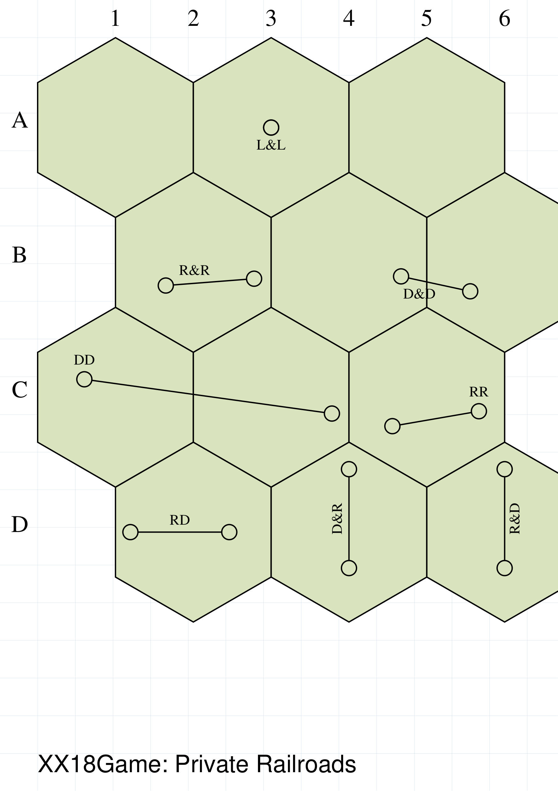

===== ======
|gfv| This example shows setting of *features* of an ``XX18Game``:

      .. code:: python

        ('A1', 'private', None, ""),
        ('A1', 'private'),
        ('A3', 'private', None, "L&L", "A3",  None, "left"),
        ('B2', 'private', ( 15, .7), "R&R", "B2", (140, .4), "above"),
        ('B4', 'private', ( 15, .6), "D&D", "B6", (140, .5), "below"),
        ('C1', 'private', (210, .4), "DD", "C3", ( 15, .7), "left"),
        ('C5', 'private', (140, .5), "RR", "C5", ( 15, .6),"right"),
        ('D2', 'private', (180, .7), "RD", "D2", (0, .4), "above"),
        ('D4', 'private', (270, .7), "D&R", "D4", (90, .4), "above"),
        ('D6', 'private', (270, .7), "R&D", "D6", (90, .4), "below"),

      This example shows how to add a private railroad to the board.

===== ======


Feature #9. Offboard Income: Pointy
~~~~~~~~~~~~~~~~~~~~~~~~~~~~~~~~~~~
`^ <xx18GameFeatures_>`_

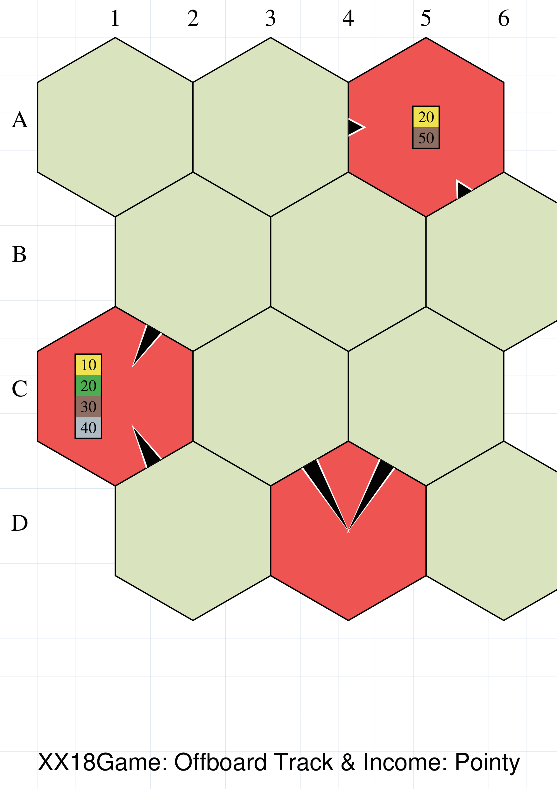

===== ======
|gf1| This example shows setting of *features* of an ``XX18Game``:

      .. code:: python

        # offboard color fills
        ('A5', 'fill', None, 'xoffboard'),
        ('C1', 'fill', None, 'xoffboard'),
        ('D4', 'fill', None, 'xoffboard'),
        # offboard tracks
        ('A5', 'spike', 'w se', "short",),
        ('D4', 'spike', 'nw ne', "long",),
        ('C1', 'spike', 'ne se', "medium",),
        # offboard phase revenue
        ('C1', 'phase_revenue', (180, .3), '10 20 30 40'),
        ('A5', 'phase_revenue', None, '20 50'),

      This example shows how to add and annotate an offboard hex, to the
      board, as well as to define its income.

===== ======


Feature #10. Offboard Income: Flat
~~~~~~~~~~~~~~~~~~~~~~~~~~~~~~~~~~
`^ <xx18GameFeatures_>`_

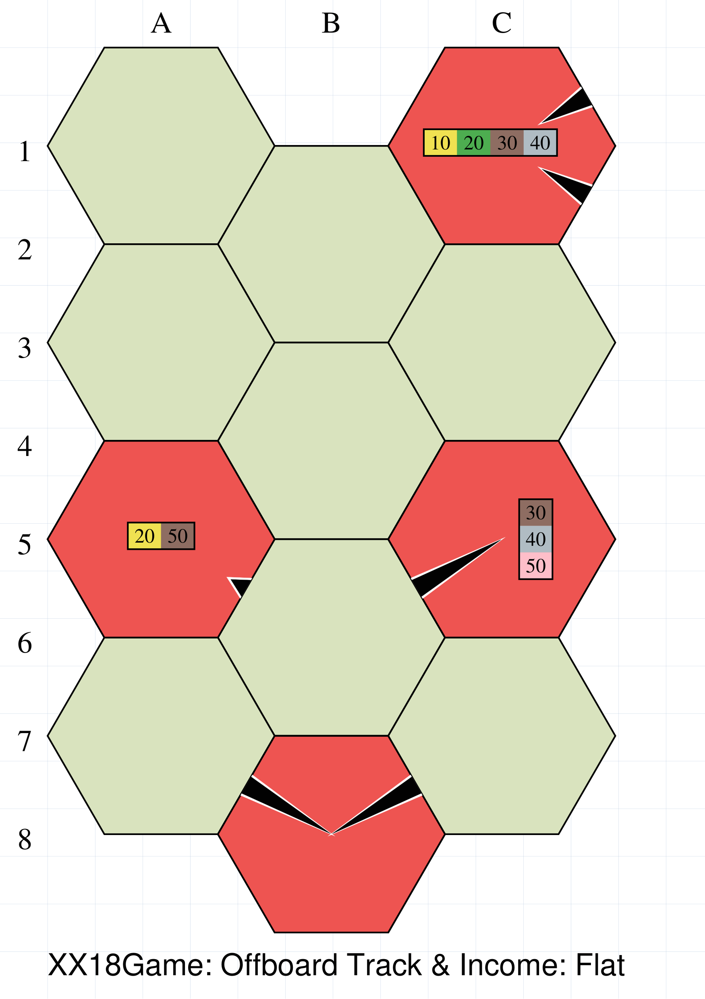

===== ======
|gf2| This example shows setting of *features* of an ``XX18Game``:

      .. code:: python

        # offboard color fills
        ('A5', 'fill', None, 'xoffboard'),
        ('C1', 'fill', None, 'xoffboard'),
        ('C5', 'fill', None, 'xoffboard'),
        ('B8', 'fill', None, 'xoffboard'),
        # offboard tracks
        ('A5', 'spike', '"n se', "short",),
        ('B8', 'spike', 'nw ne', "long",),
        ('C1', 'spike', 'ne se', "medium",),
        ('C5', 'spike', 'sw', "long",),
        # offboard phase revenue
        ('C1', 'phase_revenue', (180, .1), '10 20 30 40'),
        ('A5', 'phase_revenue', None, '20 50'),


      This example shows how to add and annotate an offboard hex, to a
      board with flat hexes, as well as to define its income.

===== ======


Feature #11. Miscellaneous
~~~~~~~~~~~~~~~~~~~~~~~~~~
`^ <xx18GameFeatures_>`_

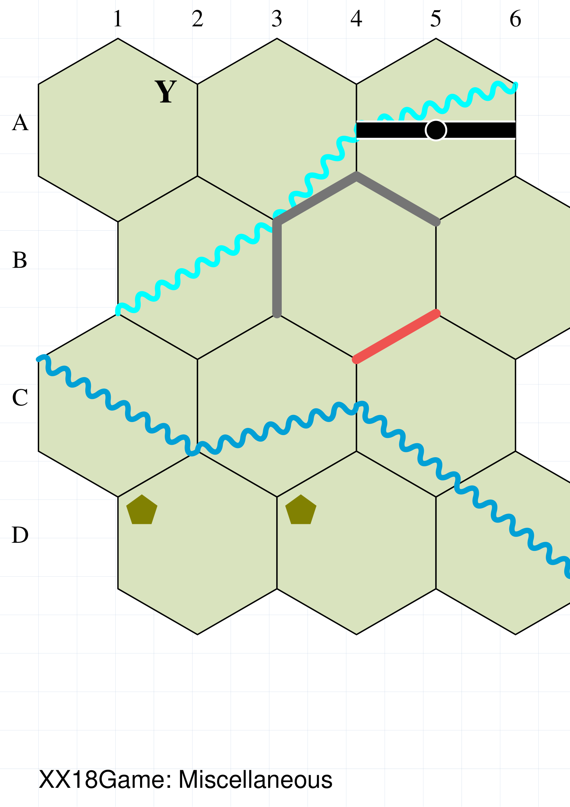

===== ======
|gfm| This example shows setting of *features* of an ``XX18Game``:

      .. code:: python

        ('B2', 'river_line', 'sw ne e ne', 'aqua'),
        ('A1', 'tile-letter', (330, 0.6), "Y"),
        ('A5', 'track', 'e,w'),
        ('A5', 'town_border', None),
        ('B4', 'block', "w nw ne"),
        ('C1', 'river_line', 'nw se e se'),
        ('C5', 'block', "nw", "xred"),
        ('D2 D4', polygon(sides=5, side=0.5, fill_stroke="olive"), (210, 0.7)),


      This example shows how to add various kinds of special, or more unusual,
      features to the board.

===== ======

.. _xx18GameJSONStyles:

XX18Game JSON Styles
--------------------
`^ <xx18game-command_>`_

As mentioned at the start, the ``XX18Game()`` command adopts a set of styles
|dash| sizes and colors |dash| for the features it provides that are largely
modeled after those from *1830*.

To alter these styles requires that you define and load a file containing the
names of the styles you want to chamges along with there new values.

The JSON file is a simple text file that follows common conventions.

1. The first line must contain a single ``{`` curly open bracket.
2. Each line must contain the name of a style, wrapped in ``""`` inverted
   commas, followed by a colon ``:``, followed by the value of the style,
   followed by a comma.
3. **Exception** the second-last line must **NOT** end in a comma.
4. The last line must contain a single ``}`` curly close bracket.


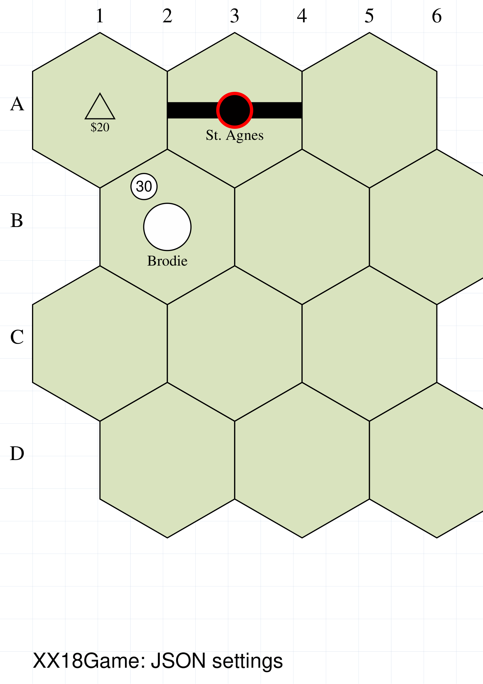

===== ======
|gfj| This example shows styling of *features* of an ``XX18Game``:

      .. code:: python

        xgzz = XX18Game(
            rows=4, cols=3,
            fill='berylgreen',
            label=True,
            label_size=18,
            settings="xx18.json",
            features=[
                ('A1', 'mountain', None, '$20'),
                ('A3', 'track', 'e,w'),
                ('A3', 'town_border', None, 'St. Agnes', "below"),
                ('B2', 'city', None, 'Brodie'),
                ('B2', 'revenue',  (240, .6), '30'),
            ]
        )
        XX18State(board=xgzz)

      This example shows how to reference a JSON file using the *settings*
      property.  The JSON file used here contains the following styles
      and values:

      .. code:: json

        {
          "XX18_MOUNTAIN_SIDE": 0.9,
          "XX18_MOUNTAIN_FILL": null,
          "XX18_TOWN_DIAMETER": 0.9,
          "XX18_TOWN_BORDER_DIAMETER": 1.1,
          "XX18_TOWN_BORDER_STROKE": "red",
          "XX18_TRACK_OUTER_FILL": null,
          "XX18_REVENUE_FILL": "white"
        }

===== ======


.. _xx18GameFunctions:

XX18Game Functions
------------------
`^ <xx18game-command_>`_

The ``XX18Game()`` command comes with functions that allow creation of
features without using the ``features`` property itself.  These functions,
in some cases, allow further customisation than is otherwise possible.


.. _xx18GameAdHocDrawing:

XX18Game AdHoc Drawing
----------------------
`^ <xx18game-command_>`_

While the ``XX18Game()`` command comes with numerous functions, and the ability
to set and customise a whole range of commonly-used features, there are some
exceptions.  For these cases, you need to fall back to using
:doc:`protograf's <../index>` more general purpose drawing functionality.


.. _xx18state-command:

XX18State Command
==================
`↑ <xx18Index_>`_

The ``XX18State()`` command will create a display of a board and its pieces
that have been defined in an :ref:`XX18Game <xx18game-command>`. This
display represents a given point during the play of an abstract game |dash| a
situation commonly referred to as "the game state".

In the current version of the software, there are no other specific settings
for the ``XX18State()`` command other than the *board* property, which refers
to the name assigned to the ``XX18Game()``.

.. code:: python

    xx_game = XX18Game()
    XX18State(board=xx_game)


.. _xx18-advanced-tips:

18xx Advanced Tips and Options
==============================
`↑ <xx18Index_>`_


.. _xx18-resources:

18xx Resources
==============
`↑ <abstractIndex_>`_

An overview of what 18xx games are about can be found at Board Game Geek:
https://boardgamegeek.com/boardgamefamily/19/series-18xx

The primary resource for working with 18xx games is the online tool
*18xx Maker* ( https://18xx-maker.com/ ). This tool takes 18xx game definitions
written in JSON, displays them, and renders them for printing. This can
create the game Map, Tiles and Tile Manifest, Tokens and Charters, Tokens
(without companies) and the Stock Market.

A comprehensive resource of available games can be found at
http://www.fwtwr.com/18xx/index.htm and games themselves can be played at
https://18xx.games/ .
