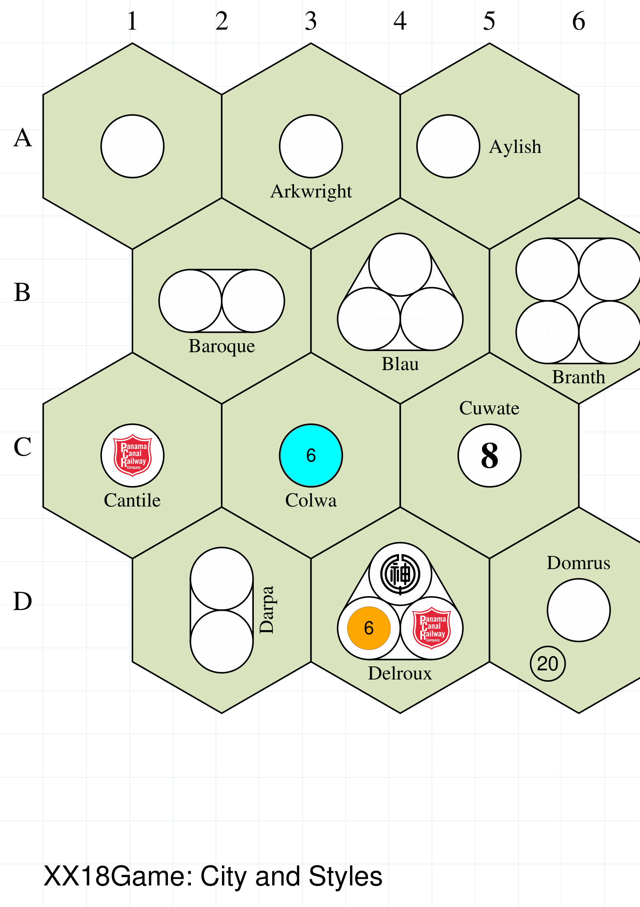

======================
XX18Game and XX18State
======================

.. |dash| unicode:: U+2014 .. EM DASH SIGN

The ``XX18tGame`` and ``XX18State`` are two of a number of commands
used to create what are termed :doc:`Compound Objects <index>`.

This section assumes you are very familiar with the concepts, terms and ideas
for :doc:`protograf <../index>`  as presented in the
:doc:`Basic Concepts <../basic_concepts>` , that you understand all of the
:doc:`Additional Concepts <../additional_concepts>` and that you've created some
basic scripts of your own using the :doc:`Core Shapes <../core_shapes>`. You
should also be familiar with the various types of shapes' properties described in
the :doc:`Customised Shapes <../customised_shapes>`.

.. _xx18Index:

- `Overview`_
- `Background`_
- `Features`_
- `XX18Game Command`_

    - `XX18Game Properties`_
    - `XX18Game Board: Grid`_

        - *Grid Orientation and Offset*
        - *Grid Coordinates and Labels*

    - XX18Game Board: Features
    - XX18Game Board: Functions
    - XX18Game Board: AdHoc Drawing

- `XX18State Command`_
- `18xx Advanced Tips and Options`_
- `18xx Resources`_


.. _xx18Backround:

Background
==========

**protograf** is a general purpose tool and is not designed to produce prototypes
for specific games.  However, there are hundreds of games in the 18XX series, and
so it seemd worthwile was worth developing custom functionality to allow this
type of game to be more easily prototyped.

The very first game in the series was *1829*, designed by Francis Tresham, and
published in 1974.  It was the forerunner to the series, but the game that has
really provided the foundation for all the ones that came after was *1830*,
developed by Avalon Hill in collaboration with Francis Tresham.

*1830* also set the tone of the graphic design that has been used in many of the
games in the series and the prototyping capability provided here is modeled
after that design.

.. _xx18Over:

Overview
========
`↑ <abstractIndex_>`_

The aim of the ``XX18Game`` and ``XX18Game`` commands is to allow
diagrams for many of the 18Xx series of games to be easily created.

The ``XX18Game`` command allows for the details of the board and features
for such a game to be specified.  However, an ``XX18Game`` is **not**
designed to be drawn |dash| it can be thought of as the game being
"still in the box".

The ``XX18Game`` command will, when supplied with a previously defined
``XX18Game``, to show the board, along with any other components, such
as tiles, and, optionally, annotated or marked.

.. _xx18game-features:

Features
========

Below is a short summary of the features available.

The ``XX18Game()`` command can depict:

* towns as filled-in, black circles, or rectangles
* cities (different sizes) as white circles; may include
  the railroad logo or a custom shape or text inset into it
* revenue as an open (default) circle with an amount
* track, curved or straight
* track extending from a point to an edge
* terminal spikes running off-board (short, medium and long)
* blocked hex-sides as thick lines
* a highlighted hex as a yellow band inside of all hex edges
* private railways; either in-hex or across hexes
* icons for common in-hex features; including mountains
  (two sizes), hills, and rivers
* symbols for special features such as: coal, desert, factory, fish,
  flag, forest, hills, lock, mine, noentry, oil, pennant, port,
  swamp, train, tree, tunnel
* a river; as "wavy line"; running through a hex
* a custom shape in a hex
* a single piece of text
* hex coordinates along the edges of the map (above, below,
  left-of, and right-of)
* a whole, colored-in hex
* a small, multi-line, colored table to appear in an off-board
  hexagon or area (showing revenue per phase of the game)

The command also provides:

* standard, named 18xx colors
* the ability to load different map font names & sizes, or colors to use,
  from a settings file
* simple labelling for use with icons, symbols, towns or cities

In-hex features, for example, cities, towns, icons, symbols or lettering will,
by default, appear at the centre of a hex. These can be repositioned using a
combination of direction (in degrees clockwise from east) and distance (as a
fraction of the hex radius).

Positioning of features, such as lines, spikes, bumps or numbered circles, on
hex edges will be done using standard compass directions; "ne" for northeast,
"s" for south, etc., and will be centred on that edge.

Drawing of features is done following the order in which they are provided.

Setting of an off-board, colored, rectangular, or polyshape area |dash|
typically reddish and extending from the edge of the board hexagons |dash| is
not handled directly by the ``XX18Game()`` command.  There is simply too much
variation in how such areas are drawn to use a common formula.  What **is**
possible is to use the grid references and hexagon geometry to set the
vertices of such shapes relative to the board.


.. _xx18game-command:

XX18Game Command
================
`↑ <abstractIndex_>`_

The ``XX18Game()`` command defines the parts of an 18XX game; primarily
the construction and styling, of the board and features.

The overall **size** of the board is set by a combination of rows and
columns.

.. NOTE::

  The hexagonal locations on the board are termed **cells** in this guide.

- `XX18Game Properties`_
- `XX18Game Board: Grid`_
- `XX18Game Board: Hexagonal`_


.. _xx18GameProperties:

XX18Game Properties
-------------------
`^ <xx18game-command_>`_

The key properties that can be set for an ``XX18Game()`` command are:

* *cols*: this is the number of cells in the horizontal direction, for a
  regular layout; a default of ``8`` is used
* *rows*: then this is the number of cells, in the vertical direction,
  for a regular layout; a default of ``8`` is used
* *pattern*: an on/off design showing which cells should be used and which
  should be blank i.e. unused
* *orientation*: whether the edges of the hexes are parallel to the top of
  the mapbard ("flat") or pointing at it ("pointy"); the default of "pointy"
  matches that of *1830*
* *fill*: the default color with which most of the hexagons will be filled;
  by default this is white, but many maps use a light brown or light green.

.. IMPORTANT::

    Unlike many other shapes or objects in **protograf**, the *height* property
    is used to set the height of a cell on the board, and **not** the height
    of the board itself |dash| this being derived from the combination of
    the number of rows and columns as well the cell *height*.

Other useful properties that can be set for an XX18Game are:

* *side*: sets the length of the side of a single hexagon; by default this is
  slighly less than 1 inch (2.3864 cm)
* *label*: if ``True``, draw labels around the board's edges; use the
  normal styling options for a label; *label_font*, *label_size*,
  *label_stroke* etc.
* *label_position*: the sides of the board along which the labelling runs; this
  can be: *top-left* (``TL``) |dash| the default |dash| *bottom-left* (``BL``),
  *bottom-right* (``BR``) or *top-right* (``TR``).
* *label_offset*: how far away label are drawn from the board edge(s); if not
  set, this is calculated based on the label's font size
* *settings*: this is the name of JSON file, including its path, that can be
  used to override some of the default sizes and style of features

.. NOTE::

    The default settings for an XX18Game are:

    * *rows*: ``8``
    * *cols*: ``8``
    * *side*: about 1 inch (2.3864 cm)


.. _xx18GameGrid:

XX18Game Board: Base Grid
-------------------------
`^ <xx18game-command_>`_

Below are some examples of how to set the basic parameters for 18XX boards.


Example 1. Default Board
~~~~~~~~~~~~~~~~~~~~~~~~
`^ <xxGameGrid_>`_

.. |ab1| image:: ../images/objects/xx18_default.png
   :width: 330

===== ======
|ab1| This example shows an ``XX18Game`` constructed using these commands:

      .. code:: python

         xx1 = XX18Game()
         XX18Game(board=xx1)

      The default settings for a board are those of a 8x8 grid of hexagons.

      As can be seen, the board is drawn when it is referenced by the *board*
      property of an ``XX18Game`` command.  In short: the ``XX18Game``
      is assigned to ``xx1`` which in turn is referenced by ``board=xx1``.

===== ======


Example 2. Board Size, Color and Position
~~~~~~~~~~~~~~~~~~~~~~~~~~~~~~~~~~~~~~~~~
`^ <xxGameGrid_>`_

.. |ab2| image:: ../images/objects/xx18_size_position.png
   :width: 330

===== ======
|ab2| This example shows ``XX18Game`` used with these commands:

      .. code:: python

        agsp = XX18Game(
            x=0, y=0,
            side=0.25,
            rows=3, cols=3,
            fill="khaki"
        )
        XX18Game(board=agsp)

        ahsp = XX18Game(
            name="hexagons",
            x=4, y=4,
            height=1.25,
            rows=3, cols=3,
            fill="berylgreen"
        )
        XX18Game(board=ahsp)

      Each of the two boards shown have their own *rows*, *cols* and *height*
      values set in order to determine their size.

      Each of the two boards shown make use of custom *x* and *y* values to
      set their position on the page.

      Each of the boards sets the default color of the cells to a light
      brown and light green, respectively, via the *fill* property. It
      is also possible to choose from the built-in 18XX colors.

      The board on the lower-right also has the *name* set to ``hexagons``
      in order to change its layout; more example of these types can be
      seen in :ref:`Hexagonal XX18Game Boards <abstractGameHexagonal>`.

      As can be seen, the boards are drawn when the name assigned to them is
      referenced by the *board* property of the ``XX18Game`` commands
      (``agsp`` and ``ahsp`` respectively).

===== ======


Example 3. Styled Board
~~~~~~~~~~~~~~~~~~~~~~~
`^ <xxGameGrid_>`_

.. |ab3| image:: ../images/objects/xx18_styled.png
   :width: 330

===== ======
|ab3| This example shows an ``XX18Game`` constructed using these commands:

      .. code:: python

        ags = XX18Game(
            label=True,
            label_stroke="blue"
        )
        XX18Game(board=ags)

      The default board size is a 8x8 ``grid`` of square cells; in this
      example the type of board is explicitly set by its *name* property.

      In this case, the board is further styled by setting:

      - *label* - if ``True``, the labels will be drawn
      - *label_stroke* - the color of the labels

      The *label_start* defaults to the *bottom-left* (``BL``),
      and the *label_type* defaults to  *alpha-numeric* (``AN```); so
      letters for the columns go from left to right along the bottom edge
      and numbers for the rows increase from ``1`` up along the left edge.

      As can be seen, the board is drawn when the name assigned to it
      (``ags``) is referenced by the *board* property of an
      ``XX18Game`` command.

===== ======


Example 4. Pattern Grid
~~~~~~~~~~~~~~~~~~~~~~~
`^ <xxGameGrid_>`_

If a hexagonal grid for a game contains a custom number of hexagons,
that may vary across the rows of the board, then a pattern design,
or layout, can be defined for the ``XX18Game``.

A pattern grid uses a cell-and-dot notation which is set with the
*pattern* property.

This notation represents each row as separate line, with each regular, or
normal hexagon with a ``O`` (the letter "oh"), and each blank, or missing,
cell with a ``.`` (dot or full stop).

There should be as many lines in the pattern as are set in the *rows* value
for the ``XX18Game``. Similarly, the total combined number of hexagons
and blanks, in any given line, must match the *cols* value.

The best way to represent multi-line list of characters such as this is by
starting and ending the pattern definition with triple quotes |dash| ``"""``.

Note that empty lines and "whitespace" at the start and end of a pattern will
be ignored; as is any whitespace on a line.

If a row on the board contains only hexagons, this can be shown with a
single ``O`` (capital "oh").


.. |ah4| image:: ../images/objects/xx18_hexagons_pattern.png
   :width: 330

===== ======
|ah4| This example shows an ``XX18Game`` constructed using these commands:

      .. code:: python

        aghp = XX18Game(
            rows=5,
            cols=7,
            pattern = """
            . O O . O O .
             O O O O O O .
            O O . O . O O
             O O O O O O .
            . O O . O O .
            """)
        XX18Game(board=aghp)

      In this example, the type of board is set via its *name* property to
      ``hexagons``.

      The *pattern* property shows, in string format, an arrangement of
      hexagonal cells (``O``) and empty cells (``.``).

      Note that the spaces in the pattern are ignored when constructing the
      board; they are just used to help visualise the pattern being created.

      .. NOTE::

          It is important that the correct number of *rows* and *cols* are
          set; the pattern has to fit **exactly** into these dimensions.

===== ======


.. _xx18GameFeatures:

XX18Game: Features
------------------
`^ <xx18game-command_>`_

An 18xx game board can display numerous features that each have different
effects on game play, inclduing cities, towns, tracks, railroads and the
labels and income associated with these, as well as host of other symbols
that help characterise hexagons.

General Example Construction
~~~~~~~~~~~~~~~~~~~~~~~~~~~~

All of the feature examples follow the same overall construction, and
for sake of brevity, that construction is not repeated every time.

Essentially, each follows the pattern below: the *rows* and *cols* setup
the size of the board; the *fill* sets the defult color for all hexagons;
the ``label=True`` turns on the grid labels |dash| by default, along the
top and left-side of the grid; the *label_size* sets the font point size
of those labels.

Finally, the *features* list contains the "specifications" for all the
features for that board; this is the part that differs for each example.

.. code:: python

    xgfc = XX18Game(
        rows=4, cols=3,
        fill='berylgreen',
        label=True,
        label_size=18,
        features=[
          ...
        ]
    )
    XX18State(board=xgfc)


General Feature Specification
~~~~~~~~~~~~~~~~~~~~~~~~~~~~~

Each feature contains two or more pieces of information as a *set* of values
enclosed in round brackets ``( ... )``. The **order of these items is vital**
and must follow the list of options below.


Example 1. Cities
~~~~~~~~~~~~~~~~~
`^ <xxGameFeatures_>`_



===== ======
|gfc| This example shows the *features* of an `XX18Game``:

      .. code:: python

        ('A1', 'city', None),
        ('A3', 'city', None, 'Arkwright', 'above'),
        ('A5', 'city', (180, .4), 'Aylish', 'right'),

        ('B2', 'cityx2', None, 'Baroque'),
        ('B4', 'cityx3', None, 'Blau'),
        ('B6', 'cityx4', None, 'Branth'),

        ('C1', 'city', None, 'Cantile', 'b',
            [image("images/Panama_Canal_Railway.svg")]),
        ('C3', 'city', None, 'Colwa', 'below',
            [circle(fill="aqua", label="6", radius=0.7)]),
        ('C5', 'city', None, 'Cuwate', 'above',
            [text("8", font_name="Times-Bold", font_size=24)]),

        ('D2', 'cityx2v', None, 'Darpa'),

        ('D4', 'cityx3', None, 'Delroux', "b",
            [
              image("images/Jinchu_Railway.svg"),
              image("images/Panama_Canal_Railway.svg"),
              circle(fill="orange", label="6")
            ]
        ),

        ('D6', 'city', None, 'Domrus'),
        ('D6', 'revenue',  (240, .6), '20'),

      In this example, the

===== ======


Example N. NAME OF FEATURE
~~~~~~~~~~~~~~~~~~~~~~~~~~
`^ <xxGameFeatures_>`_

.. |gf0| image:: ../images/objects/xx18_???.png
   :width: 330

===== ======
|gf0| This example shows an ``XX18Game`` constructed using these commands:

      .. code:: python

        aghp = XX18Game(


      In this example, the

===== ======


Example N. NAME OF FEATURE
~~~~~~~~~~~~~~~~~~~~~~~~~~
`^ <xxGameFeatures_>`_

.. |gf0| image:: ../images/objects/xx18_???.png
   :width: 330

===== ======
|gf0| This example shows an ``XX18Game`` constructed using these commands:

      .. code:: python

        aghp = XX18Game(


      In this example, the

===== ======


Example N. NAME OF FEATURE
~~~~~~~~~~~~~~~~~~~~~~~~~~
`^ <xxGameFeatures_>`_

.. |gf0| image:: ../images/objects/xx18_???.png
   :width: 330

===== ======
|gf0| This example shows an ``XX18Game`` constructed using these commands:

      .. code:: python

        aghp = XX18Game(


      In this example, the

===== ======


Example N. NAME OF FEATURE
~~~~~~~~~~~~~~~~~~~~~~~~~~
`^ <xxGameFeatures_>`_

.. |gf0| image:: ../images/objects/xx18_???.png
   :width: 330

===== ======
|gf0| This example shows an ``XX18Game`` constructed using these commands:

      .. code:: python

        aghp = XX18Game(


      In this example, the

===== ======


Example N. NAME OF FEATURE
~~~~~~~~~~~~~~~~~~~~~~~~~~
`^ <xxGameFeatures_>`_

.. |gf0| image:: ../images/objects/xx18_???.png
   :width: 330

===== ======
|gf0| This example shows an ``XX18Game`` constructed using these commands:

      .. code:: python

        aghp = XX18Game(


      In this example, the

===== ======


Example N. NAME OF FEATURE
~~~~~~~~~~~~~~~~~~~~~~~~~~
`^ <xxGameFeatures_>`_

.. |gf0| image:: ../images/objects/xx18_???.png
   :width: 330

===== ======
|gf0| This example shows an ``XX18Game`` constructed using these commands:

      .. code:: python

        aghp = XX18Game(


      In this example, the

===== ======


Example N. NAME OF FEATURE
~~~~~~~~~~~~~~~~~~~~~~~~~~
`^ <xxGameFeatures_>`_

.. |gf0| image:: ../images/objects/xx18_???.png
   :width: 330

===== ======
|gf0| This example shows an ``XX18Game`` constructed using these commands:

      .. code:: python

        aghp = XX18Game(


      In this example, the

===== ======


Example N. NAME OF FEATURE
~~~~~~~~~~~~~~~~~~~~~~~~~~
`^ <xxGameFeatures_>`_

.. |gf0| image:: ../images/objects/xx18_???.png
   :width: 330

===== ======
|gf0| This example shows an ``XX18Game`` constructed using these commands:

      .. code:: python

        aghp = XX18Game(


      In this example, the

===== ======


.. _xx18state-command:

XX18State Command
==================
`↑ <xx18Index_>`_

The ``XX18State()`` command will create a display of a board and its pieces
that have been defined in an :ref:`XX18Game <xx18game-command>`. This
display represents a given point during the play of an abstract game |dash| a
situation commonly referred to as "the game state".

In the current version of the software, there are no other specific settings
for the ``XX18State()`` command other than the *board* property, which refers
to the name assigned to the ``XX18Game()``.

.. code:: python

    xx_game = XX18Game()
    XX18State(board=xx_game)


.. _xx18-advanced-tips:

18xx Advanced Tips and Options
==============================
`↑ <xx18Index_>`_


.. _xx18-resources:

18xx Resources
==============
`↑ <abstractIndex_>`_

The primary resource for working with 18xx games is the online tool
*18xx Maker* (https://18xx-maker.com/). This tool takes 18xx game definitions
written in JSON, displays them, and renders them for printing. This can
create the game Map, Tiles and Tile Manifest, Tokens and Charters, Tokens
(without companies) and the Stock Market.

A comprehensive resource of available games can be found at
http://www.fwtwr.com/18xx/index.htm and games themselves can be played at
https://18xx.games/ .
