============================
XX18 Commands for 18xx-games
============================

.. |dash| unicode:: U+2014 .. EM DASH SIGN

The *XX18* commands |dash| ``XX18Game``, ``XX18Market`` and ``XX18State``
|dash| are some of a number of commands used to create what are termed
:doc:`Compound Objects <index>`.

This section assumes you are very familiar with the concepts, terms and ideas
for :doc:`protograf <../index>`  as presented in the
:doc:`Basic Concepts <../basic_concepts>` , that you understand all of the
:doc:`Additional Concepts <../additional_concepts>` and that you've created some
basic scripts of your own using the :doc:`Core Shapes <../core_shapes>` and their
properties.  Being familiar with :doc:`Hexagonal Grids <../hexagonal_grids>`
will also help with understanding how an 18xx game board is created and used.

.. _xx18Index:

- `Background`_
- `Overview`_
- `XX18Game Command`_

    - `XX18Game Summary`_
    - `XX18Game Properties`_
    - `XX18Game Board Grid`_
    - `XX18Game Features`_
    - `XX18Game JSON Styles`_
    - `XX18Game Functions`_
    - `XX18Game AdHoc Drawing with a Map`_
    - `XX18Game Style Settings`_
    - `XX18Game Function Options`_

- `XX18Market Command`_

    -  `18xx Stock Markets`_
    - `XX18Market Summary`_
    - `XX18Market Properties`_
    - `XX18Market Values`_
    - `XX18Market Value Attributes`_
    - `XX18Market Value Color`_
    - `XX18Market Examples`_

- `XX18State Command`_

- `18xx Resources`_


.. _xx18Background:

Background
==========
`↑ <xx18Index_>`_

**protograf** is a general purpose tool and is not designed to produce prototypes
for specific games.  However, there are hundreds of games in the 18xx series of
railroad board games, and so it seemed worthwhile developing custom functionality
to allow this type of game to be more easily prototyped.

The very first game in the series was *1829*, designed by Francis Tresham, and
published in 1974.  It was the forerunner to the series, but the game that has
really provided the foundation for most of the ones that came after was *1830*,
developed by The Avalon Hill Game Company in collaboration with Francis Tresham.

*1830* also set the style for the graphic design that has been used in many of
the games in the series and the prototyping capability provided here is modeled
primarily after that design.


.. _xx18Over:

Overview
========
`↑ <xx18Index_>`_

The aim of the ``XX18Game``, ``XX18Market`` and ``XX18State`` commands
is to allow some of the components for typical games in the 18Xx series
to be easily created.

The ``XX18Game`` command allows for the details of the board and features
for an 18xx-type game to be specified.  However, an ``XX18Game`` is **not**
designed to be drawn |dash| it can be thought of as the game being
"still in the box".

The ``XX18State`` command will, when supplied with a previously defined
``XX18Game``, draw the board, along with all its features.

The ``XX18Market`` command allows for the details of the Stock Market
for an 18xx-type game to be specified.  However, an ``XX18Market`` is
**not** designed to be drawn |dash| it can be thought of as the game
being "still in the box".

The ``XX18State`` command will, when supplied with a previously defined
``XX18Game``, draw the board, along with all its features. Similarly,
when supplied with a previously defined ``XX18Market``, it will draw the
Stock Market grid.


.. _xx18game-command:

XX18Game Command
================
`↑ <xx18Index_>`_

The ``XX18Game()`` command defines the parts of an 18xx game; primarily
the construction and styling, of the board and features, as well the use
of its functions for more extensive control of features.

Topics covered are:

- `XX18Game Summary`_
- `XX18Game Properties`_
- `XX18Game Board Grid`_
- `XX18Game Features`_
- `XX18Game JSON Styles`_
- `XX18Game Functions`_
- `XX18Game AdHoc Drawing with a Map`_
- `XX18Game Style Settings`_
- `XX18Game Function Options`_


.. _xx18game-summary:

XX18Game Summary
----------------
`^ <xx18game-command_>`_

Below is a short summary of the map features the ``XX18Game()`` command
can depict:

* towns as filled-in, black circles, or rectangles
* cities (different sizes) as white circles; may include
  the railroad logo or a custom shape or text inset into it
* revenue as an open (default) circle with an amount
* track, curved or straight
* track extending from a point to an edge
* terminal spikes running off-board (short, medium and long)
* blocked hexagon-sides as thick lines
* a highlighted hexagon as a yellow band inside all the hexagon edges
* private railways; either in-hexagon or across hexagons
* icons for common in-hexagon features; including mountains
  (two sizes), hills, and rivers
* symbols for special features such as: coal, desert, factory, fish,
  flag, forest, hills, lock, mine, noentry, oil, pennant, port,
  swamp, swamps, train, tree, tunnel
* a river; as "wavy line"; running through a hexagon
* a custom shape in a hexagon
* a single piece of text
* hexagon coordinates along the edges of the map (above, below,
  left-of, and right-of)
* a whole, colored-in hexagon
* a small, multi-line, colored table to appear in an off-board
  hexagon or area (showing revenue per phase of the game)

The command also provides:

* standard, named 18xx colors
* the ability to load different map font names & sizes, or colors to use,
  from a settings file
* simple labelling for use with icons, symbols, towns, private railroads
  or cities

In-hexagon features, for example, cities, towns, icons, symbols or lettering
will, by default, appear at the centre of a hexagon. These can be repositioned
using a combination of direction |dash| in degrees clockwise from east |dash|
and distance |dash| as a fraction of the hexagon radius.

Positioning of features, such as lines, spikes, bumps or numbered circles on
hexagon edges, will be done using standard compass directions; "ne" for northeast,
"s" for south, etc., and will be centred on that edge.

Drawing of features is done following the order in which they are provided.

Setting of an off-board, colored, rectangular, or polyshape area |dash|
typically reddish and extending from the edge of the board hexagons |dash| is
not handled directly by the ``XX18Game()`` command.  There is simply too much
variation in how such areas are drawn to use a common formula.  What **is**
possible is to use the grid references and hexagon geometry to set the
vertices of such shapes relative to the board.


.. _xx18GameProperties:

XX18Game Properties
-------------------
`^ <xx18game-command_>`_

The key properties that can be set for an ``XX18Game()`` command are:

* *cols*: this is the number of hexagons in the horizontal direction, for a
  board's layout; a default of ``8`` is used
* *rows*: then this is the number of hexagons, in the vertical direction,
  for a board's layout; a default of ``8`` is used
* *fill*: the default color with which most of the hexagons will be filled;
  by default this is white, but many maps use a light brown or light green.
* *features*: the "things" that need to be drawn on the board; there are
  :ref:`many possible features <xx18GameFeatures>`
* *orientation*: whether the edges of the hexagons are parallel to the top of
  the mapboard ("flat") or pointing at it ("pointy"); the default of "pointy"
  matches that of *1830*
* *pattern*: an on/off design showing which hexagons should be used and which
  should be blank i.e. unused

.. IMPORTANT::

    Unlike many other shapes or objects in **protograf**, the *height* property
    is used to set the height of a hexagon on the board, and **not** the height
    of the board itself |dash| this being derived from the combination of
    the number of rows and columns as well the hexagon *height*.

Other useful properties that can be set for an ``XX18Game()`` command are:

* *side*: sets the length of the side of a single hexagon; by default this is
  slighly less than 1 inch (2.3864 cm)
* *label*: if ``True``, draw labels around the board's edges; use the
  normal styling options for a label; *label_font*, *label_size*,
  *label_stroke* etc.
* *label_locations*: the sides of the board along which the labelling runs; this
  can be: *above-left* (``AL``) |dash| the default |dash| *below-left* (``BL``),
  *below-right* (``BR``) or *above-right* (``AR``).
* *label_offset*: how far away labels are drawn from the board edge(s); if not
  set, this is calculated based on the label's font size
* *settings*: this is the name of JSON file, including its path, that can be
  used to override some of the default sizes and style of features

.. NOTE::

    The default settings for an XX18Game are:

    * *rows*: ``8``
    * *cols*: ``8``
    * *side*: about 1 inch (2.3864 cm)


.. _xx18GameGrid:

XX18Game Board Grid
-------------------
`^ <xx18game-command_>`_

The overall **size** of the board is set by a combination of number of
rows and columns of hexagons.

Below are some examples of how to set the basic parameters to configure the
hexagonal grid that is used for all 18xx game boards:

- `Example 1. Default Board`_
- `Example 2. Default Board - Flat Hexagons`_
- `Example 3. Default Board - Pointy Hexagons - Offset`_
- `Example 5. Grid Labels & Debug`_
- `Example 6. Styled Board`_
- `Example 7. Pattern Grid`_


Example 1. Default Board
~~~~~~~~~~~~~~~~~~~~~~~~
`^ <xx18GameGrid_>`_

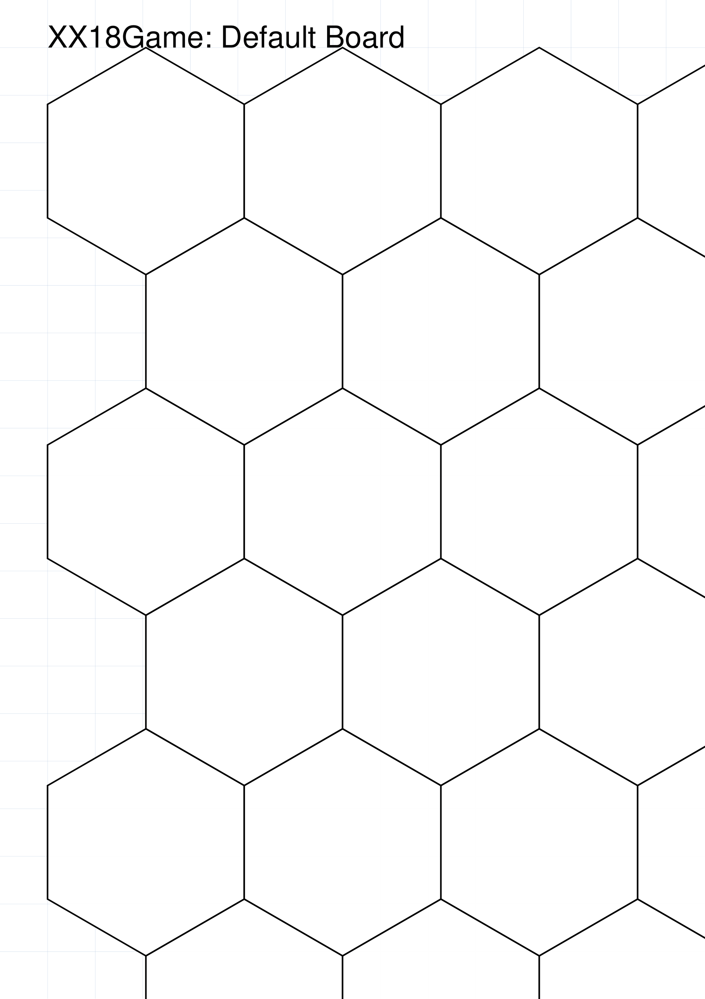

===== ======
|xb1| This example shows an ``XX18Game`` constructed using these commands:

      .. code:: python

         xx1 = XX18Game()
         XX18Game(board=xx1)

===== ======

The default settings for an 18xx game's board are those of a 8x8
grid of ``pointy`` hexagons i.e. two flat sides of each hexagon are
parallel to the left and right of the board.

Because a small page size is being used, the full extent of the grid
i.e. all 64 hexagons, is not visible.

As can be seen, the board is drawn when it is referenced by the *board*
property of an ``XX18Game`` command.  In short: the ``XX18Game``
is assigned to ``xx1`` which in turn is referenced by ``board=xx1``.


Example 2. Default Board - Flat Hexagons
~~~~~~~~~~~~~~~~~~~~~~~~~~~~~~~~~~~~~~~~
`^ <xx18GameGrid_>`_

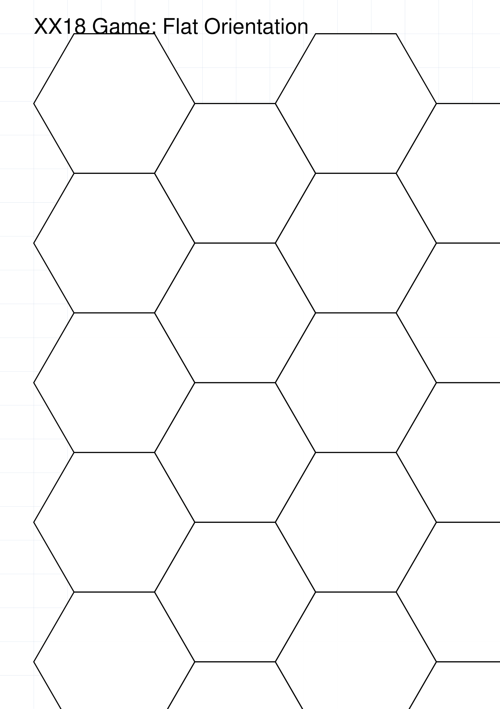

===== ======
|xb2| This example shows an ``XX18Game`` constructed using these commands:

      .. code:: python

         xx1 = XX18Game(orientation="flat")
         XX18Game(board=xx1)

===== ======

For this example, the *orientation* of the hexagons in the grid are
changed to ``flat`` i.e. two flat sides of each hexagon are parallel
to the top and bottom of the board.

Because a small page size is being used, the full extent of the grid
i.e. all 64 hexagons, is not visible.

The board is drawn when it is referenced by the *board*
property of an ``XX18Game`` command.


Example 3. Default Board - Pointy Hexagons - Offset
~~~~~~~~~~~~~~~~~~~~~~~~~~~~~~~~~~~~~~~~~~~~~~~~~~~
`^ <xx18GameGrid_>`_

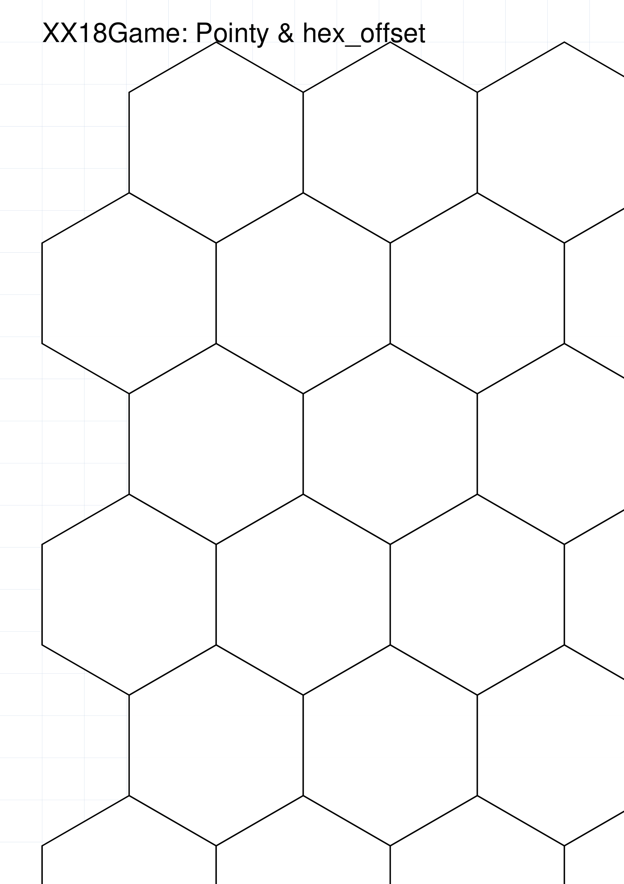

===== ======
|xb3| This example shows an ``XX18Game`` constructed using these commands:

      .. code:: python

         xx1 = XX18Game(hex_offset="odd")
         XX18Game(board=xx1)

===== ======

For this example, the *orientation* of the hexagons in the grid are,
by default, already set to ``pointy``. In addition, the *hex_offset* is
set to ``odd``, thereby shifting down the top-left hexagon.

Because a small page size is being used, the full extent of the grid
i.e. all 64 hexagons, is not visible.

The board is drawn when it is referenced by the *board*
property of an ``XX18Game`` command.


Example 4. Default Board - Flat Hexagons - Offset
~~~~~~~~~~~~~~~~~~~~~~~~~~~~~~~~~~~~~~~~~~~~~~~~~
`^ <xx18GameGrid_>`_

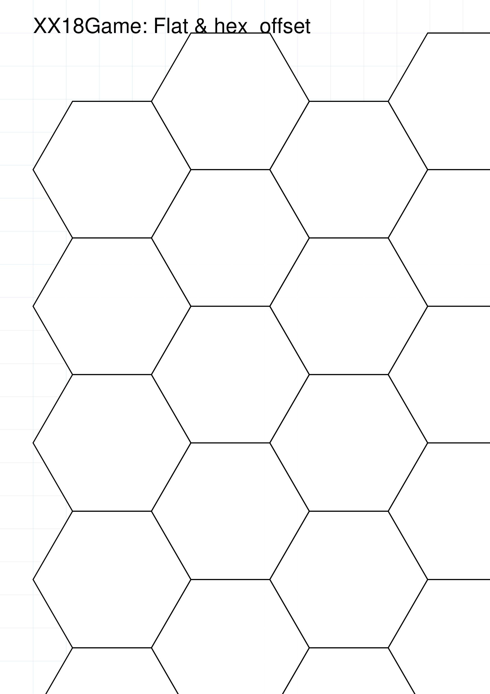

===== ======
|xb4| This example shows an ``XX18Game`` constructed using these commands:

      .. code:: python

         xx1 = XX18Game(
           orientation="flat",
           hex_offset="odd")
         XX18Game(board=xx1)

===== ======

For this example, the *orientation* of the hexagons in the grid are
set to ``flat``. In addition, the *hex_offset* is set to ``odd``,
thereby shifting down the top-left hexagon.

Because a small page size is being used, the full extent of the grid
i.e. all 64 hexagons, is not visible.

The board is drawn when it is referenced by the *board*
property of an ``XX18Game`` command.


Example 5. Grid Labels & Debug
~~~~~~~~~~~~~~~~~~~~~~~~~~~~~~
`^ <xx18GameGrid_>`_

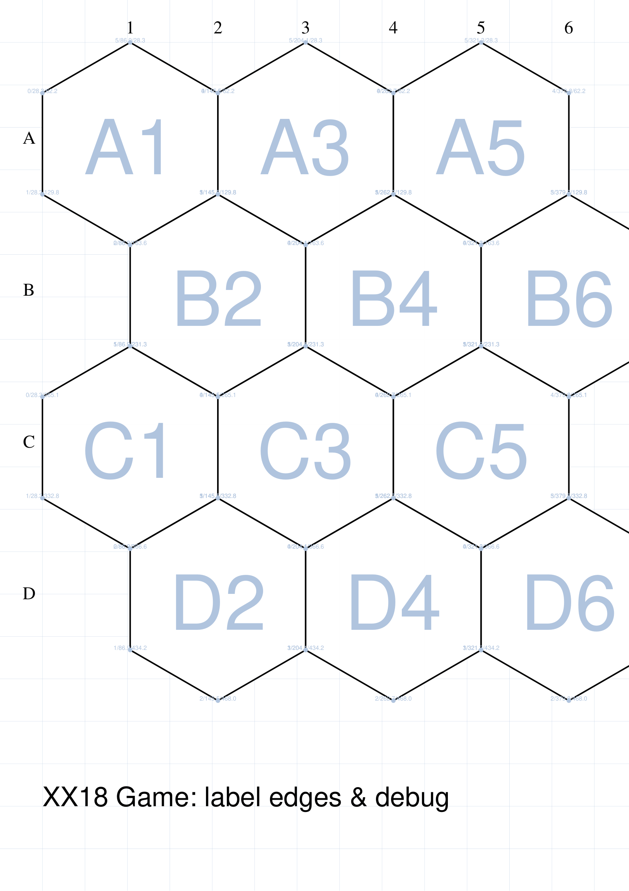

===== ======
|xb5| This example shows ``XX18Game`` used with these commands:

      .. code:: python

        xgld = XX18Game(
            rows=4, cols=3,
            label=True,
            debug=True,
        )
        XX18State(board=xgld)

===== ======

For this example, the default number of *rows* and *cols* have been
changed; the whole board is now displayed on this smaller page size.

Setting the *label* property to ``True`` enables labels to be placed
at the board edges. The labels defaults to the *above-left* (``AL``);
numbers for the columns increase from ``1``, starting at the top-left,
and the letters for the rows go from top to bottom along the left edge.

Note that the 18xx grid style of numbering means the column numbers for
odd rows start at 1 and increment by 2 i.e. all odd numbers, whereas
the column numbers for even rows start at 2 and increment by 2
i.e. they are all even numbers.

Setting the *debug* property to ``True`` activates the display of
large, in-hex grid reference labels that appear inside each hexagon.
This is useful when designing a layout but is obviously not something
that would be shown in a final version.


Example 6. Styled Board
~~~~~~~~~~~~~~~~~~~~~~~
`^ <xx18GameGrid_>`_

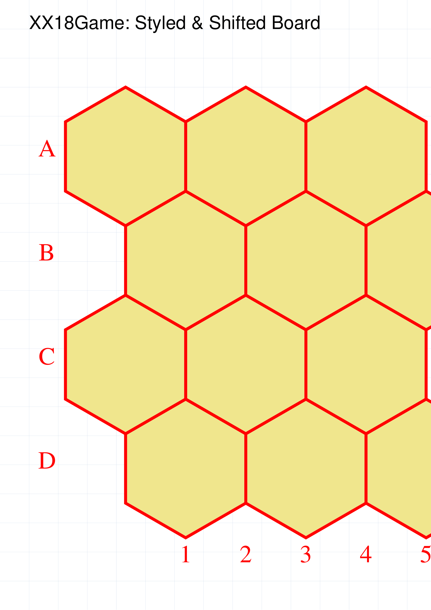

===== ======
|xb6| This example shows an ``XX18Game`` constructed using these commands:

      .. code:: python

        ags = XX18Game(
            rows=4, cols=3,
            x=1.25, y=2,
            label=True,
            label_size=24,
            label_locations="BL",
            fill="khaki",
            stroke="red",
            stroke_width=3
        )
        XX18Game(board=ags)

===== ======

In this case, the 18xx board is further styled by setting:

* *rows* - the number of rows in the grid
* *cols* - the number of columns in the grid
* *x* and *y* - set the offset of the grid's top-left from the page margins
* *label* - if ``True``, the labels will be drawn
* *label_locations* - where the labels are drawn at the grid edges;
  in this case below (``B``) and to the left (``L``)
* *label_size* - the point height of the labels
* *fill* - the default color of the hexagons
* *stroke* - the default color for lines and labels
* *stroke_width* - the default width of lines


Example 7. Pattern Grid
~~~~~~~~~~~~~~~~~~~~~~~
`^ <xx18GameGrid_>`_

While the extent of an 18xx game board may stretch across a number of
hexagons for both rows and columns, typically there are also unused
hexagons in that grid, because the outline is meant to conform to some
underlying terrain e.g. the borders of a state, country or even a
continent.

To achieve this effect, a *pattern* design must be created that uses a
circle-and-dot notation. This notation represents each row as separate line,
showing each regular, or normal, hexagon with a ``O`` (the letter "oh"),
and each blank, or missing, hexagon with a ``.`` (dot or full stop).

There should be as many lines in the pattern as are set in the *rows* value
for the ``XX18Game``. Similarly, the total combined number of hexagons
and blanks, in any given line, must match the *cols* value.

The best way to represent multi-line list of characters such as this is by
starting and ending the pattern definition with triple quotes |dash| ``"""``.

Note that empty lines and "whitespace" at the start and end of a pattern will
be ignored; as is any whitespace within a line.

If a row on the board contains only hexagons, this can be shown with a
single ``O`` (capital "oh").


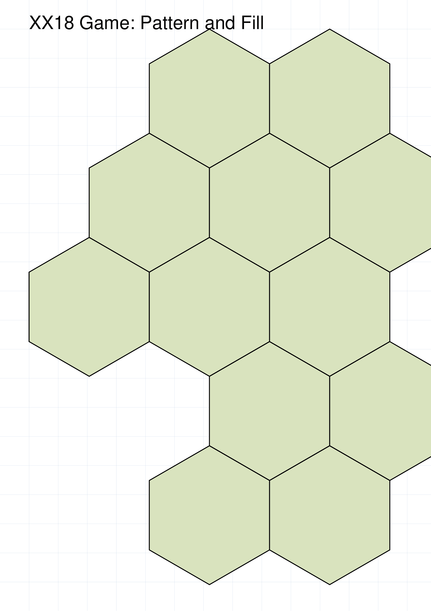

===== ======
|xb7| This example shows an ``XX18Game`` constructed using these commands:

      .. code:: python

        aghp = XX18Game(
            rows=5, cols=4,
            fill='berylgreen',
            pattern="""
            . O O .
             O O O .
            O O O .
             . O O .
             . O O .
            """)
        XX18Game(board=aghp)

===== ======

The *pattern* property shows, in string format, an arrangement of
available hexagons (``O``) and empty positions (``.``).

.. NOTE::

    Empty positions can still be accessed and used as normal; but they
    will not, by default, be drawn with an outline and fill as the rest.

Note that any spaces in the pattern lines themselves are ignored when
constructing the board; they can just be used to help you visualise the
pattern that will be created.

.. NOTE::

    It is important that the correct number of *rows* and *cols* are
    set; the pattern has to fit **exactly** into these dimensions.


.. _xx18GameFeatures:

XX18Game Features
-----------------
`^ <xx18game-command_>`_

An 18xx game board can display numerous features that each have different
effects on game play, including cities, towns, tracks, railroads and the
labels and income associated with these, as well as host of other symbols,
text and styling that help characterise the board's hexagons.

Features are set in a list i.e. enclosed in square brackets ``[ ... ]``
and asssigned to the *features* property.

- `General Feature Specification`_
- `Construction of Examples`_
- `Feature #1. City`_
- `Feature #2. Town and Mountain`_
- `Feature #3. Train Track`_
- `Feature #4. Train Track & Town & Curve`_
- `Feature #5. Train track-to-edge`_
- `Feature #6. Symbols`_
- `Feature #7. Colored Hexagons`_
- `Feature #8. Private Railroad`_
- `Feature #9. Offboard Income: Pointy`_
- `Feature #10. Offboard Income: Flat`_
- `Feature #11. Miscellaneous`_
- `XX18Game JSON Styles`_
- `XX18Game Functions`_
- `XX18Game AdHoc Drawing with a Map`_


General Feature Specification
~~~~~~~~~~~~~~~~~~~~~~~~~~~~~
`^ <xx18GameFeatures_>`_

Each feature contains two or more pieces of information as a *set* of values
enclosed in round brackets ``( ... )``. The **order of these items is vital**
and must follow the sequence below.

1. Feature **location**: this is a grid reference of one or more hexagons,
   with each reference separated by a space; for example ``A1 B4```.  In a
   pointy hexagons grid, the letter is the row identifier, and in a grid
   with flat hexagons, the letter is the column identifier.
2. Feature **name**: the lowercase name of the feature, such as town, city,
   track etc.
3. Feature **offset**: by default, a feature is drawn in the centre of the
   hexagon.  By specifying an offset, the feature can be drawn elsewhere in
   the hexagon. The offset is defined by a pair of comma-separated numbers
   enclosed in round brackets ``( ... )``:

   * the first number is *direction* |dash| degrees clockwise from the east
   * the second number is *distance* |dash| a fraction of the hexagon's
     radius from the location's centre

   For example, ``(90, 0.5)`` is a point in the "south" direction, half-way
   along the radius.
4. Feature **label**:  the name or text associated with a feature; for example,
   the name of a city, or the cost associated with a mountain.
5. Feature **label location**: the place where the label is drawn relative
   to the feature, by default it is drawn below it.  Possible label locations
   are: above, below, left, or right.


This general pattern of feature specification is changed somewhat for the
following features: *hex_fill*, *highlight*, *private railroads*, and
*track_edge*.  See the specific feature examples and description below for
details of these changes.


Construction of Examples
~~~~~~~~~~~~~~~~~~~~~~~~
`^ <xx18GameFeatures_>`_

All of the feature examples follow the same overall construction, and
for sake of brevity, that construction is not repeated every time.

Essentially, each follows the approach shown in the code fragment below:
the *rows* and *cols* define the extent of the board |dash| the number of
hexagons in each direction; the *fill* sets the default color for all the
hexagons on the board; the ``label=True`` turns on the grid labels |dash|
by default, along the top and left-side of the grid; and the *label_size*
sets the font point size of those labels.

Finally, the *features* list contains the "specifications" for all the
features for that board; this is the part that differs for each example.

.. code:: python

    xgfc = XX18Game(
        rows=4, cols=3,
        fill='berylgreen',
        label=True,
        label_size=18,
        features=[
          ...
        ]
    )
    XX18State(board=xgfc)


Feature #1. City
~~~~~~~~~~~~~~~~
`^ <xx18GameFeatures_>`_

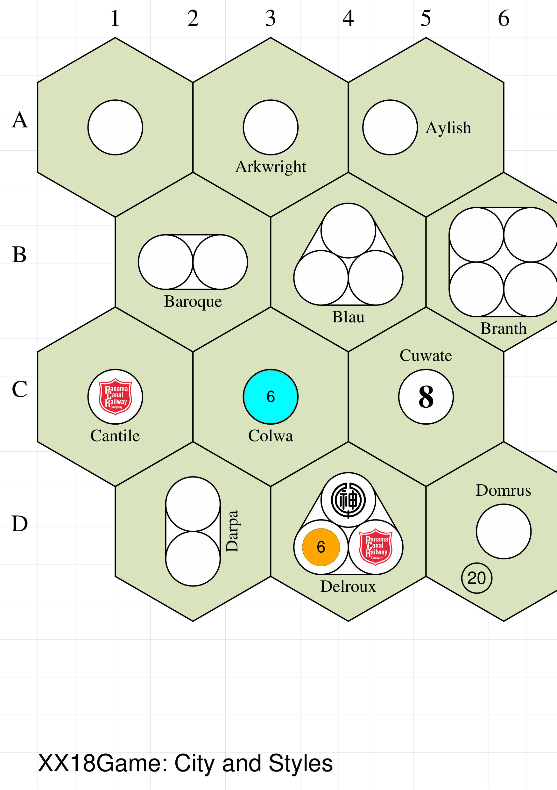

===== ======
|gfc| This example shows setting of *features* of an ``XX18Game``:

      .. code:: python

        ('A1', 'city'),
        ('A3', 'city', None, 'Arkwright', 'above'),
        ('A5', 'city', (180, 0.4), 'Aylish', 'right'),

        ('B2', 'cityx2', None, 'Baroque'),
        ('B4', 'cityx3', None, 'Blau'),
        ('B6', 'cityx4', None, 'Branth'),

        ('C1', 'city', None, 'Cantile', 'b',
            [image('images/Panama_Canal_Railway.svg')]),
        ('C3', 'city', None, 'Colwa', 'below',
            [circle(fill='aqua', label='6', radius=0.7)]),
        ('C5', 'city', None, 'Cuwate', 'above',
            [text('8', font_name='Times-Bold', font_size=24)]),

        ('D2', 'cityx2v', None, 'Darpa'),

        ('D4', 'cityx3', None, 'Delroux', 'b',
            [
              image('images/Jinchu_Railway.svg'),
              image('images/Panama_Canal_Railway.svg'),
              circle(fill='orange', label='6')
            ]
        ),

        ('D6', 'city', None, 'Domrus'),
        ('D6', 'revenue',  (240, 0.6), '20'),

===== ======

This example shows how to add cities of different sizes to the board.

A city is depicted by large circle, usually white, with a black border.

A city is by default drawn at the centre of the hexagon, or hexagons,
in which it is located (``A1`` in this example).  To shift the position,
set values for ``(direction, distance)`` offset; for example, in ``A5``.

The city label and the relative label position can also be set, as shown
for ``A3`` and ``A5``.

A city can also be comprised of multiple circles; the feature name for
this includes an ``x`` followed by the number of circles; for example,
the cities in ``B2``, ``B4`` and ``B6``.  An additional option for a
size "2" city is to display it vertically, as can be seen in ``D2``,
by adding a ``v`` at the end.

Adding shapes to be displayed inside the city's circle is also possible.
This is shown for ``C1``, ``C3`` and ``C5``, each of which have a
different :ref:`kind of shape <shape-index>` embedded.

Multiple shapes can be added to a city comprised of multiple circles;
the features should be in a list i.e. enclosed in square brackets
``[ ... ]``, and will appear on the city circles in clockwise order.


Feature #2. Town and Mountain
~~~~~~~~~~~~~~~~~~~~~~~~~~~~~
`^ <xx18GameFeatures_>`_

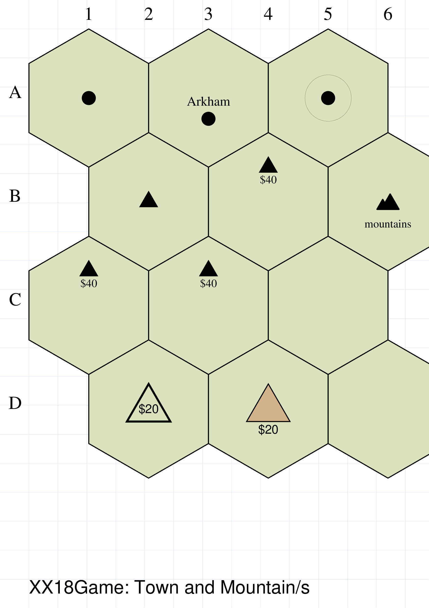

===== ======
|gft| This example shows setting of *features* of an ``XX18Game``:

      .. code:: python

        ('A1', 'town'),
        ('A3', 'town', (90, .3), 'Arkham', 'above'),
        ('A5', circle(fill=None, radius=0.8)),
        ('A5', 'town',),
        ('B2', 'mountain'),
        ('B4 C1 C3', 'mountain', (270, .5), '$40'),
        ('B6', 'mountains', None, "mountains"),
        ('D2', triangle(side=1.5, fill=None, stroke_width=2, label='$20')),
        ('D4', triangle(side=1.5, fill="tan", stroke_width=1, title='$20')),

===== ======

This example shows how to add a town or a mountain to the board.

A town is typically depicted by a small, solid black circle.

A town is by default drawn at the centre of the hexagon, or hexagons,
in which it is located (``A1`` in this example).  To shift the position,
set values for ``(direction, distance)`` offset; for example, in ``B4``.
The town name and the relative label position can also be set, as shown
for ``A3``.  A town can be depicted along with other shapes; in this
example, a large, empty circle is drawn first at ``A5``, and then the
town is drawn "on top" of it.

A mountain is typically depicted by a small, solid black triangle,
drawn at the centre of the hexagon; see the example in ``B2``.

To shift the position of the mountain, set values for the offset
as ``(direction, distance)``; for example, the ones in ``B4 C1 C3``.

A pair of mountains can be shown using the ``mountains`` symbol |dash|
note the plural form of the name for ``B6``.

It could be that mountains need to be represented a little differently.
The simplest way to do this is via a ``triangle()`` shape, whose various
properties can be set to provide a custom look, as shown in ``D2`` and
``D4``.  For more details see the
:ref:`Triangle command <triangle-command>` documentation.


Feature #3. Train Track
~~~~~~~~~~~~~~~~~~~~~~~
`^ <xx18GameFeatures_>`_

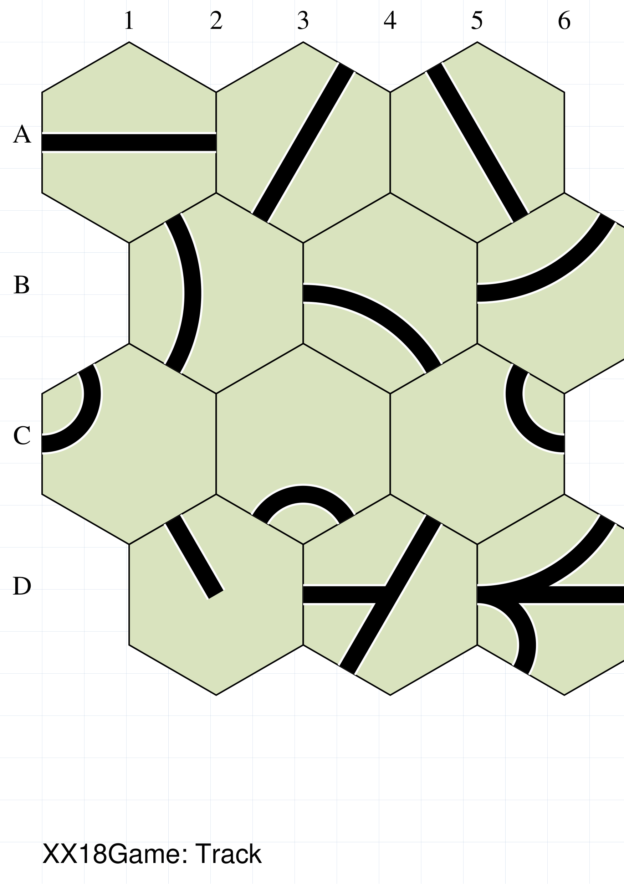

===== ======
|gfk| This example shows setting of *features* of an ``XX18Game``:

      .. code:: python

        ('A1', 'track', 'e,w'),
        ('A3', 'track', 'ne,sw'),
        ('A5', 'track', 'se,nw'),
        ('B2', 'track', 'nw,sw'),
        ('B4', 'track', 'se,w'),
        ('B6', 'track', 'w,ne'),
        ('C1', 'track', 'nw,w'),
        ('C3', 'track', 'se,sw'),
        ('C5', 'track', 'ne,e'),
        ('D2', 'track', 'nw'),
        ('D4', 'track', 'w ne,sw'),
        ('D6', 'track', 'w,e w,ne w,sw'),

===== ======

This example shows how to add railroad track to the board.

Railroad track is depicted as a thick line, straight or curved, usually
with a white border, that typically connects two edges of a hexagon.

The name of this feature is ``track``, and it should be followed by
the track settings.  These are the compass location of one or more
pairs of edges, separated by a comma.  Each pair should be separated
by a space.

Note that for a board comprised of ``pointy`` hexagons, the available
compass location of edges are: ``ne``, ``nw``, ``se``, ``sw``, ``e``,
and ``w``; while for one comprised of ``dlat`` hexagons, the available
compass location of edges are: ``ne``, ``se``, ``nw``, ``sw``, ``n``,
and ``s``.  Using other values will trigger an error such as:

.. code::

  WARNING:: The track start and end must be chosen from
            '['ne', 'e', 'se', 'sw', 'w', 'nw']'
  FEEDBACK:: Could not continue with script.


Feature #4. Train Track & Town & Curve
~~~~~~~~~~~~~~~~~~~~~~~~~~~~~~~~~~~~~~
`^ <xx18GameFeatures_>`_

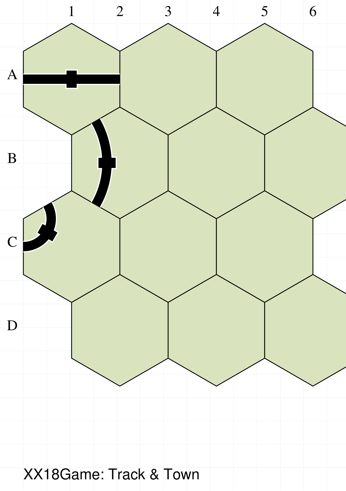

===== ======
|gfn| This example shows setting of *features* of an ``XX18Game``:

      .. code:: python

        ('A1', 'track_town', 'e,w'),
        ('B2', 'track_town', 'nw,sw'),
        ('C1', 'track_town', 'nw,w'),

        ('D2', 'track_curve', (0, 0.6), 1.2),
        ('D2', 'city'),
        ('D4', 'track_curve', (0, 0.6), -1.2),
        ('D4', 'track', 'e,w'),
        ('D4', 'city'),

===== ======

This example shows how to add track, with a town on it, to the board,
as well a curve inside a hexagon.

The name of the first feature is ``track_town``, and it should be followed
by the track settings for a single piece of track that connects two hexagon
edges (see `Feature #3. Train Track`_).

The town is drawn as a rectangular shape at the centre of the track segment.

The name of the second feature is ``track_curve``, and it should be followed
by the location of the curve's start.  The opposite end is automatically
calculated.  The height of the curve can be set as the fourth option; if
negative it will be drawn "downwards".

Feature #5. Train track-to-edge
~~~~~~~~~~~~~~~~~~~~~~~~~~~~~~~
`^ <xx18GameFeatures_>`_

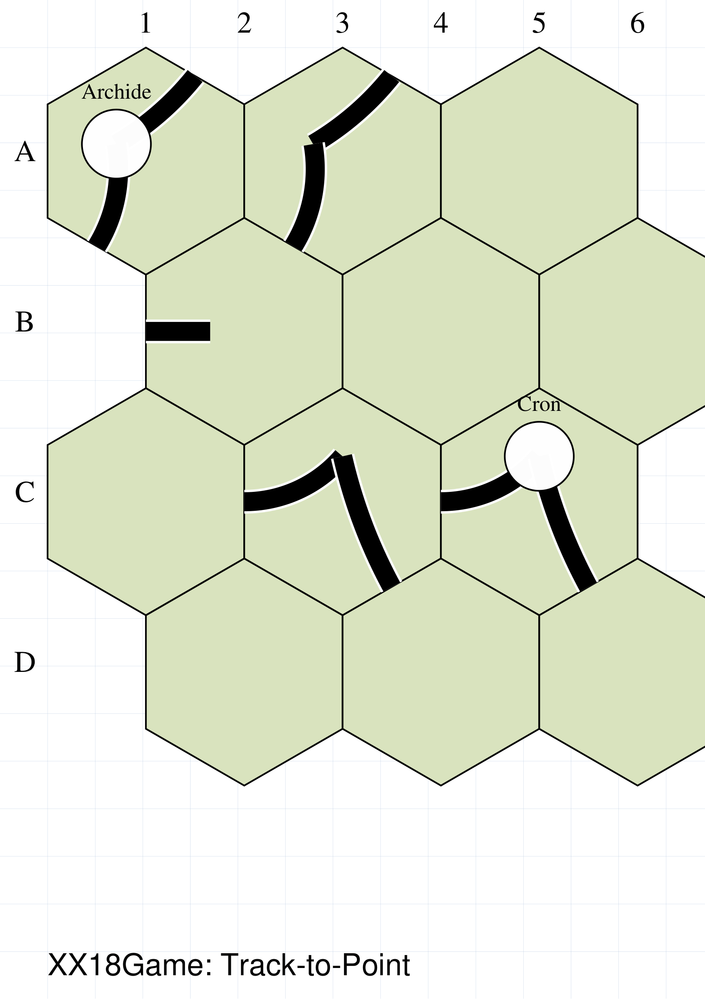

===== ======
|gfe| This example shows setting of *features* of an ``XX18Game``:

      .. code:: python

        C3 = (270, 0.4)

        ('A1', 'track_edge', (210, 0.3), 'ne', -0.1),
        ('A1', 'track_edge', (210, 0.3), 'sw', 0.2),
        ('A1', 'city', (210, 0.3), 'Archide', "above"),

        ('A3', 'track_edge', (210, 0.3), 'ne', -0.1),
        ('A3', 'track_edge', (210, 0.3), 'sw', 0.2),

        ('B2', 'track_edge', (180, 0.3), 'w', 0),

        ('C3', 'track_edge', C3, 'w', 0.25),
        ('C3', 'track_edge', C3, 'se', -0.1),

        ('C5', 'track_edge', C3, 'w', 0.25),
        ('C5', 'track_edge', C3, 'se', -0.1),
        ('C5', 'city', C3, 'Cron', "above"),

===== ======

This example shows how to add track to the board that extends from a
point location to an edge location, as well as the height of the curve.

.. NOTE::

  This feature changes the meaning of the fourth and fifth
  specification values.

The point location is the third value in the specification set;
this is the starting point of the track.

The edge location is the fourth value in the specification set.
This is the hexagon edge |dash| see `Feature #3. Train Track`_
for details |dash| to which the track extends.

The fifth value in the specification set is the height of track'
curve.  This can either be curved positively in an anti-clockwise
direction, or negatively in an clockwise direction.

.. HINT::

  Because multiple track ends do not align "neatly" at a point,
  this feature is usually used in conjunction with a town or
  city that is drawn over that point; this can be seen in the
  example; compare ``A1`` to ``A2`` and ``A3`` to ``C5``.


Feature #6. Symbols
~~~~~~~~~~~~~~~~~~~
`^ <xx18GameFeatures_>`_

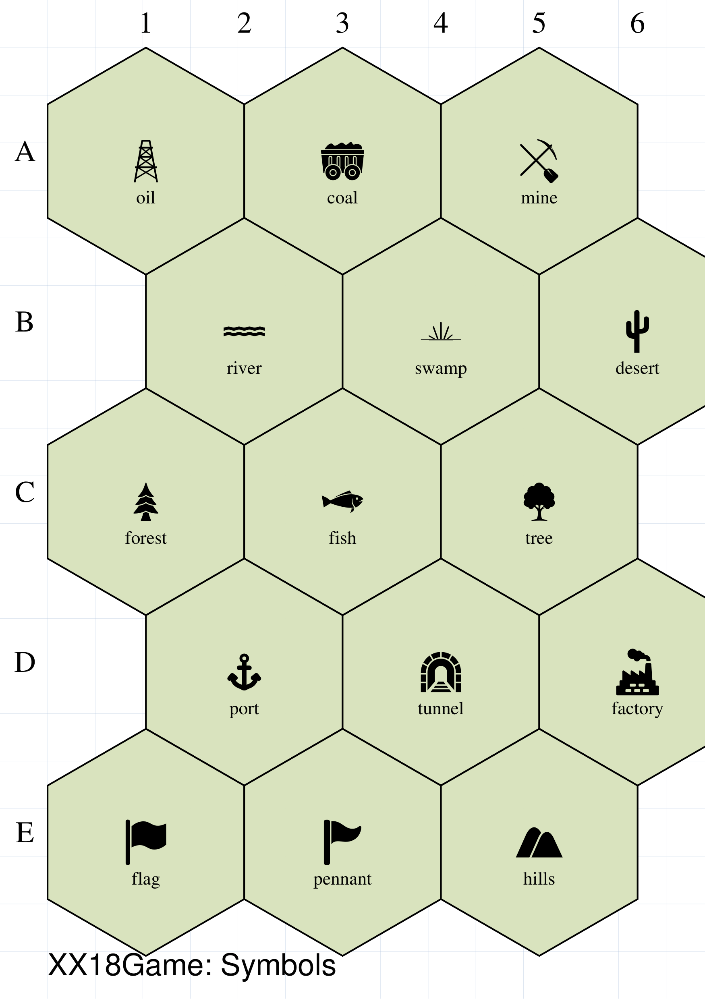

===== ======
|gfs| This example shows setting of *features* of an ``XX18Game``:

      .. code:: python

        ('A1', 'oil', None, 'oil'),
        ('A3', 'coal', None, 'coal'),
        ('A5', 'mine', None, 'mine'),
        ('B2', 'river', None, 'river'),
        ('B4', 'swamp', None, 'swamp',),
        ('B6', 'desert', None, 'desert'),
        ('C1', 'forest', None, 'forest'),
        ('C3', 'fish', None, 'fish'),
        ('C5', 'tree', None, 'tree'),
        ('D2', 'port', None, 'port'),
        ('D4', 'tunnel', None, 'tunnel'),
        ('D6', 'factory', None, 'factory'),
        ('E1', 'flag', None, 'flag'),
        ('E3', 'pennant', None, 'pennant'),
        ('E5', 'hills', None, 'hills'),

===== ======

This example shows how to add different symbols to the board.

As with towns and cities, the symbols are drawn by default in the
centre of the hexagon, but can be offset from the centre by setting
the values for ``(direction, distance)``.

The feature label and the relative label position can also be set.


Feature #7. Colored Hexagons
~~~~~~~~~~~~~~~~~~~~~~~~~~~~
`^ <xx18GameFeatures_>`_

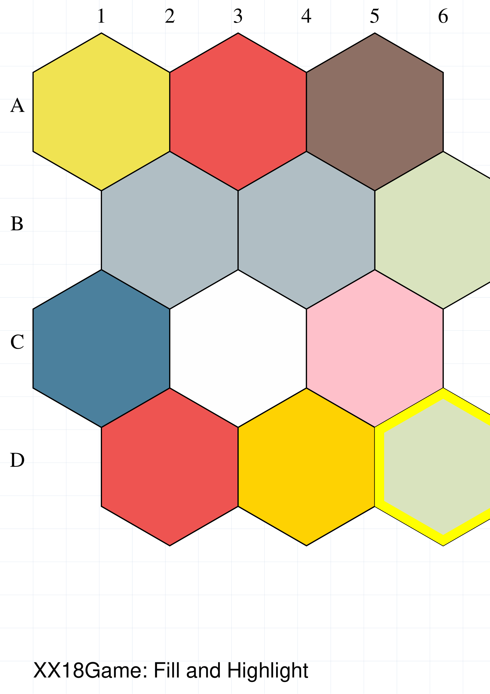

===== ======
|gff| This example shows setting of *features* of an ``XX18Game``:

      .. code:: python

        ('A1', 'hex_fill', None, 'xyellow'),
        ('A3', 'hex_fill', None, 'xred'),
        ('A5', 'hex_fill', None, 'xbrown'),
        ('B2', 'hex_fill', None, 'xgrey'),
        ('B4', 'hex_fill', None, 'xgray'),
        ('B6', 'hex_fill', None, 'xwater'),
        ('C1', 'hex_fill', None, 'xplain'),
        ('C3', 'hex_fill', None, 'pink'),
        ('C5', 'hex_fill', None, 'xoffboard'),
        ('D2 D6', 'hex_fill', None, 'XX18_TILE_YELLOW'),
        ('D4', 'highlight', None, 'yellow'),

===== ======

This example shows how to add hexagons filled with, or highlighted by,
a color to the board.

The ``hex_fill`` feature name causes the whole hexagon to be filled with
the color supplied.

The ``highlight`` feature name causes a thick line to be drawn just
inside the edges of the hexagon.

For these features, the fourth value in the feature specification
set is **not** a label, but a :ref:`color <basic-color>`.

The normal association of colors can be changed to match those an 18xx
style by appending an ``x`` in front of the name.  Special colors, such as
``xplain``, ``xwater`` and ``xoffboard`` (a shade of red) are also available.
There are also a range of tile colors with the ``XX18_TILE_`` prefix.


Feature #8. Private Railroad
~~~~~~~~~~~~~~~~~~~~~~~~~~~~
`^ <xx18GameFeatures_>`_

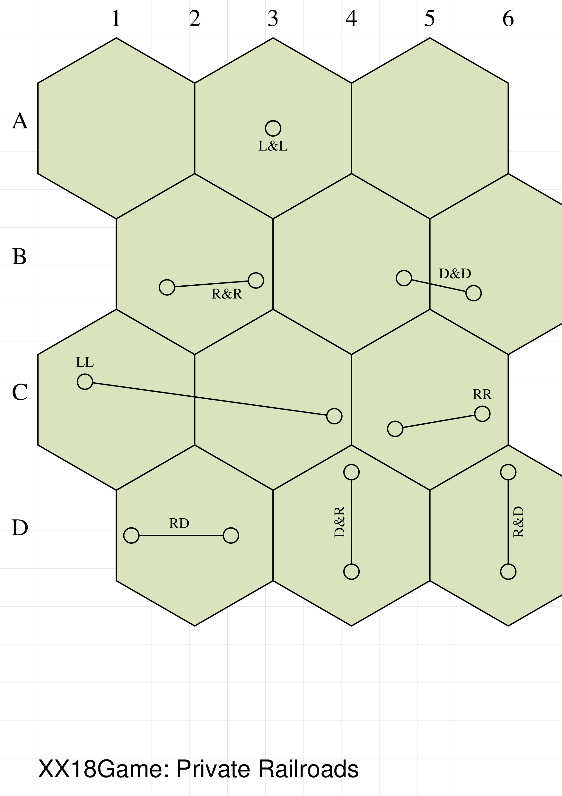

===== ======
|gfv| This example shows setting of *features* of an ``XX18Game``:

      .. code:: python

        ('A1', 'private', ( 15, .7), 'L&R', 'A1', (140, .4), 'left'),
        ('A3', 'private', None, 'L&C', 'A3',  None, 'left'),
        ('A5', 'private', ( 15, .3), 'R&L', 'A5', (140, .7), 'right'),
        ('B2', 'private', ( 15, .7), 'B&C', 'B2', (120, .4), 'below'),
        ('B4', 'private', (195, .6), 'A&C', 'B6', (140, .5), 'above'),
        ('C1', 'private', (210, .4), 'LL', 'D2', ( 15, .7), 'left'),
        ('C3', 'private', (180, .7), 'H&A ', 'C3', (0, .4), 'above'),
        ('C5', 'private', (  0, .5), 'H&B', 'C5', ( 180, .6), 'below'),
        ('D4', 'private', (270, .7), 'V&A', 'D4', (90, .4), 'above'),
        ('D6', 'private', (270, .7), 'V&B', 'D6', (90, .4), 'below'),

===== ======

This example shows how to add a private railroad to the board.

A private railroad is depicted in an 18xx game as two small circles
joined by a line.  The railroad is often named for reference.

.. NOTE::

  This feature changes the meaning of the fifth specification
  values and adds two more optional values.

For a private railroad, the specification values, in the order they
must appear, are as follows:

1. Start **location**: this is a grid reference of single hexagon,
   representing the hexagon where one end (circle) of the private
   railroad is drawn
2. The feature **name** ``private`` is used here
3. The **offset**, if any, of the start (circle) of the private
   railroad is set here; if ``None`` then it will drawn at the centre
   of the start location's hexagon
4. The **name** of the private railroad is set here
5. End **location**: this is a grid reference of single hexagon,
   representing the hexagon where the other end (circle) of the
   private railroad is drawn
6. The **offset**, if any, of the end (circle) of the private
   railroad is set here; if ``None`` then it will drawn at the centre
   of the end location's hexagon
7. The relative location of the private railroad's **label**; ``left``
   or ``right`` draw the label next to the start or end circles; while
   ``above`` or ``below`` draw the label centred on the connecting line,
   at a distance based on the font size


Feature #9. Offboard Income: Pointy
~~~~~~~~~~~~~~~~~~~~~~~~~~~~~~~~~~~
`^ <xx18GameFeatures_>`_

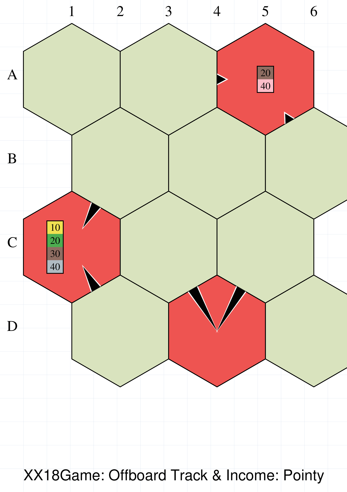

===== ======
|gf1| This example shows setting of *features* of an ``XX18Game``:

      .. code:: python

        # offboard color fills
        ('A5', 'hex_fill', None, 'xoffboard'),
        ('C1', 'hex_fill', None, 'xoffboard'),
        ('D4', 'hex_fill', None, 'xoffboard'),
        # offboard tracks
        ('A5', 'spike', 'w se', "short",),
        ('C1', 'spike', 'ne se', "medium",),
        ('D4', 'spike', 'nw ne', "long",),
        # offboard phase revenue
        ('A5', 'phase_revenue', None, '20 40', ['xbrown', 'pink']),
        ('C1', 'phase_revenue', (180, .3), '10 20 30 40'),
        ('D4', 'phase_revenue', (90, .2), '20 30'),

===== ======

This example shows how to add and annotate an offboard hex, to the
board, as well as to define its income in tabular form.

Offboard locations are normally shown as "end points" for track connected
to them by the use of a *spike* or pointed triangle.  A spike extends
from the edge of its hexagon towards the centre.  Three different lengths
of spike can be used: ``short``, ``medium``, or ``long``.

Offboard locations often offer income to the company whose track connects
to them.  This is shown in a table, colored to match the phase of the game
for which the income applies, as defined by the *phase_revenue* feature.

The colors for the table cells are from a "yellow, green, brown, grey"
sequence or, for the case of two income values, a "yellow, brown"
sequence. This can be seen for hexagons ``C1`` and ``D4`` respectively.

A fifth item in the specifications can be added to define a custom set
of different colors to be used, as can be seen for hexagon ``A5``. Note
that there must be a matching color for each value in the income "label".

For a board grid with "pointy" orientation of the hexagons, the income
table is drawn vertically.


Feature #10. Offboard Income: Flat
~~~~~~~~~~~~~~~~~~~~~~~~~~~~~~~~~~
`^ <xx18GameFeatures_>`_

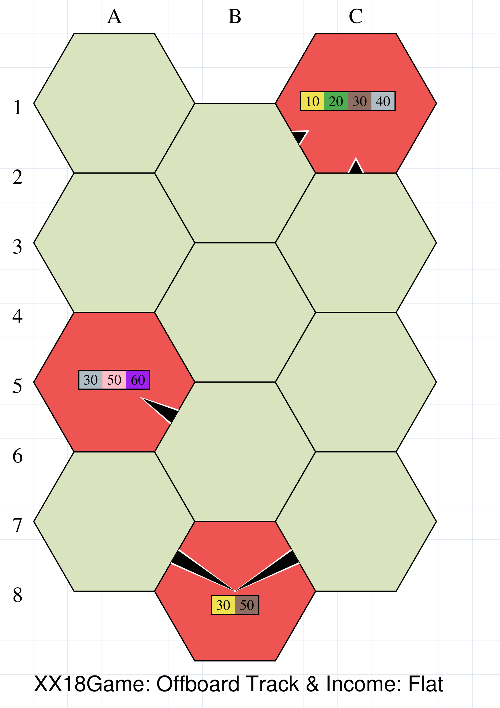

===== ======
|gf2| This example shows setting of *features* of an ``XX18Game``:

      .. code:: python

        # offboard color fills
        ('A5', 'hex_fill', None, 'xoffboard'),
        ('C1', 'hex_fill', None, 'xoffboard'),
        ('B8', 'hex_fill', None, 'xoffboard'),
        # offboard tracks
        ('A5', 'spike', '"n se', "medium",),
        ('B8', 'spike', 'nw ne', "long",),
        ('C1', 'spike', 'ne se', "short",),
        # offboard phase revenue
        ('C1', 'phase_revenue', (180, 0.1), '10 20 30 40'),
        ('B8', 'phase_revenue', (90, 0.2), '30 50'),
        ('A5', 'phase_revenue', None, '30 50 60', ['xgrey', 'pink', 'purple']),

===== ======

This example shows how to add and annotate an offboard hex, to a
board with flat hexes, as well as to define its income in tabular form.

Offboard locations are normally shown as "end points" for track connected
to them by the use of a *spike* or pointed triangle.  A spike extends
from the edge of its hexagon towards the centre.  Three different lengths
of spike can be used: ``short``, ``medium``, or ``long``.

Offboard locations often offer income to the company whose track connects
to them.  This is shown in a table, colored to match the phase of the
game for which the income applies, as defined by the *phase_revenue*
feature.  The income itself appears as space-separated values in the
"labels" part of the specification list.

The colors for the table cells are from a "yellow, green, brown, grey"
sequence or, for the case of two income values, a "yellow, brown"
sequence. This can be seen for hexagons ``C1`` and ``B8`` respectively.

A fifth item in the specifications can be added to define a custom set
of different colors to be used, as can be seen for hexagon ``A5``. Note
that there must be a matching color for each value in the income "label".

For a board grid with "flat" orientation of the hexagons, the income
table is drawn horizontally.


Feature #11. Miscellaneous
~~~~~~~~~~~~~~~~~~~~~~~~~~
`^ <xx18GameFeatures_>`_

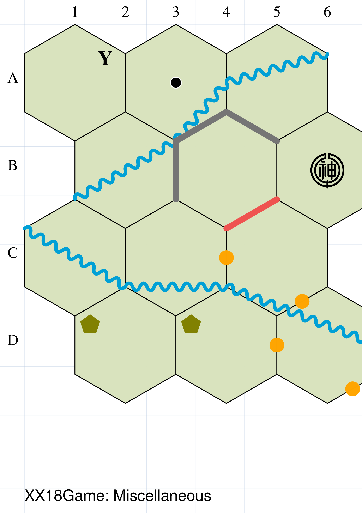

===== ======
|gfm| This example shows setting of *features* of an ``XX18Game``:

      .. code:: python

        ('A1', 'tile-letter', (330, 0.6), 'Y'),
        ('A3', 'town_border'),
        ('B2', 'river_line', 'sw B2,ne A3,e A5,ne'),
        ('B4', 'block', 'w nw ne'),
        ('B6', image('images/Jinchu_Railway.svg', height=1.5, width=1.5)),
        ('C1', 'river_line', 'nw C1,se C3,se D6,e'),
        ('C5', 'block', "nw", 'xred'),
        ('D2 D4', polygon(sides=5, side=0.5, fill_stroke="olive"), (210, 0.7)),
        ('D6 C5', circle(radius=0.3, fill_stroke="orange"), 'w se'),

===== ======

This example shows how to add various kinds of special, or more unusual,
features to the board. These are:

* A **tile_letter** is a single large character drawn either at the centre
  of the hexagon, or at an offset, by setting the values for
  ``(direction, distance)``. See the example in ``A1``.
* A **town_border**, as shown in ``A13`` depicts a town with a white line
  drawn around it; other specifications for a town can be used as normal.
* A **block** is a single thick line drawn at one or more hexagon edges;
  an edge can be identified by ``ne``, ``nw``, ``se``, ``sw``, ``e``,
  ``w``, ``n` or ``s`` depending if the grid orientation is ``flat`` or
  ``pointy``.  The block in ``B4`` extends over multiple edges and uses
  the default color; whereas the block in ``C5`` is at a single edge and
  uses a custom color, which is set as the fourth specification value.
* A normal **protograf** :doc:`shape <../core_shapes>` can be displayed
  in one or more hexagons, by providing the shape's name, in lowercase,
  along with all the usual construction details; it will be drawn either,
  by default, at the centre of the hexagon(s), or at an offset |dash|
  either by setting the values for ``(direction, distance)`` or providing
  a string with one or more hexagon compass-located edges, separated by
  spaces. For example:

  * The olive-colored :ref:`polygon <polygon-command>` shown in ``D2``
    and ``D4`` is one example of adding a normal shape with an offset.
  * The SVG :ref:`image <image-command>` shown in ``B6`` is another example
    of adding a normal shape; because it has no offset it is drawn, by default,
    at the hexagon centre.
  * The orange :ref:`circle <circle-command>` shapes shown in ``C5`` and
    ``D6`` are an example of adding a normal shape at the centre of a
    hexagon edge(s).
* A **river_line** is a wavy line drawn between hexagon edges/vertices.
  The locations for the points along the river are given by pairs of
  ``Hexagon,Vertex`` location values; for example ``C1,se`` to indicate
  the south-east vertex of hexagon ``C1`` in the grid.  It should
  be noted that the ``river_line`` not really a recommended feature; but
  rather to be used as a "placeholder" until proper representation of
  a river can be created by a regular drawing tool.

.. _xx18GameJSONStyles:

XX18Game JSON Styles
--------------------
`^ <xx18game-command_>`_

As mentioned at the start, the ``XX18Game()`` command adopts a set of styles
|dash| sizes and colors |dash| for the features it provides that are largely
modeled after those from *1830*.

To alter these styles requires that you define and load a file containing the
names of the styles you want to change, along with their new values.

The JSON file is a simple text file that follows some common conventions.

1. The first line must contain a single ``{`` curly open bracket.
2. Each line must contain the name of a style, wrapped in ``""`` inverted
   commas, followed by a colon ``:``, followed by the value of the style,
   followed by a comma.
3. **Exception** the second-last line must **NOT** end in a comma.
4. The last line must contain a single ``}`` curly close bracket.

The full list of settings is provided in `XX18Game Style Settings`_.

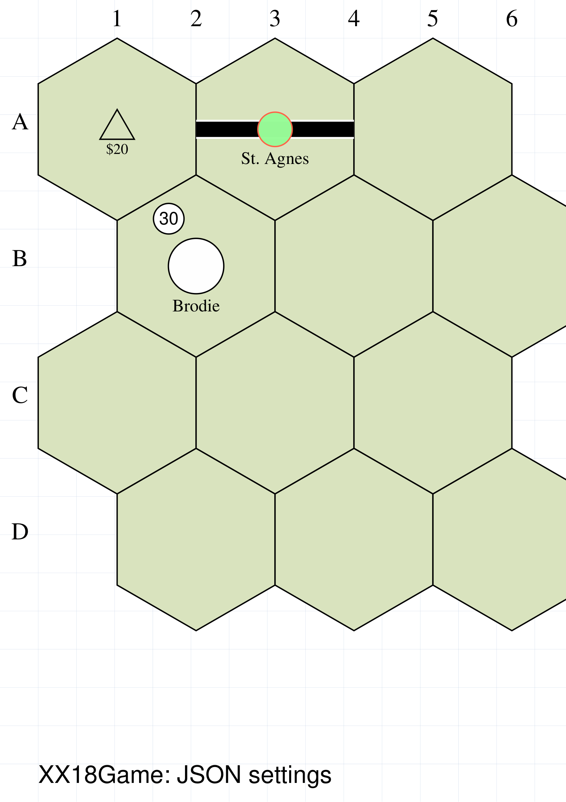

===== ======
|gfj| This example shows styling of *features* of an ``XX18Game``:

      .. code:: python

        xgzz = XX18Game(
            rows=4, cols=3,
            fill='berylgreen',
            label=True,
            label_size=18,
            settings="xx18.json",
            features=[
                ('A1', 'mountain', None, '$20'),
                ('A3', 'track', 'e,w'),
                ('A3', 'town', None, 'St. Agnes', 'below'),
                ('B2', 'city', None, 'Brodie'),
                ('B2', 'revenue',  (240, 0.6), '30'),
                ('C1',
                 'river_line',
                 'nw C1,n C1,ne C3,n C3,ne C5,n C5,ne'),
                ('C1 C3 C5',
                  circle(radius=0.5, fill='aqua', label='$20'),
                  'ne nw'),
                ('D4', 'hex_fill', None, 'xoffboard'),
                ('D4', 'spike', 'ne nw', 'short'),
            ]
        )
        XX18State(board=xgzz)

===== ======

This example shows how to reference a JSON file using the *settings*
property.


The JSON file used here, named ``xx18.json``, contains the following styles
and values:

.. code:: json

  {
      "XX18_MOUNTAIN_SIDE": 0.9,
      "XX18_MOUNTAIN_FILL": null,
      "XX18_TOWN_DIAMETER": 0.9,
      "XX18_TOWN_BORDER_DIAMETER": 1.1,
      "XX18_TOWN_STROKE": "tomato",
      "XX18_TOWN_FILL": "palegreen",
      "XX18_TRACK_OUTER_FILL": null,
      "XX18_REVENUE_FILL": "yellow",
      "XX18_SPIKE_BASE_OUTER": 1.5,
      "XX18_SPIKE_BASE_INNER": 1.35,
      "XX18_RIVER_LINE": "royalblue",
      "XX18_RIVER_LINE_WAVE_HEIGHT": null
  }

It can be seen in this example, how the river, which follows the hexagon
edges, is not "wavy" because the ``"XX18_RIVER_LINE_WAVE_HEIGHT"`` is ``null``;
and how the small value-containing circles, drawn at the hexagon edges, can
be used to indicate the cost of laying track across the river at that edge.


.. _xx18GameFunctions:

XX18Game Functions
------------------
`^ <xx18game-command_>`_

The ``XX18Game()`` command comes with functions that allow creation of
features without using the ``features`` property itself.  These functions,
in some cases, allow further customisation than is otherwise possible.

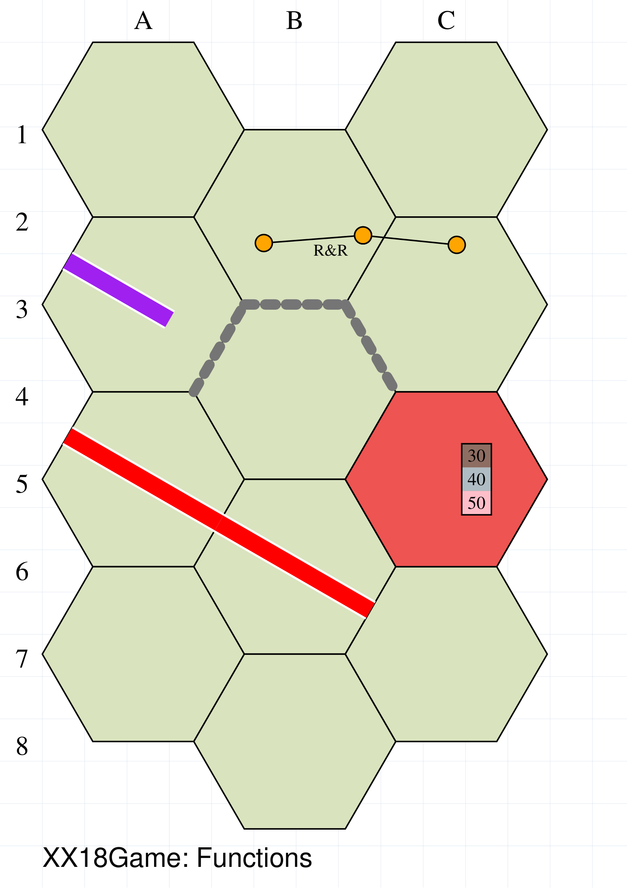

===== ======
|xgn| This example shows using feature functions for an ``XX18Game``:

      .. code:: python

        xgffn = XX18Game(
            rows=4, cols=3,
            fill='berylgreen',
            label=True,
            label_size=18,
            orientation='flat',
        )
        XX18State(board=xgffn)

        xgffn.hex_fill('C5', 'xoffboard')
        xgffn.spike('C5', 'nw sw', "medium", color='green')
        xgffn.phase_revenue(
            'C5', '30 40 50', 0, 0.3, 'vertical',
            colors=['xbrown','xgrey','pink'])
        xgffn.block(
            'B4', 'ne n nw',
            dotted=True)
        xgffn.track(
            'A5 B6',
            position='ne,sw',
            color='red')
        xgffn.track_edge(
            'A3', 'nw', 30, .3, 0,
            color='purple'),
        xgffn.private(
            'B2', 15, 0.7,  'B2', 140, 0.4, 'C&C', 'left',
            color="orange",
            label_size="xlarge")
        xgffn.private(
            'B2', 15, 0.7, 'C3', 280, 0.6,
            color="orange")
        xgffn.symbol(
            location='A7', name='desert',
            height=2.5, width=2.5,
            label="$20", label_size="large")
        xgffn.symbol(
            location='B8', name='tunnel',
            height=2.5, width=2.5,
            label="$40", label_size=20)

===== ======

Functions should be accessed **after** the ``XX18State()`` in the script.

Functions are the sections of code that ``XX18Game()`` uses internally to
draw the various features; essentially, its *features* property just passes
in the correct values to those functions.

The way to reference these functions is by appending their name to the name
assigned to the ``XX18Game()`` command; so, for example,
``xgffn.hex_fill()``.  The properties for that function are then supplied
between the ``()`` brackets; these values should look similar to the ones
already described earlier for that feature.

Functions can also support additional properties that would normally
be assigned to their "underlying" shape. For example, the *block* in
``B4`` is a just a :ref:`line <line-command>` and so its style can be
changed |dash| in this case to ``dotted``.

For the ``track`` and ``track_edge`` functions, use of the color property
allows the track's default color |dash| usually ``black`` |dash| to be
overridden. It is also possible to color the ``private`` railroads
circles, as is shown in ``B2`` and ``C3``.  The ``spike`` color can be
changed as shown in ``C5``.

The size of a ``symbol`` can be changed by altering its *height* and/or
*width* properties.

The size of feature labels can be changed by setting their *label_size*
property; either a descriptive name |dash| xsmall, small, medium, large,
xlarge, xxlarge |dash| or an actual point size value.

The full list of functions, and their allowed properties, are supplied in
`XX18Game Function Options`_.


.. _xx18GameAdHocDrawing:

XX18Game AdHoc Drawing with a Map
---------------------------------
`^ <xx18game-command_>`_

While the ``XX18Game()`` command comes with numerous functions, and the ability
to set and customise a whole range of commonly-used features, there are some
exceptions.  For these cases, you need to fall back to using
:doc:`protograf's <../index>` more general purpose drawing functionality.

.. NOTE::

   This example assumes you already understand all of the
   :doc:`Additional Concepts <../additional_concepts>` and that you are
   comfortable working with  :doc:`Shapes <../core_shapes>`.


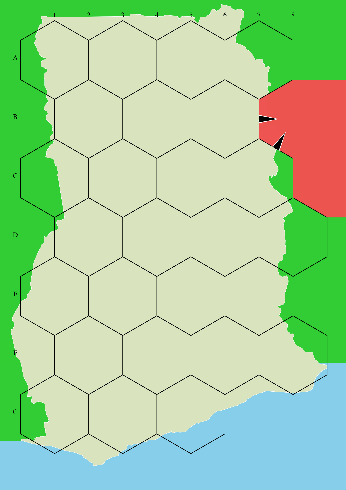

===== ======
|xgm| This example shows drawing combined with an ``XX18Game``:

      .. code:: python

        Create(
            filename='xx18_map.pdf',
            paper='A4',
            margin=1.25,
            fill='skyblue')

        Rectangle(
            x=-1.25, y=-1.25,
            height=22.5, width=21,
            fill_stroke='limegreen')
        Rectangle(
            x=-1.25, y=19.5,
            height=6.2, width=4,
            fill_stroke='limegreen')

        Image(
            'images/gh.svg',
            height=30, width=20,
            y=-1.7, x=-0.5)

        map_pattern="""
        O O O O
         O O O .
        . O O O
         O O O O
        O O O O
         O O O O
        O O O .
        """

        xgh = XX18Game(
            rows=7,
            cols=4,
            fill=None,
            pattern=map_pattern)
        XX18State(board=xgh)

        Polyshape(
            fill_stroke='xred',
            points=[
              xgh.A7.se,
              xgh.A7.s,
              xgh.B8.sw,
              xgh.B8.s,
              xgh.D8.n,
              xgh.D8.ne,
              (21, xgh.D8.ne.y),
              (21, xgh.A7.se.y)
            ]
        )
        Polyshape(
            fill_stroke='xgray',
            points=[
              xgh.G7.n,
              xgh.G7.nw,
              xgh.G7.sw,
              xgh.G7.ne
            ]
        )

        def plot(**kwargs):
            for loc in kwargs['hexes']:
                Circle(cxy=loc.e, radius=0.5, fill='blue')
                Circle(cxy=loc.ssw, radius=0.5, fill='red')

        xgf = XX18Game(
            rows=7,
            cols=4,
            label=True,
            fill=None,
            pattern=map_pattern,
            features=[
                ('B8', 'spike', 'w sw', 'medium'),
                ('G7', 'track', 'w,ne'),
                ('C3 D4', plot),
            ]
        )
        Text(
          'Togo',
          xy=xgf.B8.c,
          stroke='white', font_size=18)

        XX18State(board=xgf)

===== ======

This example shows the use of other :doc:`Shapes <../core_shapes>` that are
provided by **protograf**, together with the use of layering, to
supplement the ``XX18Game()`` command for the creation of a map-enhanced board.

.. HINT::

    The SVG for the map of Ghana shown here is sourced from
    https://simplemaps.com/svg/country/gh#all - a very useful resource
    for simple, scalable country outlines.

There are effectively six main layers in this board creation process, with
each layer being drawn over the one before:

1. The primary blue color is set when the page is created, using *fill*
2. The green land areas are then drawn in the form of
   :ref:`Rectangles <rectangle-command>`.
3. The map itself is loaded as an :ref:`Image <image-command>`.
4. The hexagonal grid is drawn for the first time, named ``xgh``.
5. The red offboard area is drawn as a filled
   :ref:`Polyshape <polyshape-command>`; and the grey half-hexagon
   is drawn as a filled :ref:`Polyshape <polyshape-command>`.
6. The hexagonal grid is drawn for the second time as ``xgf`` and
   its features are created.

The creation of the map grid happens twice in order to allow the two
Polyshapes to make use of the grid coordinates for their drawing
routine. The second time the board grid is drawn, it then overlays that
same area, and adds the labels and features.

It can be seen in the polyshape *points* property that every hexagon on the
board can be referenced by the ``MAPNAME.ZZ`` method; where ``MAPNAME`` is
the name assigned to the map grid (in the above example it is ``xgh``),
followed by a dot, followed by a reference to a hexagon (the ``ZZ``) using
the grid notation e.g. ``A7`` or ``D8``.

It is also possible to append to the hexagon reference, the compass direction
for a vertex of that hexagon and, if needed, further append a reference to
the ``x`` or ``y`` value of that vertex.  So, for example, the position
``xgh.D8.ne.y`` is the distance from the top of the page of the north-east
vertex of the hexagon at grid location ``D8`` of the XX18 grid named ``xgh``.

The :ref:`Text <text-command>` that is displayed at grid location ``D8`` also
makes uses of the geometry available for that hexagon; in this case it is using
the ``.c`` (short for ``centre``) property to locate where the text is
displayed.

Python Functions
~~~~~~~~~~~~~~~~

Access to :doc:`using Python functions <../python_commands>` is provided for
those with the skill to create them.  For example, the circles at ``C3`` and
``D4`` are drawn by a custom Python function.

A function is defined as it normally would be, but it **must** support the
use of ``**kwargs`` otherwise the call to it will trigger an error such as:

.. code:: python

    TypeError: func() got an unexpected keyword argument 'locations'

The keyword args (``kwargs``) passed to such a function include:
list of location grid *locations*; list of *hexes* geometries; the
*label*, *direction* and *distance*. Note that just because these
values are passed to the function does not mean they have to be
used, but it does mean the function itself should not directly
define these properties in its own definition.


.. _xx18GameStyleSettings:

XX18Game Style Settings
-----------------------
`^ <xx18game-command_>`_

The following are the "internal" settings for styles and sizes used by
the ``XX18Game()`` command, that be changed in a JSON file; see
`XX18Game JSON Styles`_.

* ``"XX18_HEX_SIDE"`` - default is ``2.3864`` cm; length of standard hexagon edge
* ``"XX18_CITY_DIAMETER"`` - default is ``1.45`` cm; city circle size
* ``"XX18_CITY_BACKGROUND_FILL"`` - default is ``white``; city fill color
* ``"XX18_TOWN_DIAMETER"`` - default is ``0.45`` cm; inner-circle size
* ``"XX18_TOWN_BORDER_DIAMETER"`` - default is ``0.55`` cm; outer-circle size
* ``"XX18_TOWN_HEIGHT"`` - default is ``0.7`` cm; rectangular town size (inner)
* ``"XX18_TOWN_HEIGHT_OUTER"`` - default is ``0.8`` cm; rectangular town size (outer)
* ``"XX18_TOWN_WIDTH"`` - default is ``0.4`` cm; rectangular town size (inner)
* ``"XX18_TOWN_WIDTH_OUTER"`` - default is ``0.5`` cm; rectangular town size (outer)
* ``"XX18_TOWN_STROKE"`` - default is ``white``; circular town stroke color
* ``"XX18_TOWN_FILL"`` - default is ``black``; circular town fill color
* ``"XX18_PRIVATE_DIAMETER"`` - default is ``0.4`` cm; private railroad circle size
* ``"XX18_PRIVATE_STROKE"`` - default is ``black"``; private railroad circle stroke color
* ``"XX18_PRIVATE_FILL"`` - default is ``None``; private railroad circle fill color
* ``"XX18_REVENUE_DIAMETER"`` - default is ``0.8`` cm; in-hex revenue circle size
* ``"XX18_REVENUE_STROKE"`` - default is ``black"``; in-hex revenue circle stroke color
* ``"XX18_REVENUE_FILL"`` - default is ``None``; in-hex revenue circle fill color
* ``"XX18_TRACK_INNER_WIDTH"`` - default is ``0.4`` cm; width of outer, white track
* ``"XX18_TRACK_OUTER_WIDTH"`` - default is ``0.5`` cm; width of black track
* ``"XX18_TRACK_OUTER_FILL"`` - default is ```white``; edge color
* ``"XX18_MOUNTAIN_SIDE"`` - default is ``0.6`` cm; side of the triangle
* ``"XX18_MOUNTAIN_FILL"`` - default is ``black``; color inside the triangle
* ``"XX18_SPIKE_FRACTION_SHORT"`` - default is ``0.1``; fraction of hexagon diameter
    for a short spike
* ``"XX18_SPIKE_FRACTION_MEDIUM"`` - default is ``0.25``; fraction of hexagon diameter
    for a medium spike
* ``"XX18_SPIKE_FRACTION_LONG"`` - default is ``0.45``; fraction of hexagon diameter
    for a long spike
* ``"XX18_SPIKE_BASE_INNER"`` - default is ``0.4`` cm; matches width of black track
* ``"XX18_SPIKE_BASE_OUTER"`` - default is ``0.5`` cm; matches width of white track
* ``"XX18_PHASE_REVENUE_BOX"`` - default is ``0.7`` cm; default width of single cell
* ``"XX18_RIVER_LINE_WAVE_HEIGHT"`` - default is ``0.15`` cm; wave height in feature river_line
* ``"XX18_RIVER_LINE"`` - default is ``#01A0D6``; river_line feature color
* ``"XX18_DEBUG_FONT_FRACTION"`` - default is ``0.75``; relative size of debug font
* ``"XX18_DEBUG_FONT_OFFSET_X"`` - default is ``0.0``; x-offset for debug lettering
* ``"XX18_DEBUG_FONT_OFFSET_Y"`` - default is ``0.0``; y-offset for debug lettering
* ``"XX18_DEBUG_FONT_NAME"`` - default is ``Helvetica``; name of debug font
* ``"XX18_STROKE_WIDTH"`` - default is ``1`` point; all lines are drawn this thickness
* ``"XX18_STROKE_WIDTH_BLOCK"`` - default is ``7`` points; width of block feature line
* ``"XX18_STROKE_WIDTH_HIGHLIGHT"`` - default is ``8`` points; width of highlight feature line
* ``"XX18_STROKE_TRANSPARENCY_HIGHLIGHT"`` - default is ``50`` (%); transparency of highlight feature line
* ``"XX18_TEXT_STROKE"`` - default is ``black"``; text is drawn this color
* ``"XX18_TEXT_XXS"`` - default is ``7`` points; extra-extra small text
* ``"XX18_TEXT_XS"`` - default is ``9`` points; extra small text
* ``"XX18_TEXT_SMALL"`` - default is ``11`` points; small text
* ``"XX18_TEXT_MEDIUM"`` - default is ``13`` points; medium text
* ``"XX18_TEXT_LARGE"`` - default is ``16`` points; large text
* ``"XX18_TEXT_XL"`` - default is ``20`` points; extra large text
* ``"XX18_TEXT_XXL"`` - default is ``24`` points; extra-extra large text
* ``"XX18_TEXT_XXXL"`` - default is ``28`` points; super-size text
* ``"XX18_TEXT_FONT"`` - default is ``Times-Roman``; font name used throughout
* ``"XX18_TEXT_FONT_BOLD"`` - default is ``Times-Bold``; font name for tile_letter


.. _xx18GameFunctionOptions:

XX18Game Function Options
-------------------------
`^ <xx18game-command_>`_

The section on `XX18Game Functions`_ illustrates example of how to use
the built-in functions of the ``XX18Game()`` command. Below are the details
of all available properties and which function(s) make use of them.

Available Properties
~~~~~~~~~~~~~~~~~~~~

The following are the properties that can be used when making use of the
built-in functions.

* *breadth* - the "thickness" of a line or shape e.g. a river in ``points``
* *color* - a color name
* *colors* - a list of color names
* *count* - how many of the feature to draw e.g. number of cities in a group
* *direction* - the ``degrees`` clockwise from East of the feature offset
* *distance* - the ``fraction`` of the hexagon radius of the feature offset
* *height* - the height of the curve of a track in ``cm``
* *label* - a string used to annonate or name a feature; any combination of
  letters or numbers or symbols
* *label_location* - where a label is drawn, relative to the feature; this can
  be ``left``, ``right``, ``above``, ``below``
* *label_size* - how large or small the label for a feature should be (if
  different from its default value)
* *location* - the hexagon grid reference where a feature is to be drawn;
  usually multiple references can be used unless not appropriate
* *position* - a hexagon edge ``compass`` reference or references; for example
  ``ne sw`` - the allowed values depend on grid orientation and feature type
* *rotation* - the direction, in ``degrees`` anti-clockwise from East,
  by which a feature is rotated around its centre
* *shapes* - a list of **protograf** :doc:`shapes <../core_shapes>`
* *size* - the length of a spike; this can be ``short``, ``medium`` (default)
  or ``long``
* *stroke* - the color name for a line
* *style* - the shape used to draw a town; this can be ``circle`` (default)
  or ``rectangle``
* *thing* - a **protograf** :doc:`shape <../core_shapes>`
* *town* - where a town "block" should appear on a track; this can
  be ``middle``, ``start`` or ``end``
* *width* - stroke width in ``points``


Function Properties
~~~~~~~~~~~~~~~~~~~

The following list shows which `Available Properties`_ are applicable for
which functions.

Note that if you omit the property name when using the function, you **MUST**
supply properties in the exact order shown. So for example, you can use:

.. code:: python

    highlight(location="A1", width=5)

and omit the ``color`` property without causing a problem but if you
want to avoid using the property names then all values, up to the last
one you want to set, must be supplied:

.. code:: python

    highlight("A1", None, 5)

Its usually safe to use ``None`` as a default, because **protograf** will
then switch that out with a substitute /fallback value.

.. NOTE::

    Some features may not display, or trigger unusual errors, if the
    correct values are not supplied to the needed properties!

* ``block(location, position, stroke)``
* ``city(location, label, direction, distance, count, rotation, shapes, color)``
* ``figure(location, direction, distance, position, thing)``
* ``hex_fill(location, color)``
* ``highlight(location, color, width)``
* ``mountain(location, label, direction, distance, label_size)``
* ``phase_revenue(location, income, direction, distance, orientation, colors)``
* ``private(location, direction, distance, location1,
  direction1, distance1, label, label_location, color, label_size)``
* ``revenue(location, label, direction, distance, color, label_size)``
* ``river_line(location, position, stroke, breadth, color)``
* ``spike(location, position, size, color)``
* ``symbol(location, label, direction, distance, name, label_size)``
* ``tile_letter(location, label, direction, distance, stroke, label_size)``
* ``town(location, label, direction, distance, style, rotation, color, stroke, label_size)``
* ``track(location, label, position, town, color)``
* ``track_curve(location, direction, distance, height, color)``
* ``track_edge(location, position, direction, distance, height, color)``


.. _xx18market-command:

XX18Market Command
==================
`↑ <xx18Index_>`_

The ``XX18Market()`` command defines the Stock Market for an 18xx game.

- `18xx Stock Markets`_
- `XX18Market Summary`_
- `XX18Market Properties`_
- `XX18Market Values`_
- `XX18Market Value Attributes`_
- `XX18Market Value Color`_
- `XX18Market Examples`_


.. _xx18StockMarket:

18xx Stock Markets
------------------
`^ <xx18market-command_>`_

An 18xx-style Stock Market chart is a **grid**, consisting of adjacent rows of
rectangular, outlined **cells**. Rows are of variable length, with some being
offset from the left, and each cell contains a number. However, there is
no specific pattern of numbers across different 18xx games.

The grid is created such that:

* the stock value is at a specific location inside each cell,
* some cells are colored-in, with different colors in different areas,
* some cells are outlined with a thicker line of a different color,
* some cells contain an arrow; either pointing up |dash| typically in
  cells on the right side of the grid, or down |dash| typically in
  cells on the left side of the grid.

Stock Markets in different 18xx games have different:

* fonts
* arrow styles
* set of colors

Cells in the grid can sometimes be annotated with a marker or text.


.. _xx18MarketSummary:

XX18Market Summary
------------------
`^ <xx18market-command_>`_

To create an 18xx-style Stock Market, the ``XX18Market()`` command
can set:

* a list of values for each of the Stock Market rows
* fill and stroke color to be associated with specific cells
* which cells require a border drawn around them
* which cells should have an arrow (up or down) drawn in them.

The command can accept the usual font settings to display the
text values, as well as settings for the grid line colors and cells' size.

Default arrow styles are "built-in", but it is possible to define custom
:ref:`arrows <arrow-command>` and use these instead.

Additional annotation, or construction of features, for a specific cell or
cells in the grid can be done using cell geometry. This allow the cells'
vertices to be used to position shapes at locations relative to the board.


.. _xx18MarketProperties:

XX18Market Properties
---------------------
`^ <xx18market-command_>`_

The properties that can be set for an ``XX18Market()`` command are:

* *values* - a list with rows of values contained within strings
* *values_direction* - where to locate the value within a cell; typically a
  compass direction (defaults to the cell ``centre``)
* *values_separator* - a single character used to separate individual values
  in the *values* list (defaults to a space)
* *market_colors* - a list of ``(number, fill, stroke)`` values, used to
  define what colors may be used to fill cells and color the text
* *x* and *y* - set the location for the grid's top-left position
* *height* - height of a rectangular cell in the grid (defaults to ``1`` cm)
* *width* - width of a rectangular cell in the grid (defaults to ``1`` cm)
* *stroke_width* - the default stroke width of a rectangular cell in the grid
* *fill* - the fill color of a rectangular cell in the grid (defaults to ``white``)
* *outline_stroke* - the stroke color for an outline of a rectangular cell
* *outline_width* - the stroke width for an outline of a rectangular cell
* *font_stroke* - the font color for the values drawn in the cells
* *font_size* - the font size for the values drawn in the cells
* *font_name* - the font family for the values drawn in the cells
* *arrow_up* - a **protograf** shape to use for arrows pointing up
  (defaults to a simple line-with-arrowhead)
* *arrow_down* - a **protograf** shape to use for arrows pointing down
  (defaults to a simple line-with-arrowhead)
* *arrow* - a **protograf** shape to use for other arrows (no default)


.. _xx18MarketValues:

XX18Market Values
-----------------
`^ <xx18market-command_>`_

The key property for an ``XX18Market()`` command is that of *values*.

The values must be supplied as a list of strings of values.

A simple list could look like:

.. code:: python

    values = [
        "50  55  60  65  70  75  80",
        "40  50  55  60  65  70",
        "30  40  50  55  60",
    ]

As can be seen, each value in a row of values is separated by a space (or
spaces; it does not matter).  A row of values like this will be split up and
each value will then appear in a different **cell** in the Stock Market grid.

It is also possible to use another character for the separator. This needs
to be supplied as the *values_separator* property. For example, here the
separator is set to be a semi-colon:

.. code:: python

    values_separator=';',
    values = [
        "50;55;60;65;70;75;80",
        "40;50;55;60;65;70",
        "30;40;50;55;60",
    ]

The start of some rows is offset.  In this case, you need to supply a "dummy"
character to indicate that there are cells that do not contain a value and
should not be drawn. The dummy character can be a ``0`` or a ``~`` (tilde).
For example, here the first two rows are offset:

.. code:: python

    values = [
        " ~  ~ 60 65 70 75 80",
        " ~ 50 55 60 65 70",
        "30 40 50 55 60",
    ]

The values are usually numeric, but do not have to be and this is not
enforced in any way; a value of ``$20`` could be used as well as the more
common ``20``.


.. _xx18MarketValueAttributes:

XX18Market Value Attributes
---------------------------
`^ <xx18market-command_>`_

While many cells in an 18xx-type Stock Market grid simply contain a value,
there are others whose display is "enhanced" in some way.

The ``XX18Market()`` command supports three kinds of cell attributes to create
this "enhancement":

- *color* - the fill (and, optional, stroke) color for the cell
- *arrow* - draw an arrow inside the cell
- *border* - draw an outline around the cell

These three attributes can be remembered by the acronymn **"CAB"** |dash| for
**c**\ olor; **a**\ rrow, and **b**\ order.

To set a color, the ``XX18Market()`` command will require the *market_colors*
property to be set so that a number can be used for |dash| see the details for
this is in `XX18Market Value Color`_.

To draw an arrow, either use the character ``u`` for an up-arrow, or
``d`` for a down-arrow.  The arrow will either be drawn in the default style,
as can be seen in `Example 4. Default Arrows for Stock Market`_
or it can reference a custom-created one, as can be seen in
`Example 5. Custom Arrows for Stock Market`_.

To draw a border, simply use the ``o`` character. The color and thickness
can be set by ``outline_stroke`` and ``outline_width`` respectively.

The cell attributes are added as a short list of values, separated by commas,
directly after the value itself. The list can be shorter than all three if
only the color is needed; but must include the commas if, say, only a border
is needed.

For example, for just a color:

.. code:: python

    values = [
        "30,1 40 45 55 60",
        "20,2 25 35 40 50",
    ]

Here the ``30`` has the color number ``1`` and  ``20`` has the color
number ``2`` assigned.

For example, for a border or border and color:

.. code:: python

    values = [
        "30,,,o 40 45 55 60",
        "20,2,,o 25 35 40 50",
    ]

Here the ``30`` has a border activated via the ``o`` and ``20`` has the color
number ``2`` assigned and also has a border activated.  In both cases, three
commas are needed.


.. _xx18MarketValueColor:

XX18Market Value Color
----------------------
`^ <xx18market-command_>`_

As described in `XX18Market Value Attributes`_, different colors can be
set for different cells, by assigning them a number attribute.

This number must be defined by the *market_colors* property, which is
a list of ``(number, fill, stroke)`` values, used to specify what colors
may be used to fill-in the cells and also the color of the font used for
the value text.

The ``stroke`` value is optional, but the ``fill`` value should always
be supplied. For example:

.. code:: python

    market_colors=[(1, "lime"), (2, "sienna", "white"), (3, "gold")]

As can be seen *market_colors* set consists of a number (an integer), and
at least one color value.  The first color is to fill the cell; the second
is the one used for the font stroke of the value of that cell.

For this example:

* the color set of ``(1, "line")`` means that all cells
  referring to ``1`` will be filled with a green color; and
* the color set of ``(2, "sienna", "white")`` means that all cells
  referring to ``2`` will be filled with a brown color and the value
  will be drawn with a white font color.


.. _xx18MarketExamples:

XX18Market Examples
-------------------
`^ <xx18market-command_>`_

The basic script structure for working with an 18xx-type Stock Market
in a script follows this pattern:

.. code:: python

    xgp = XX18Market()
    XX18State(market=xgp)

However; in this specific case, nothing will be seen because the *values*
property has not been set, so there is nothing to draw!

The following examples illustrate how different propeties can be set to
style the Stock Market.

- `Example 1. Unstyled Stock Market`_
- `Example 2. Sized Stock Market`_
- `Example 3. Colors and Borders for Stock Market`_
- `Example 4. Default Arrows for Stock Market`_
- `Example 5. Custom Arrows for Stock Market`_
- `Example 6. Annotated Stock Market`_


Example 1. Unstyled Stock Market
~~~~~~~~~~~~~~~~~~~~~~~~~~~~~~~~
`^ <xx18MarketExamples_>`_

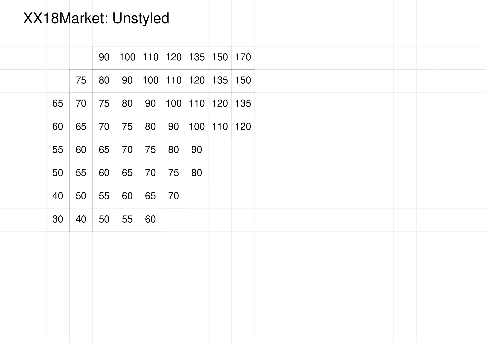

===== ======
|mx1| This example shows an ``XX18Market`` constructed using these commands:

      .. code:: python

        xgp = XX18Market(
            values=[
            " 0  0 90 100 110 120 135 150 170",
            " 0 75 80  90 100 110 120 135 150",
            "65 70 75  80  90 100 110 120 135",
            "60 65 70  75  80  90 100 110 120",
            "55 60 65  70  75  80  90",
            "50 55 60  65  70  75  80",
            "40 50 55  60  65  70",
            "30 40 50  55  60",
            ])
        XX18State(market=xgp)

===== ======

For this example, the only property set is *values*.  This data is used to
define how many rows are in the grid and how long each row is.

As explained in `XX18Market Values`_, using a ``0`` at the start of a row
results in an "empty" and undrawn cell.

This grid is completely unstyled so is just drawn with the default cell sizes,
fonts, strokes and colors.


Example 2. Sized Stock Market
~~~~~~~~~~~~~~~~~~~~~~~~~~~~~
`^ <xx18MarketExamples_>`_

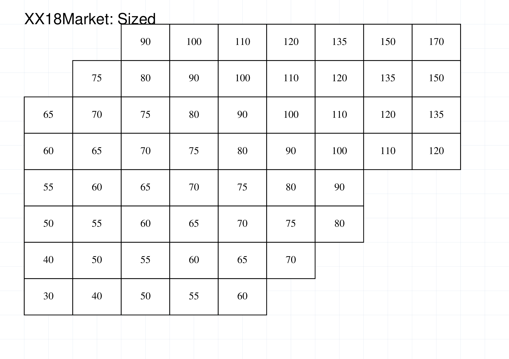

===== ======
|mx2| This example shows an ``XX18Market`` constructed using these commands:

      .. code:: python

        xgs = XX18Market(
            x=0, y=0,
            height=1.5, width=2,
            stroke_width=1,
            font_name='Times-Roman',
            values=[
                " 0  0 90 100 110 120 135 150 170",
                " 0 75 80  90 100 110 120 135 150",
                "65 70 75  80  90 100 110 120 135",
                "60 65 70  75  80  90 100 110 120",
                "55 60 65  70  75  80  90",
                "50 55 60  65  70  75  80",
                "40 50 55  60  65  70",
                "30 40 50  55  60",
            ]
        )
        XX18State(market=xgs)

===== ======

For this example, the *height* and *width* of each cell is set (in ``cm`` as
for all XX18 commands!), and the lines for the grid are drawn with a
*stroke_width* of ``1`` point.  The grid itself is placed to start right next
to the left and top margins, although it may appear offset if no cells are
drawn close to that position.

The cell values are all drawn in ``Times Roman`` font.


Example 3. Colors and Borders for Stock Market
~~~~~~~~~~~~~~~~~~~~~~~~~~~~~~~~~~~~~~~~~~~~~~
`^ <xx18MarketExamples_>`_

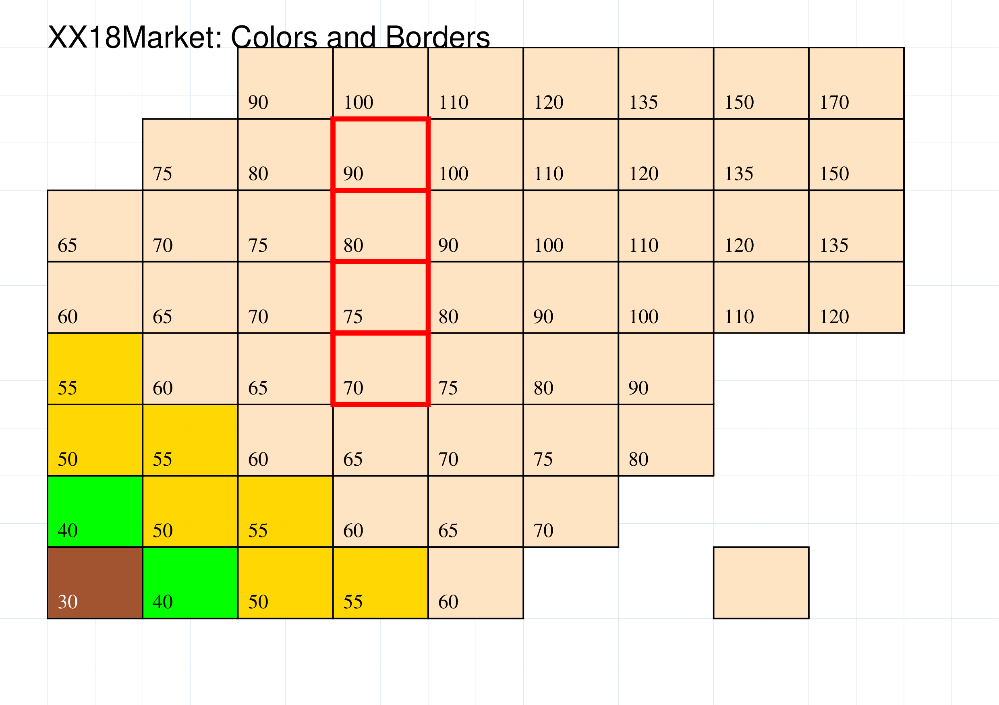

===== ======
|mx3| This example shows an ``XX18Market`` constructed using these commands:

      .. code:: python

        xgs = XX18Market(
            x=0, y=0,
            height=1.5, width=2,
            font_name='Times-Roman',
            stroke_width=1,
            fill="bisque",
            market_colors=[(1, "sienna", "white"), (2, "lime"), (3, "gold")],
            values_direction='sw',
            values=[
            " 0  0 90 100 110 120 135 150 170",
            " 0 75 80  90,,,o 100 110 120 135 150",
            "65 70 75  80,,,o  90 100 110 120 135",
            "60 65 70  75,,,o  80  90 100 110 120",
            "55,3 60 65  70,,,o  75  80  90",
            "50,3 55,3 60  65  70  75  80",
            "40,2 50,3 55,3  60  65  70",
            "30,1 40,2 50,3  55,3  60   0   0  ~",
            ],
        )
        XX18State(market=xgs)

===== ======

For this example, a number of new properties have been set:

- *fill* is set to ``"bisque"`` so all cells are, by default, filled in a
  green color
- *market_colors* is assigned to a list of sets; the set values being wrapped
  in ``(...)``  brackets


Example 4. Default Arrows for Stock Market
~~~~~~~~~~~~~~~~~~~~~~~~~~~~~~~~~~~~~~~~~~
`^ <xx18MarketExamples_>`_

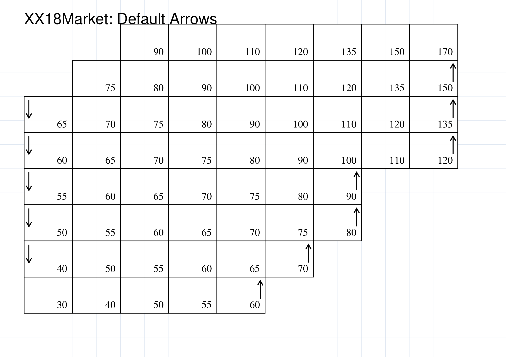

===== ======
|mx4| This example shows an ``XX18Market`` constructed using these commands:

      .. code:: python

        xga = XX18Market(
            x=0, y=0,
            height=1.5, width=2,
            font_name='Times-Roman',
            stroke_width=1,
            values_direction='se',
            values=[
            " 0  0 90 100 110 120 135 150 170",
            " 0 75 80  90 100 110 120 135 150,,u",
            "65,,d 70 75  80  90 100 110 120 135,,u",
            "60,,d 65 70  75  80  90 100 110 120,,u",
            "55,,d 60 65  70  75  80  90,,u",
            "50,,d 55 60  65  70  75  80,,u",
            "40,,d 50 55  60  65  70,,u",
            "30 40 50  55  60,,u",
            ],
        )
        XX18State(market=xga)

===== ======

For this example, a number of cells' values have been "annotated" to draw
arrows.

The annotation follows the "CAB" style described above.  The "A" in "CAB"
is the mnemonic for **a**\ rrow" and so it is the second item, in the
comma-separated list attached to a value, that represents that thing.

For example, ``40,,d`` - represents the *value* ``40``, followed by nothing
for the *color*, followed by a ``d`` to signify a *down arrow*. Similarly,
``70,,u`` represents the *value* ``70``, followed by nothing for the *color*,
followed by a ``u`` to signify an *up arrow*.


Example 5. Custom Arrows for Stock Market
~~~~~~~~~~~~~~~~~~~~~~~~~~~~~~~~~~~~~~~~~
`^ <xx18MarketExamples_>`_

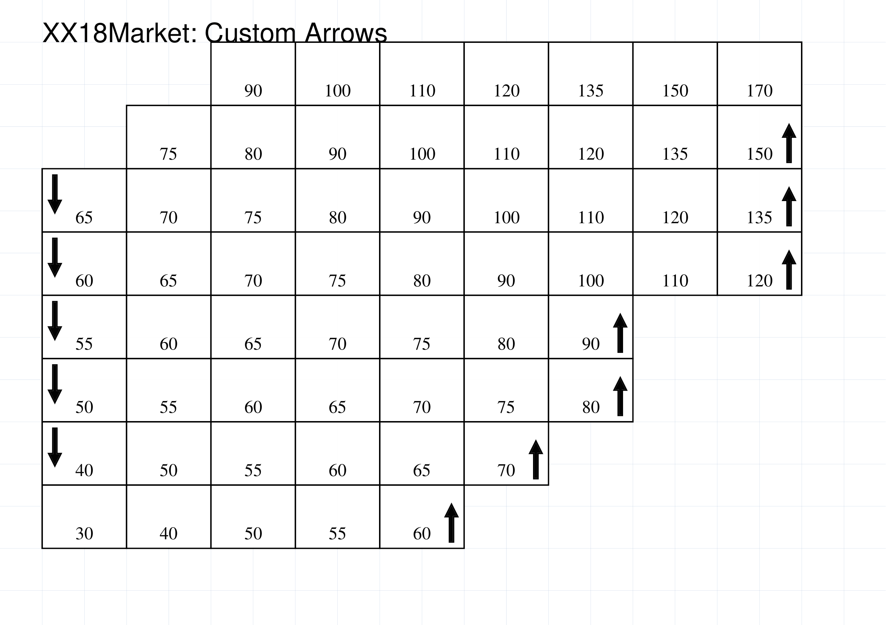

===== ======
|mx5| This example shows an ``XX18Market`` constructed using these commands:

      .. code:: python

        arrows = Common(
            fill="black",
            height=0.6, width=0.1,
            head_height=0.3, head_width=0.3,)
        arr_up = arrow(
            common=arrows,
            offset_x=0.7, offset_y=0.6)
        arr_down = arrow(
            common=arrows,
            rotation=180,
            offset_x=-0.7, offset_y=-0.6)

        xgr = XX18Market(
            x=0, y=0,
            height=1.5, width=2,
            font_name='Times-Roman',
            stroke_width=1,
            values_direction='s',
            arrow_up=arr_up,
            arrow_down=arr_down,
            values=[
            " 0  0 90 100 110 120 135 150 170",
            " 0 75 80  90 100 110 120 135 150,,u",
            "65,,d 70 75  80  90 100 110 120 135,,u",
            "60,,d 65 70  75  80  90 100 110 120,,u",
            "55,,d 60 65  70  75  80  90,,u",
            "50,,d 55 60  65  70  75  80,,u",
            "40,,d 50 55  60  65  70,,u",
            "30 40 50  55  60,,u",
            ],
        )
        XX18State(market=xgr)

===== ======

This example builds on `Example 4. Default Arrows for Stock Market`_.

In this case, the default arrows are replaced by custom ones that must
be created and named before the ``XX18Market()`` command is used.

In the example, ``arr_up`` and ``arr_down`` are created and styled using
the **protograf** :ref:`arrow <arrow-command>` command. It can be seen that
the :ref:`Common <the-common-command>` command is used to set the properties
applicable to both the up- and down-arrows.

Once created they can be used in ``XX18Market()`` command, by being assigned
to the properties *arrow_up* and *arrow_down*.


Example 6. Annotated Stock Market
~~~~~~~~~~~~~~~~~~~~~~~~~~~~~~~~~
`^ <xx18MarketExamples_>`_

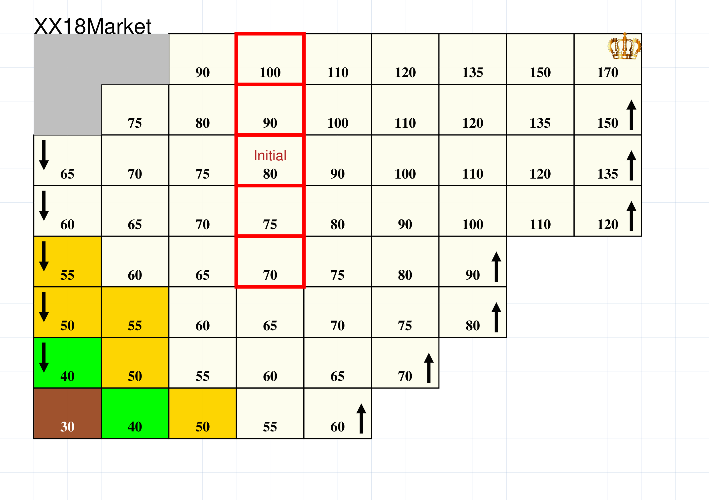

===== ======
|mx6| This example shows an ``XX18Market`` constructed using these commands:

      .. code:: python

        arrows = Common(
            fillpr="black",
            height=0.6, width=0.1,
            head_height=0.3, head_width=0.3,)
        arr_up = arrow(
            common=arrows,
            offset_x=0.7, offset_y=0.6)
        arr_down = arrow(
            common=arrows,
            rotation=180,
            offset_x=-0.7, offset_y=-0.6)

        xgf = XX18Market(
            x=0, y=0,
            height=1.5, width=2,
            font_name='Times-Bold',
            stroke_width=1,
            values_direction='s',
            fill="ivory",
            market_colors=[(1, "sienna"), (2, "lime"), (3, "gold")],
            arrow_up=arr_up,
            arrow_down=arr_down,
            values=[
            " 0  0 90 100,,,o 110 120 135 150 170",
            " 0 75 80  90,,,o 100 110 120 135 150,,u",
            "65,,d 70 75  80,,,o  90 100 110 120 135,,u",
            "60,,d 65 70  75,,,o  80  90 100 110 120,,u",
            "55,3,d 60 65  70,,,o  75  80  90,,u",
            "50,3,d 55,3 60  65  70  75  80,,u",
            "40,2,d 50,3 55  60  65  70,,u",
            "30,1 40,2 50,3  55  60,,u",
            ],
        )
        XX18State(market=xgf)

        Polyshape(points=[
            xgs.A1.nw,
            xgs.B1.ne, xgs.B1.se, xgs.B1.sw,
            xgs.A2.se, xgs.A2.sw,
            ],
            fill="silver",
            stroke=None)
        Image("images/king.png", x=xgf.I1.c.x, y=xgf.I1.c.y - 0.9)
        Text("Initial", xy=xgf.D3.c, stroke="firebrick")

       xgf.csv_values("xgf.csv", ";")

===== ======

This example is a compilation of all the previous examples into a single
"ready to use" one.

The only new feature is the demonstration of using **protograf** shape
commands to overlay other items on, or next to, the grid.

.. IMPORTANT::

    Any shape commands that reference the grid cells' geometries can only
    be used in the script **after** the ``XX18State()``` command is used
    to draw that grid.

The :ref:`Polyshape <polyshape-command>` command draws a series of points
and then fills in the area with a ``silver`` color.  The *points* in this
shape are all specified using the ``GRID.CELL.COMPASS`` notation:

* ``GRID`` refers to the name assigned to the ``XX18Market`` grid |dash|
  in this case it is ``xgf``;
* ``CELL`` refers to a single cell in the grid using an Excel-like notation,
  with letters for columns and numbers for rows; and
* ``COMPASS`` references a point on the cell edge determined by a
  :ref:`compass direction<termsDirection>` |dash| also including ``c``
  to refer the cell's centre.

.. HINT::

    Even though a cell might not be drawn on the grid, its geometry is still
    available for use with the ``GRID.CELL.COMPASS`` notation.

The :ref:`Image <image-command>` command places an image at a cell location;
in this case, slighly offset from the centre of cell ``I1``.  Here the
``GRID.CELL.COMPASS`` point notation is extended to reference the specific
``x`` or ``y`` value of that point.

The :ref:`Text <text-command>` command simply draws text; in this case,
centred on the centre of cell ``D3``.

Bonus: Export Values to csv
+++++++++++++++++++++++++++

One final "extra" shown here is that you can extract the *values* from
those provided to ``XX18Market`` by making use of the built-in
``csv_values`` function.

You can supply a filename and CSV separator if needed; otherwise
these will default to: the name of your script but with a ``.csv``
extension; and the use of a ``,`` for the value delimiter.

The short rows will be "padded out" with null values, so that all the lines
are the same length.

For this example, the ``xgf.csv`` CSV file would contain:

.. code:: text

    ;;90;100;110;120;135;150;170
    ;75;80;90;100;110;120;135;150
    65;70;75;80;90;100;110;120;135
    60;65;70;75;80;90;100;110;120
    55;60;65;70;75;80;90;;
    50;55;60;65;70;75;80;;
    40;50;55;60;65;70;;;
    30;40;50;55;60;;;;


Note there is no header row in the file.


.. _xx18state-command:

XX18State Command
==================
`↑ <xx18Index_>`_

The ``XX18State()`` command will create a display of a board and its annotations
that have been defined in an :ref:`XX18Game <xx18game-command>`. It can also
create a display of a Stock Market grid and its annotations
that have been defined in an :ref:`XX18Market <xx18market-command>`.

In the current version of the software, there are no other specific settings
for the ``XX18State()`` command other than the *board* property, which refers
to the name assigned to the ``XX18Game()``, or the *market* property, which refers
to the name assigned to the ``XX18Market()``.

.. code:: python

    xx_game = XX18Game()
    xx_market = XX18Market()
    XX18State(board=xx_game, market=xx_market)


.. _xx18-resources:

18xx Resources
==============
`↑ <xx18Index_>`_

An overview of what 18xx games are all about can be found at Board Game Geek:
https://boardgamegeek.com/boardgamefamily/19/series-18xx

The primary resource for working with 18xx games is the online tool
*18xx Maker* ( https://18xx-maker.com/ ). This tool takes 18xx game definitions
written in JSON, displays them, and renders them for printing. This can
create the game Map, Tiles and Tile Manifest, Tokens and Charters, Tokens
(without companies) and the Stock Market.

Another useful tool to generate files for Charters, Privates, Shares,
Station Markers, Trains, and (linear) Stock Markets is *xxpaper*, which is
available at https://pypi.org/project/xxpaper/  It could be helpful to
read the discussions at
https://boardgamegeek.com/thread/1023598/xxpaper-a-tool-for-generating-charters-privates-sh/

For helping to build an interesting and challenging Stock Market, this tool
may be of use: https://github.com/Galatolol/market_heatmap

A comprehensive resource of available games can be found at
http://www.fwtwr.com/18xx/index.htm and games themselves can be played at
https://18xx.games/ .
